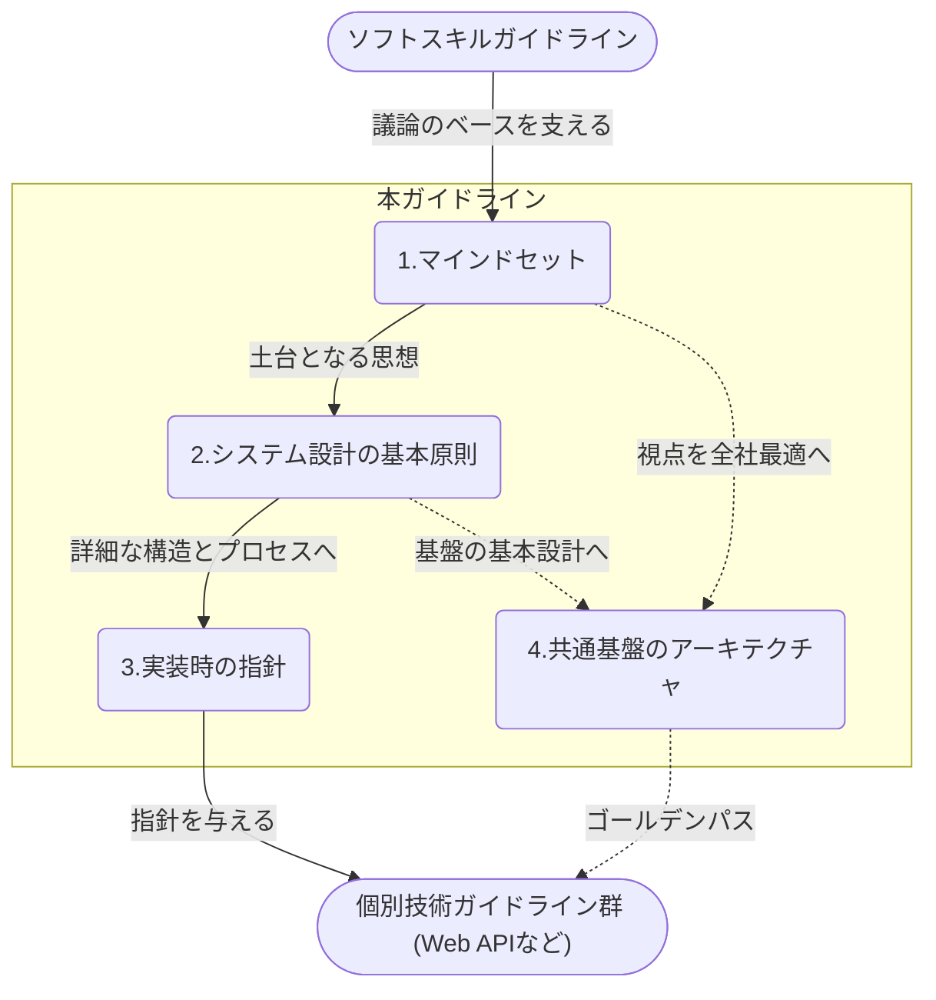

# アーキテクチャ原則ガイドラインの出典と適用範囲

`docs/architecture-principles/` の文書は、フューチャー株式会社の [アーキテクチャ原理原則と心得ガイドライン](https://future-architect.github.io/arch-guidelines/documents/forPrinciple/) を元にしている。
対象を特定の領域に限定せず、ソフトウェアシステム全体の構造を決定づける意思決定を扱う。

## 出典とライセンス

- 原文: [アーキテクチャ原則ガイドライン](https://future-architect.github.io/arch-guidelines/documents/forPrinciple/principle_guidelines.html) (フューチャー株式会社、[future-architect/arch-guidelines](https://github.com/future-architect/arch-guidelines))
- ライセンス: [CC BY 4.0](https://creativecommons.org/licenses/by/4.0/deed.ja)
- 作成者: 真野隼記、武田大輝、宮崎将太、亀井隆徳、山口真明、中村立基、清水雄一郎、澁川喜規
- レビュアー: 募集中

### 原文からの変更点

- 1つの文書を、責務ごとに複数の文書に分けた。
- 各文書に OKF の frontmatter と、冒頭の要約を足した。
- VitePress の記法 (`<page-title/>`、`::: tip` などのコンテナ、見出しの `{#id}`) を、GitHub の Markdown の記法 (`> [!TIP]` など) に置き換えた。
- 原文の章へのリンクを、分割後の文書へのリンクにした。このリポジトリに取り込んだ他のガイドラインへのリンクは、その docs/ の文書へのリンクにした。取り込んでいないガイドライン (AWS、Terraform、データマネジメント、Git ブランチフロー) へのリンクは、原文のサイトの URL にした。
- 原文のトップページ (`index.md`) にある本ガイドラインの位置付けと構成の図 (mermaid) を、この文書の「位置づけ」の節に移した。
- 開発基盤の統制 (`architecture-fitness-automation.md`) の静的解析の例に、このリポジトリの `vp lint` と ADR 0007 の import の禁止ルールを書き足した。

## 位置づけ

原文のトップページ「はじめに」と「本ガイドラインの位置付けと構成」の内容を、規約として意味があるため原文のまま残す。

アーキテクチャ設計は、プロジェクトの成否を左右する大きな意思決定である。一度定めた根幹を覆すことは許容しがたい手戻りを生むため、責任とプレッシャーは計り知れない。

本ガイドラインは、そうした重圧の中にあるアーキテクトにとっての「道標」となることを目指して策定された。多くのプロジェクトで培われてきた、困難な状況を打破するための普遍的な考え方を中心にまとめている。迷った際には先人の知恵（原理原則）や心得（考え方）に立ち返り、プロジェクトにとってのスイートスポットの探求に役立てれば幸いである。

本ガイドラインは、[ソフトスキル](https://future-architect.github.io/arch-guidelines/documents/forSoftSkill/softskill_guidelines.html)ガイドラインや[テクニカルライティングガイドライン](https://future-architect.github.io/arch-guidelines/documents/forTechnicalWriting/technical_writing_guidelines.html)を土台としつつ、各技術領域で適切なトレードオフ判断を行うための「思考の型」を提供する位置づけとなる。

内部構造は、アーキテクトのマインドセット→システム設計の基本原則（マクロなアーキテクチャ）→実装時の指針（ミクロなアーキテクチャ）→共通基盤のアーキテクチャ といった4分類で構成されている。

## 適用範囲と前提条件

- **対象スコープ**
  - 特定の領域（データ、アプリケーション、インフラなど）に限定せず、ソフトウェアシステム全体にわたる「構造」を決定づけるすべてをアーキテクチャとして扱う
  - アーキテクトのマインドセット、システム設計の基本原則、実装時の指針、共通基盤のアーキテクチャの4分類を対象とする
- **前提条件**
  - 個別技術領域のガイドライン（Web API など）に対して、トレードオフ判断のための「思考の型」を与える、上位の位置づけとなる

## 免責事項

原文の免責事項を引用する。

> [!WARNING]
>
> - 有志で作成したドキュメントである。フューチャーには多様なプロジェクトが存在し、それぞれの状況に合わせて工夫された開発プロセスや高度な開発支援環境が存在する。本ガイドラインはフューチャーの全ての部署 / プロジェクトで適用されているわけではなく、有志が観点を持ち寄って新たに整理したものである
> - 相容れない部分があればその領域を書き換えて利用することを想定している。プロジェクト固有の背景や要件への配慮は、ガイドライン利用者が最終的に判断すること。本ガイドラインに必ず従うことは求めておらず、設計案の提示と、それらの評価観点を利用者に提供することを主目的としている
> - 掲載内容および利用に際して発生した問題、それに伴う損害については、フューチャー株式会社は一切の責務を負わないものとする。掲載している情報は予告なく変更する場合がある
