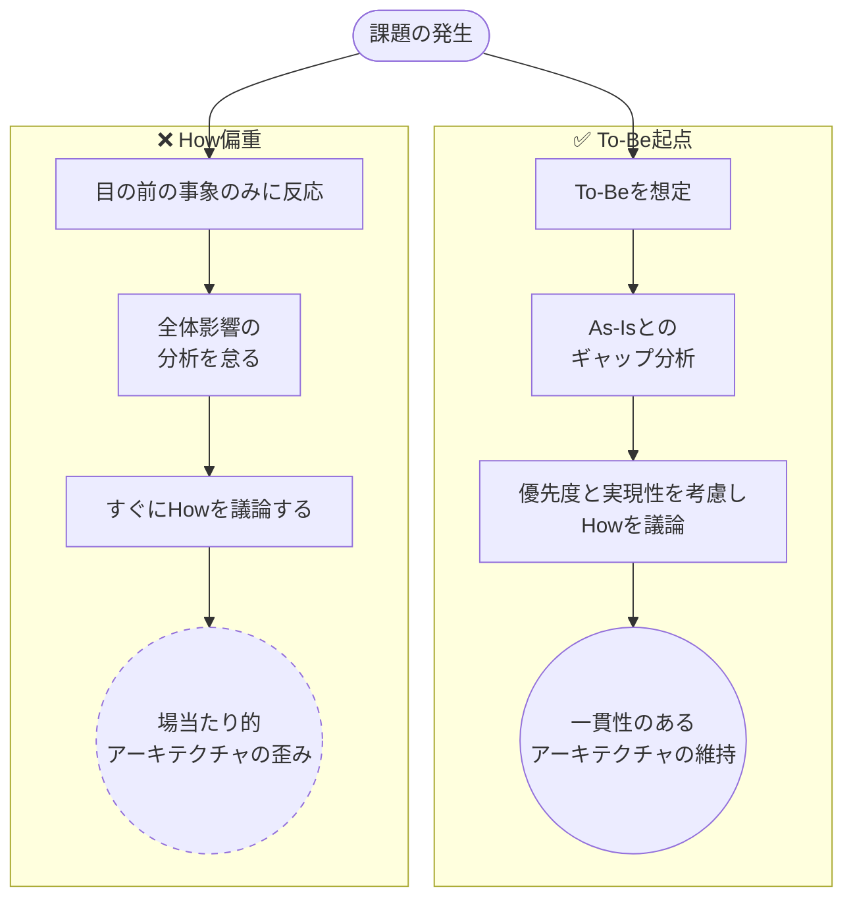

# マインドセット: あるべきを考え、着地点を探る

課題にはまずあるべき姿 (To-Be) を描き、As-Is とのギャップを可視化して埋める施策を打つ。Howから入らない。
理想で思考停止せず、誰がいつまでに埋めるかまで想像し、現実的な最適の着地点をセットで考え抜く。
出典は [アーキテクチャ原則ガイドライン](about.md) (CC BY 4.0) で、OKF の形式に合わせて分割、変更している。

## あるべきを考え、そこで思考停止しない

システム構築や運用で課題が出ると、その課題をどう解決するか（Howの実現方針）から考えてしまいがちである。特に開発フェーズが進み、スケジュールが厳しい中で追加の機能要望や仕様変更が必要になると、この傾向は顕著になる。アーキテクチャ全体を見直すことは途方もないし、なんとかタスクを消化してスケジュールを守りたいという気持ちが強くなるためである。

しかし、そもそも本来どうあるべきか（To-Be）という全体観が欠如した状態でのHowの議論は、場当たり的な設計を生み、長期的にはアーキテクチャを歪める原因となる。

そのため、1つ1つの課題に対して、まず理想的なあるべき姿は何かを描き出すことが不可欠である。そして、その理想と現状（As-Is）とのギャップを可視化し、埋めるための施策を打つことこそが、王道である。

### あるべき姿を絵に描いた餅にしない

あるべき姿を描くと、現実とギャップが非常に大きい場合がある（ギャップが大きすぎるからこそ、目の前の具体的な課題解決のみに向き合いたくなる側面もある）。しかし、いったんあるべきを描けたとしてもそこで思考停止してはならない。理想のアーキテクチャに囚われすぎると、実現コストが非現実的になり、実効性が欠如したご意見番になってしまう。

実践の入り口に立つためには、「その泥臭いギャップを埋める作業を、具体的にだれがいつまでに対応するのか」まで想像を進める必要がある。何事も構想を形にするためには、それなりのリソース（スキル、時間、コスト、体力、忍耐力）が要求される。アーキテクトは以下のような批判的な問いを自らに立てなければならない。

- それを自分が行えるのか？
- 他のメンバーにお願いしてやりきれるか？
- そこまでやる、費用対効果は本当にあるのか？
- 優先度は今なのか？

ここで満額回答は無理。「では、どうするか？」という思考に至ることも多い。次に行うべきは着地点の検討である。

### 着地点を探る

全てを一度にやろうとすると、他のタスクも含めた全体のスケジュールが破綻することも多い。アーキテクトは、理想を追い求めつつも、現実的な制約の中で「最適な着地点」をセットで考え抜く必要がある。

- **優先順位**: ギャップを埋める手段のうち、どれから、どの優先度で、どこまでやるべきか。最小の労力で早期に成果を出すための現実的な流れを考える。一般的には、ステップ論が重要で、どこまで今回対応し、いつから残りを着手するか検討する
- **次善案の許容**: 理想の追求があまりに大変な場合、実現可能で現状より良くなる次善案に着地すべきか、いっそ何もしないかを決める。この時、次善案は実現コストが高いと採用する意味がないため、対応コストはシビアに見極めが必要である
- **コスト意識を持つ**: 対応案を考えるのも時間がかかる。その時間は、もっと価値を生む時間（機能開発など）に使いうる。通常、着地点は時間をかけ過ぎず、利害関係者を集めて早期に決める必要がある

アーキテクトの仕事は、美しい理想論を語ることではない。あるべき姿を北極星として掲げつつも、現場の泥臭い現実と向き合い、どこに着地させるかを決めて推進することにある。この時、取りうる案は何があるのか、トレードオフ構造になるのかなど主体的に動く必要がある。
