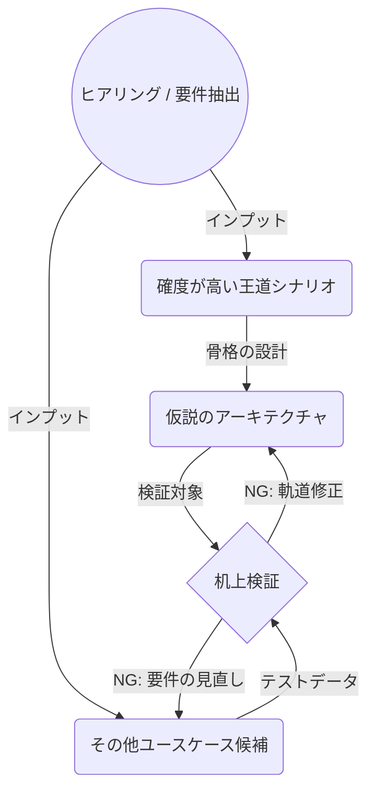

# 共通基盤: ユースケースはアーキテクチャの単体テストデータ

ユースケースをアーキテクチャのテストデータとして扱い、要件定義と設計を仮説と検証のフィードバックループにする。
王道シナリオで骨格を描き、深掘りユースケースで机上検証し、通らなければ仮説かユースケースを修正する。
出典は [アーキテクチャ原則ガイドライン](about.md) (CC BY 4.0) で、OKF の形式に合わせて分割、変更している。

## ユースケースはアーキテクチャの単体テストデータ

ユースケースが定まらないとアーキテクチャが描けない、アーキテクチャ（制約や構造）がないと現実的なユースケースが思いつかないという、鶏と卵のジレンマは、基盤系サービスの設計初期によく問題となる。

これを解消するために、「ユースケースをアーキテクチャのテストデータとして扱う」という考え方がある。この場合は要件定義とアーキテクチャ設計は直線的なウォーターフォール的な手続きではなく、仮説と検証を繰り返すフィードバックループの関係となる。

初期に洗い出された「特定のユースケース」を正のインプットとしてアーキテクチャをガチガチに組み上げてしまうと、少し要件が変わったり、新たなユースケースが追加された瞬間に破綻する柔軟性のないシステムに陥ってしまう。個別要件への過剰最適化は、アーキテクチャを脆くする。これは、ユースケースという学習データに適合しすぎた機械学習における過学習と同じ状態である。

「標準的なMVCフレームワークで作るから、アーキテクチャでそこまで悩むことはない」という意見もある。確かにアプリケーション内部の構造はある程度固定できるが、システム全体のアーキテクチャ（同期/非同期の境界、コンポーネントの分割、外部連携方式など）は要件によって大きく変動する。加えてアーキテクチャは一度構築すると、後からアジャイル的にクイックに作り直すことが難しく、手戻りコストが大きい。だからこそ、実装に入る前の「机上検証」が肝要となる。

ユースケースを元に基盤を設計する場合は、次の手順で設計と検証のループを回すべきである。

1. **仮説でシステムの骨格を考える**
   1. もっとも基本的に、システムとして正常系の王道シナリオのみをインプットとして、それを実現するためのベースとなるアーキテクチャのドラフトを描く。この時点では細部にこだわらず、全体のデータの流れやコンポーネントの責務分割に注力する
   2. このとき、前述のプロダクトオーナー視点で、プロダクトとしてどうあるべきかという発想で設計することがコツである
   3. この時のユースケースは仮説の中でもっとも確度が高いものを利用する
2. **深掘りしたユースケースによるテスト**
   1. 別途、エッジケース、異常系、バッチ処理、将来の拡張シナリオなど「深掘りしたユースケース一覧」を作成する。これをテストデータのように扱い、1で描いたアーキテクチャに対して、設計が成立するか（無理な依存関係や非機能的なボトルネックが発生しないか）を机上で検証する
   2. ここでの深掘りユースケースは、あくまで仮説のテストとして扱う。もし異常系などのエッジケースが「絶対に発生する確定要件」であるならば、それに合わせてアーキテクチャを作り込んでよい。しかし、不確実性が高い仮説の段階で細かい異常系にまで適応させると、ユースケース自体を見直すという目的が果たせなくなってしまう
3. **アーキテクチャの軌道修正**
   1. テストが通らない場合、アーキテクチャの仮説を修正するか、仮説で立てたユースケース側を再検討する
   2. 2のユースケースの中には、初期のアーキテクチャと全く適合しない要件もしばしば出てくる。この場合はそのユースケースをMVPからスコープアウトするといった議論が可能となる

未成熟なユースケースを全て正しいとしてアーキテクチャを固めるのではない。ユースケース自体の不確実性が高いのであれば、仮説ベースのアーキテクチャと突き合わせて、ユースケース自体の確度を高めることに意味がある。ユースケースによる検証を繰り返すことで、語りすぎない、無難で堅牢なアーキテクチャへと洗練されていく。
