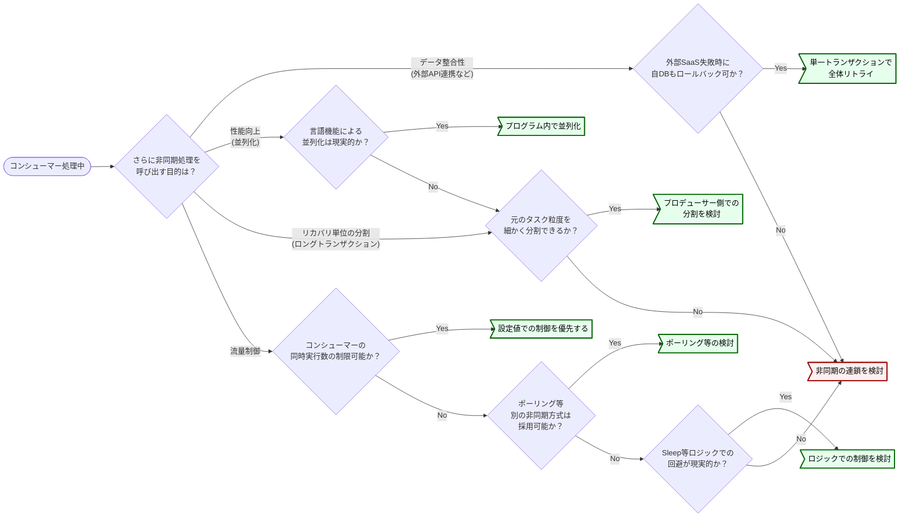

# 非同期から非同期の呼び出し

非同期の連鎖はトレーサビリティを下げるため必要最小限に留め、流量制御やデータ整合性が目的の場合は代替手段を再考する。
前段と後続でイベント処理の粒度が変わるケース (集約・分散) は連鎖を許容する。バッチからの呼び出しはバッチ設計ガイドラインに従う。
出典は [非同期設計ガイドライン](about.md) (CC BY 4.0) で、OKF の形式に合わせて分割、変更している。

## 非同期から非同期の呼び出し

コンシューマーが、その処理の一部として、さらに別の非同期処理を呼び出すと、非同期処理が連鎖する。主なモチベーションに以下がある。

- **並列化による性能改善**: 親タスクから多数の子タスクを並列実行することで性能を向上させる
- **リカバリ単位の分割**: 一連の長いビジネスプロセスを、複数の独立したトランザクションに分割し、障害時の影響範囲を限定、リカバリしやすくする
- **外部システム連携**: 非同期処理の途中で、応答に時間のかかる外部APIなどを呼び出し、メインの非同期処理への影響を局所化する

このトレードオフとして、処理のトレーシングや障害発生時の原因特定をさらに複雑化させる要因となり得る。

推奨は以下の通り。

- 同期処理から非同期処理を呼び出す時と同じく、入れ子となる非同期処理の採用も必要最小限に留める
  - 非同期処理が連鎖する程、開発効率やトレーサビリティは低下する傾向があるため
  - 以下の目的で非同期の連鎖を検討している場合は、代替手段で解決できないか再考する（オーバーエンジニアリングの可能性があるため）
    - **流量制御が目的の場合**: 後続処理を守るためにキューを分けてクッションにするのではなく、[流量制御](flow-control.md#流量制御) の章にある通り、コンシューマー自体の同時実行数やスループット制限（Lambdaの予約済み同時実行数など）で制御できないか検討する。構成要素が増えるほど運用コストが増大するため、設定値での解決を優先する
    - **データ整合性が目的の場合（外部API連携など）**: 外部API呼び出しの成功結果を記録するためだけに非同期を分けるのではなく、同一コンシューマー内で「API呼び出し → 成功後に自DBコミット」という一連の流れで完結できないか検討する。トランザクション管理が単一で済むのであれば、その方が整合性担保の難易度は低い
- 非同期から非同期を呼び出す基準としては、**前段と後続でイベント処理の粒度が変わるケース**は許容する
  - **呼び出し元より粒度が「大きく」なるケース（集約）**
    - **（例）ECサイト：** 注文（同期）→ 在庫引当（非同期1）→ **倉庫内のピッキング指示（非同期2）**
    - **理由：** 引当の都度ピッキング指示を出すより、一定数近隣のロケーションからのピッキングが溜まった時点でまとめて指示をする方が効率的なため。ただし、この場合は別プロセスでポーリングさせピッキングが溜まった時点での指示を第一に考える
  - **呼び出し元より粒度が「細かく」なるケース（分散）**
    - **（例）月次決済：** 締め処理（同期）→ 請求額計算（非同期1）→ **個々のユーザー決済実行（非同期2）**
    - **理由：** 複数のユーザーに対する決済処理を「非同期1」の中で順次ループ処理すると、1件の失敗や遅延が全体の完了を遅らせるリスクがあるため、個別に分割して実行する

判断フローの例を示す。

## バッチから非同期呼び出し

非同期処理の呼び出しは、ユーザーの操作イベント経由だけではなく、バッチ処理から呼び出される場合もありえる。[バッチ設計ガイドライン](https://future-architect.github.io/arch-guidelines/documents/forBatch/batch_guidelines.html#%E9%9D%9E%E5%90%8C%E6%9C%9F%E3%82%BF%E3%82%B9%E3%82%AF) を参照すること。
