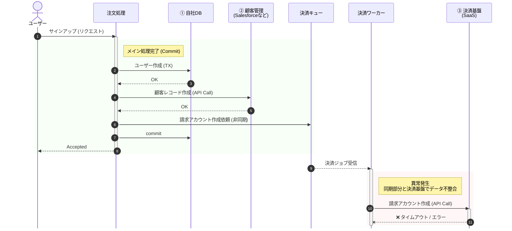
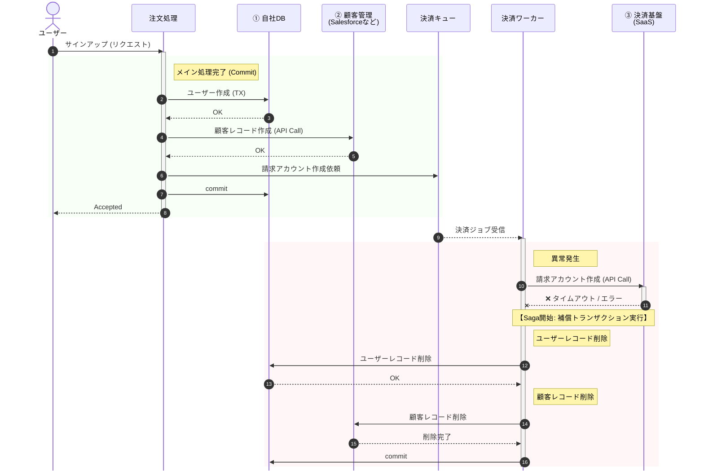

# データ整合性

非同期箇所を減らす設計の工夫を Saga より先に検討し、業務上許容できないケースのみ Saga パターン (補償トランザクション) を採用する。
補償 API の準備が難しい場合や発生頻度が低い場合は手動リカバリも検討し、いずれもリトライで発生頻度を減らす。
出典は [非同期設計ガイドライン](about.md) (CC BY 4.0) で、OKF の形式に合わせて分割、変更している。

## データ整合性

マイクロサービスアーキテクチャや、SaaS連携と同様に、非同期処理でも「データ整合性」をどのように保つかが問題になりやすい。

例えば、ユーザーがサインアップした際の、複数SaaS連携を含む以下の顧客登録フロー（下図）を想定する。

1. 自社DBにユーザーを作成
2. 顧客管理（Salesforceなど）に顧客レコードを作成
3. 決済基盤SaaS に請求アカウントを作成

この時、3の非同期部分でエラーが発生し、かつ回復不能の場合は、データ不整合が継続してしまう。

上記のような場合で、データ整合性を担保する主な方式は下表の通り。

| \#           | （1）Sagaパターン                                                     | （2）手動リカバリ                                                                    |
| :----------- | :-------------------------------------------------------------------- | :----------------------------------------------------------------------------------- |
| 説明         | 失敗したら、取り消す処理（補償トランザクション）を走らせる            | 失敗したら「人を呼ぶ」                                                               |
| 説明         | A→B→Cと進み、Cで失敗したら、Bの取消処理→Aの取消処理を実行して元に戻す | エラー時はアラートを上げ、不整合な状態を許容し、運用担当者がデータパッチ等で修正する |
| データ整合性 | ✅️高 。APIに取り消し機能が必要。副作用が残る場合あり                  | ✅高。複雑な業務判断が必要な場合に有効                                               |
| 実装コスト   | ❌高。元に戻すロジックが難しい                                        | ✅低。検知のみ                                                                       |
| 運用コスト   | ✅️低い。自動化できるため                                              | ⚠️リカバリ                                                                           |

Sagaパターンは以下のフローである。補償トランザクションは簡略表示のため決済ワーカーで行っている。本来はキューを経由した処理に切り出すべきである。

推奨は以下の通り。

- Saga以前に設計上の工夫で非同期箇所を減らせないか検討する
  - 例えば、決済基盤への決済アカウント作成までは同期で行い、顧客管理への連携側を非同期化とする。Salesforce連携が万が一遅延しても、売上には影響しないため許容すると判断する。これにより、顧客管理側への登録が失敗しても、補償トランザクションで打ち消すのではなく、その後の運用や救済ジョブで顧客管理側へ後で登録するという一方通行で済ませる
- 在庫引当のように、失敗したまま放置すると自社の機会損失となり、業務上許容できないようなケースでのみ、（1）を採用する
- Sagaパターンを実現するための取り消しAPIの準備が難しい場合や、発生頻度が低いとされる場合は（2）で様子を見ることも検討する
  - 例えば、非同期でのメール送信は取り消すことができない。そのため、別のメールで「取り消しました」と送信するしか無い
  - Sagaは複雑な実装のためバグの出る可能性が高い。またレアケースであれば、人間による判断の方がトータルコストは安くなる可能性が高い
- （1）（2）のどちらであっても、[リトライ](retry-and-visibility-timeout.md#リトライ) を組み込むことで発生頻度を減らす工夫を必須で行う
