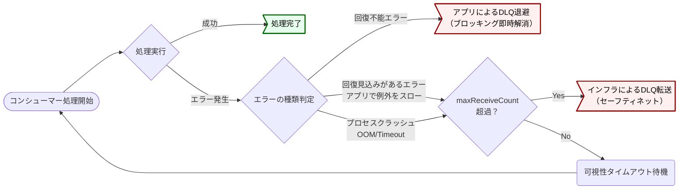

# DLQ

DLQ はキューごとに構築し、退避はアプリ制御とインフラ制御を組み合わせた二段構えを採用する。
リカバリは DLQ からソースキューへ書き戻す方式を採り、保持は原則 DLQ の最大保持期間に依存させる。
出典は [非同期設計ガイドライン](about.md) (CC BY 4.0) で、OKF の形式に合わせて分割、変更している。

## DLQ

DLQ（Dead Letter Queue: デッドレターキュー）とは、処理に失敗したメッセージを退避させるための特別なキューである。主に以下の目的がある。

1. **無限ループの防止:** 処理に失敗したメッセージが何度も再試行され、リソースを無限に浪費し続ける事態を防ぐ
2. **障害調査:** 処理に失敗したメッセージを隔離・保持することで、エラーの原因分析を容易にする
3. **手動リカバリ:** 根本原因（例: バグ修正、連携先障害の復旧）を解決した後、DLQに退避したメッセージをリランさせるための手段となる。どこかに永続化させておかないとリランに困るが、元のキューへは送信不可であるためDLQが必要となる

### DLQ構成

DLQには主に以下の2パターンの設計が考えられる。

| \#         | （1）単一のDLQ                                        | （2）キューごとのDLQ          |
| :--------- | :---------------------------------------------------- | :---------------------------- |
| 説明       | 全キューからの失敗メッセージを単一のDLQに集約する方式 | キューごとにDLQを構築する方式 |
| 構築コスト | ✅️DLQのインフラ数を抑えることができる                 | ⚠️メインのキュー:DLQ=1:1      |
| 設計コスト | ✅️単一であるためシンプル                              | ✅️1:1であるためシンプル       |
| リラン     | ❌️エラーがどのキューから発生したか特定する処理が必要  | ✅️1:1であるためシンプル       |

推奨は以下の通り。

- （2）を採用する
  - ソースキューごとにDLQを設定することがクラウド構築のベストプラクティスである（障害発生時の影響範囲の特定、リカバリ運用がシンプル）
  - 多くのマネージドサービスのキューが、データ量（メッセージ数）による従量課金がコストドライバであるため（Amazon Kinesis Data Streamsはシャードでの課金もあるため、利用サービスごとに確認すること）

### DLQへの退避方針

本ガイドラインではデフォルトでFIFOキューを利用することを推奨している。この場合、ポイズンピルと呼ばれる処理不能なメッセージが1件でも存在すると、同一メッセージグループの後続処理が詰まるというヘッドオブラインブロッキングが発生する。[順序保証](ordering.md#順序保証) 章にあるように、厳格な順序保証が求められる場合はブロッキングされることが正しい。しかし、ここではシステム全体の可用性を維持することを優先し、ポイズンピルメッセージはDLQに転送する前提とする。

この退避を実現するためには、以下の3つの方式が考えられる。

| 項目             | （1）アプリケーション制御                                    | （2）インフラ制御                                                              | （3）二段構え                                                                            |
| :--------------- | :----------------------------------------------------------- | :----------------------------------------------------------------------------- | :--------------------------------------------------------------------------------------- |
| 概要             | アプリケーションが明示的にDLQへメッセージを送信する          | アプリは例外をスローし、SQSの `maxReceiveCount` 超過による自動転送機能に任せる | 明確なエラーはアプリで即時退避し、予期せぬエラーはインフラ機能で救済するハイブリッド方式 |
| ブロッキング解消 | ✅ 即座に解消される                                          | ⚠️ 規定回数のリトライを待つため、DLQ移動までのタイムラグが発生する             | ✅ 既知のエラーであれば即座に解消される                                                  |
| クラッシュ耐性   | ⚠️ OOMなどクラッシュを検知できず、無限に詰まるリスク         | ✅ アプリがクラッシュしても、インフラ側で検知して確実に退避される              | ✅ 予期せぬエラーはインフラ機能がカバーする                                              |
| 実装難易度       | ⚠️ DLQへの送信・削除ロジックの実装が必要                     | ✅ コード修正は不要（例外スローのみ）、インフラ設定のみ                        | ⚠️ アプリケーション実装とインフラ設定の両方が必要となる                                  |
| データ整合性     | ⚠️ 送信成功・削除失敗時の重複リスクあり                      | ✅ SQSの機能内でアトミックに移動が行われる                                     | ⚠️ アプリ制御側において、重複排除やメタデータ継承の工夫が必要                            |
| エラー情報の詳細 | ✅ DLQ送信時に、エラー理由やコンテキストを属性として付与可能 | ⚠️ 元のメッセージがそのまま移動するため、失敗理由はログ確認が必要              | ✅ （アプリ制御側で対応可能）                                                            |

推奨は以下の通り。

- （3）二段構え を採用する
  - アプリケーションロジックで判断可能なエラーは即座に排除し、予期せぬクラッシュはインフラで拾うことで、FIFOキューの弱点であるブロッキング時間を最小化しつつ、堅牢性を最大化する
  - `maxReceiveCount` はあくまで無限実行を防ぐためのセーフティネットであり、アプリケーションで行いたい最大リトライ数を上回る数値を設定する。大き過ぎる値を設定すると、可視性タイムアウトの値とかけ合わせた時間がブロッキングされる。例えば、`maxReceiveCount` を10、可視性タイムアウトが30秒の場合、コンシューマーの実行時間分＋5分ブロックされることになる
  - 前提条件
    1. ステータス管理テーブルによる冪等性（アプリケーションによる手動DLQ転送とメインキューからの削除はアトミックな操作ではないことから重複実行への対策が必要であるため）
    2. メタデータの完全な継承（アプリケーションで転送する際、`MessageGroupId`や、トレースIDなどのメタデータをプログラム内で明示的にコピーしてDLQへ送信すること。これが行われない場合、リカバリ時に順序が崩れる原因となる）。

二段構えの防御における、メッセージ処理と分岐のフローを次に示す。

### DLQリカバリ

デッドレターキューから再実行するためには、以下の方式が考えられる。

| \#         | （1）ソースキューに書き戻す                                                                   | （2）DLQからタスクを実行                                                    |
| :--------- | :-------------------------------------------------------------------------------------------- | :-------------------------------------------------------------------------- |
| 説明       | DLQから元のソースキューにメッセージを書き戻すことで、元のキューから非同期タスクを実行する方式 | 一時的に、ジョブ実行基盤からDLQを読み込ませる方式                           |
| 設計コスト | ✅️非同期ジョブの設計はDLQなどの意識が不要                                                     | ❌️ソースキューとDLQの2つの読み込みの考慮が必要                              |
| 運用コスト | ✅️メッセージだけ移し替えるだけであるため、インフラレベルの変更をせずリラン可能                | ❌️一時的にDLQ読み込みをさせる構成変更が必要で、リラン運用の手順が複雑である |

推奨は以下の通り。

- （1）を採用する
  - コンシューマーの実装をシンプルに保つことができる
- DLQからソースキューに転送する、リラン専用のジョブを作成しておく
  - リランのオペレーションを統一することで、運用性を向上させるため

### DLQのメッセージ保持方針

メッセージには通常、最大保持期間（例: AWS SQSでは最大14日間）が存在する。即時リカバリするような領域であれば問題ない。しかし、解決までビジネス的な判断が必要な場合や、監査要件で失敗したデータを長期間保持する必要がある場合は、DBやオブジェクトストレージにメッセージを保持しておく必要が出てくる。

DLQのメッセージ永続化について、主に以下の設計案がある。

| 設計案     | （1）DLQの保持期間に依存                                                          | （2）失敗時にDB/ストレージへ永続化                                                                             | （3）DLQから定期的にアーカイブ                                                                   |
| :--------- | :-------------------------------------------------------------------------------- | :------------------------------------------------------------------------------------------------------------- | :----------------------------------------------------------------------------------------------- |
| 説明       | クラウドサービスのDLQ機能のみを利用し、その保持期間（例: 14日間）を上限とする方式 | コンシューマーでの処理失敗を検知した時点で、メッセージ内容をDBやオブジェクトストレージ（S3など）に書き出す方式 | DLQを定期的にポーリングするバッチを用意し、メッセージが失効する前にDB/ストレージに退避させる方式 |
| 構築コスト | ✅ 低い (インフラ設定のみ)                                                        | ⚠️ 中 (アプリで実装が面倒)                                                                                     | ⚠️ 中 (アプリはシンプルになるが、アーカイブのバッチ処理が別途必要)                               |
| 調査コスト | ⚠️メッセージ本文の確認は手間が大きい                                              | ✅️DBでペイロードの確認が可能                                                                                   | ⚠️メッセージ本文の確認は手間が大きい                                                             |
| リラン性   | ✅ 低い                                                                           | ⚠️ 中 (データパッチ的なリカバリ運用が必要)                                                                     | ⚠️ 中 (データパッチ的なリカバリ運用が必要)                                                       |
| 保持期間   | ❌ 短い (サービスの制約に依存)                                                    | ✅ 無期限                                                                                                      | ✅ 無期限                                                                                        |

推奨は以下の通り。

- 原則、（1）を採用する。保持期間は最大（SQSであれば14日）を選択する
  - 基本的に業務判断が求められるようなリラン要件は存在しないと考えられるため
- 失敗データの解決に数週間以上かかる可能性がある場合は、（2）を選択する
  - ただし、非同期処理の全てではなく、解決に時間がかかる該当の機能のみの特殊対応とする
