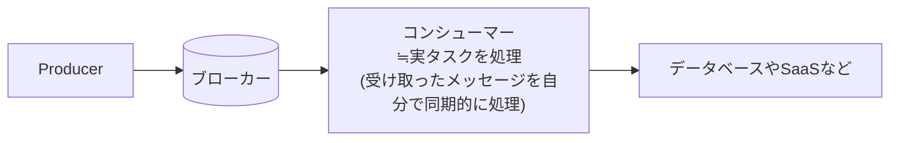
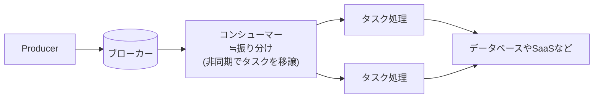

# 流量制御

プロデューサー側のバックプレッシャーは不要で、コンシューマー側の同時実行数を DB 保護とリソース占有防止のために制限する。
実行時間の制約が問題なければイベント駆動型 (Lambda の予約済み同時実行数) を第一に選び、制約があれば常駐型を採用する。
出典は [非同期設計ガイドライン](about.md) (CC BY 4.0) で、OKF の形式に合わせて分割、変更している。

## 流量制御

現代のクラウドサービスやKafkaなど拡張性が高いプロダクトを利用する前提では、プロデューサー側のメッセージ送信処理にレートリミットのような制限（バックプレッシャー）を設ける必要はなく、またキューが溢れないようにブロッキングされることは無い。

一方でコンシューマー側については、以下の理由で同時実行数を制限（≒流量調整）する必要がある。

1. DBの負荷軽減（スパイクした処理で、DBやシステム全体が不安定になることを防ぎたい）
2. ある特定のタスクで、あるリソースが占有されてしまい、他のタスクが起動されないといった占有を防ぐ

コンシューマーがメッセージを受け取る方式は、大きく常駐型 と イベント駆動型 に分けられ、それぞれ流量制御の方式が異なる。

|          | （1）常駐型（ポーリング型）                                                                | （2）イベント駆動型（プッシュ型）                                                                                                   |
| :------- | :----------------------------------------------------------------------------------------- | :---------------------------------------------------------------------------------------------------------------------------------- |
| 図       | 図1（表の下）                                                                              | 図2（表の下）                                                                                                                       |
| 説明     | コンシューマーがキューに対し、メッセージを能動的にポーリングし、同期的に処理する構成を指す | （Lambda Event Source Mappingなどのサービス基盤の）ポーリング担当が別のワーカー（実質的にはコンシューマー）にメッセージを割り当てる |
| 構成例   | 常駐プロセスであるECSタスク、SQSのReceiveMessage APIを呼び出す                             | SQS \+ Lambdaや、SQS \+ Lambda \+ ECSスタンドアローンタスク（EventBridge Pipesでも同様）                                            |
| 拡張性   | 常駐プロセス数を増やすことでスケールアウトさせる                                           | 事実上プッシュ的に動くため自動でスケールする                                                                                        |
| 縮退性   | 常駐プロセスをスケールインさせる必要があり大掛かり                                         | タスク処理をLambdaのような基盤で動かせれば柔軟に縮退できる                                                                          |
| 流量制御 | 比較的容易                                                                                 | 一定の工夫が必要なパターンがある                                                                                                    |

図1

図2

（1）の場合は、コンシューマー数:処理スレッド数=1:1 とすることが基本であるため、流量はサービス数のスケールイン/アウトで調整できる。

（2）の場合は実質的にプッシュ型のようにコンシューマーが起動されるため、意図しない並列数の高まりによる過負荷に気をつける必要がある。以下の方式が考えられる。

| \#         | （2-1）処理リソース制限                                                                                                             | （2-2）実行時に同時実行数を確認                                                                  |
| :--------- | :---------------------------------------------------------------------------------------------------------------------------------- | :----------------------------------------------------------------------------------------------- |
| 説明       | コンシューマーを実行する基盤（Lambda, ECSクラスタ）のリソースや同時実行数に上限を設定する方式                                       | 起動時に現在の同時実行数を確認して、上限の場合はスリープやリトライさせるか、キューに書き戻す方式 |
| 厳密性     | ⚠️Lambdaの場合は関数単位で「予約済み同時実行数」で並列数を制御できる。ECSクラスタの場合は全体のリソース上限となり厳密な設定は難しい | ✅️厳密に行える                                                                                   |
| 設計コスト | ✅️低い（インフラ設定）                                                                                                              | ⚠️制御ロジックがやや複雑                                                                         |
| 制約       | ✅️特に無い                                                                                                                          | ❌️ECSの場合、describe APIのレートリミットの懸念                                                  |

推奨は以下の通り。

- 実行時間の制約が問題なければ、（2）を第一の選択肢とする
  - Lambdaの場合（2-1）「予約された同時実行」で関数単位に流量調整が可能でありコスト効率も高いため
  - Lambdaから `ecs run task` を呼び出すような構成は、Lambdaの同時実行数を制限しても、最終的にDBなどにアクセスするECSタスクの総数を直接制御できないため（クラスタのリソースを絞ることで擬似的に制限は可能だが）、できる限り採用しない。ECSを利用する場合は（2-2）ではなく（1）の方式を検討する
  - その他の構成においても、（1）や（2-1）が不可な場合に初めて、（2-2）の方式を検討する
- Lambdaの実行時間に懸念がある場合、（1）を採用する

> [!TIP]
> **参考**
>
> > 関連するダウンストリームが高負荷になる可能性を低減するために、Lambda は関数レベルで予約済み同時実行数（Reserved concurrency）、イベントソースレベルで最大同時実行数（Maximum concurrency）を設定
>
> [Amazon SQS をイベントソースとした AWS Lambda 関数のより高速なポーリングスケールアップの紹介](https://aws.amazon.com/jp/blogs/news/introducing-faster-polling-scale-up-for-aws-lambda-functions-configured-with-amazon-sqs/)
