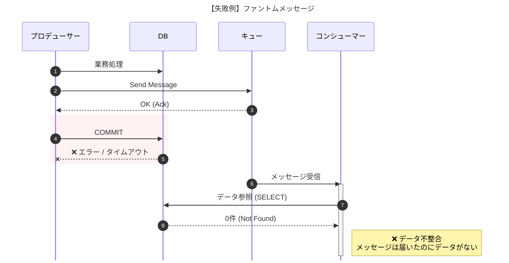
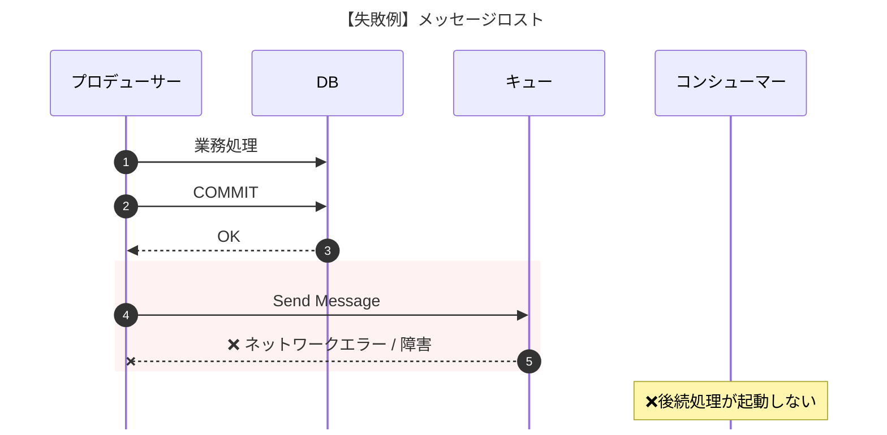
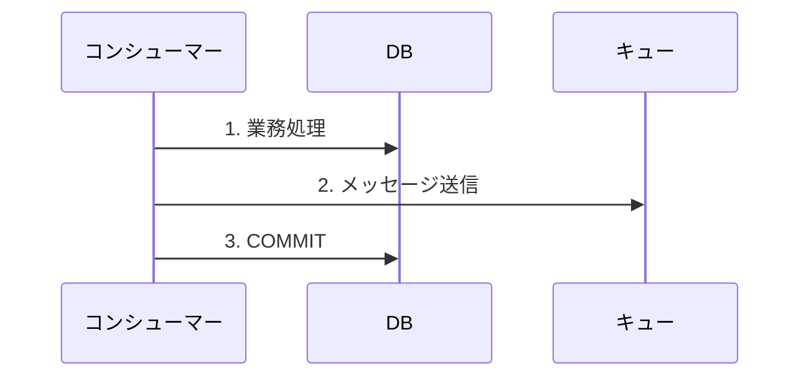
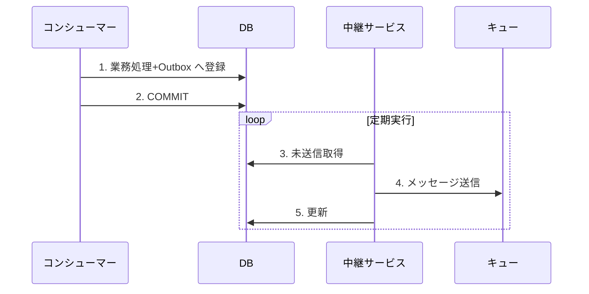
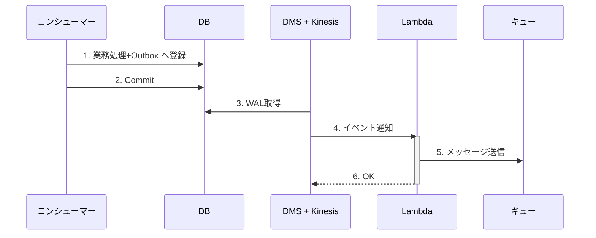

# メッセージ送信の信頼性

DB コミットとメッセージ送信の整合性が崩れると、ファントムメッセージやメッセージロストが発生する。
原則は直接ディスパッチにステータス管理テーブルを組み合わせ、順序保証や柔軟な制御が必要な場合にアウトボックス (ポーリング) を検討する。
出典は [非同期設計ガイドライン](about.md) (CC BY 4.0) で、OKF の形式に合わせて分割、変更している。

## メッセージ送信の信頼性

プロデューサー側で自領域のDB更新とキューへのメッセージ送信の整合性をどのように保つかが課題となる。例えば、キューの送信には成功したが自領域のDBのコミットに失敗することが考えられる。この場合、コンシューマーは起動するが処理対象のデータが存在しないため不整合となる。これはファントムメッセージと呼ばれる。

これは、単純に順序を逆転しても解決しない。むしろ、一部処理が成功したと見せかけて後続のコンシューマーが起動しないというメッセージロストが発生する分、事態は悪化しているとも言える。

代表的な対応案にトランザクションアウトボックスパターンがある。

> [!NOTE]
> **トランザクションアウトボックスパターン**
>
> 1. 各コンシューマーは自身の担う業務ロジック処理と、処理完了を示すステータス更新を1トランザクションで実施する。
> 2. 後続コンシューマーへのメッセージ連携は、別のトランザクションで行う。
>
> これにより、1→2の順序性の担保と、2単体でのリトライが可能となる。

ファントムメッセージが発生する直接ディスパッチ方式と、トランザクションアウトボックスパターンのポーリング版、CDC版を下表で比較する。

| \#                       | （1）直接ディスパッチ        | （2）アウトボックス (ポーリング・リレー)                      | （3）アウトボックス (CDC・リレー)                                            |
| :----------------------- | :--------------------------- | :------------------------------------------------------------ | :--------------------------------------------------------------------------- |
| 図                       | 図1（表の下）                | 図2（表の下）                                                 | 図3（表の下）                                                                |
| 処理概要                 | メッセージ送信 → DBコミット  | DBコミット → (別プロセス) → ポーリング → メッセージ送信       | DBコミット → (CDC) → イベント → メッセージ送信                               |
| 信頼性                   | ❌                           | ✅                                                            | ✅                                                                           |
| クラッシュ時の主なリスク | ❌ファントムメッセージの懸念 | ✅ リレーの送信失敗時は、次回のポーリングで自動リトライされる | ✅ リレーの送信失敗時は、CDCがトリガーしたLambda等のリトライ機構で処理される |
| 実装コスト               | ✅ 低                        | ⚠️中 ポーリングバッチの実装/運用が必要                        | ❌ 高 CDCパイプライン(Debezium/DMS等)の構築/運用が必要                       |
| レイテンシ               | ✅ 低                        | ⚠️ 中～高（ポーリング間隔に依存）                             | ✅ 低                                                                        |
| DB負荷                   | ✅ 低                        | ⚠️ 中（定期的なポーリングスキャンが発生）                     | ✅ 低（トランザクションログベース）                                          |

図1

図2

図3

推奨は以下の通り。

- （1）を採用する
  - ファントムメッセージについては、[ステータス管理テーブル](status-management.md#ステータス管理テーブル) をプロデューサー側が登録＋コンシューマー側でレコードチェックすれば不正検知ができるため。ステータス管理テーブルを用意しない場合は、(2)のような仕組みの導入を検討する
- （2）は実行順序を保証し柔軟に制御する必要がある場合に採用を検討する。(3)は仕組みが重厚になりすぎるため非推奨とする

## このリポジトリのアウトボックス

このリポジトリは（2）を採用している。Outbox の表の置き場所、送る処理のロールと RLS、モジュールをまたぐ変更のつなぎ方、受信の重複除去は [ADR 0029](../adr/0029-module-data-ownership-and-shared-outbox.md)、送る処理の実行基盤は [ADR 0013](../adr/0013-api-on-ecs-and-lambda-web-functions.md) で決めている。この文書の推奨は、ADR と食い違う場合は ADR に従う。
