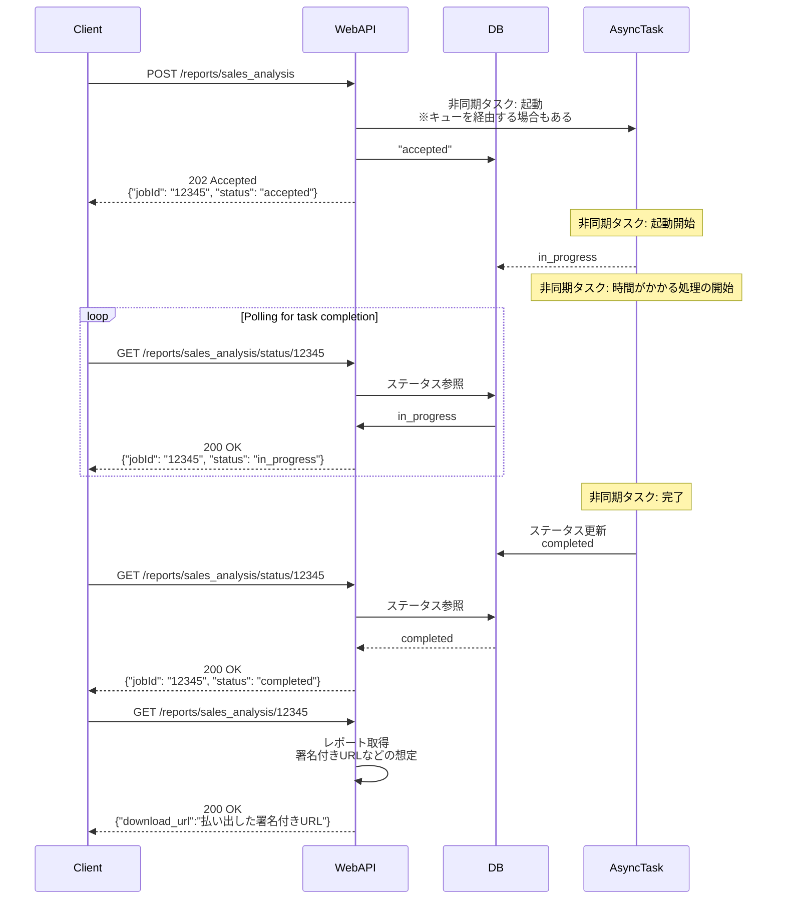
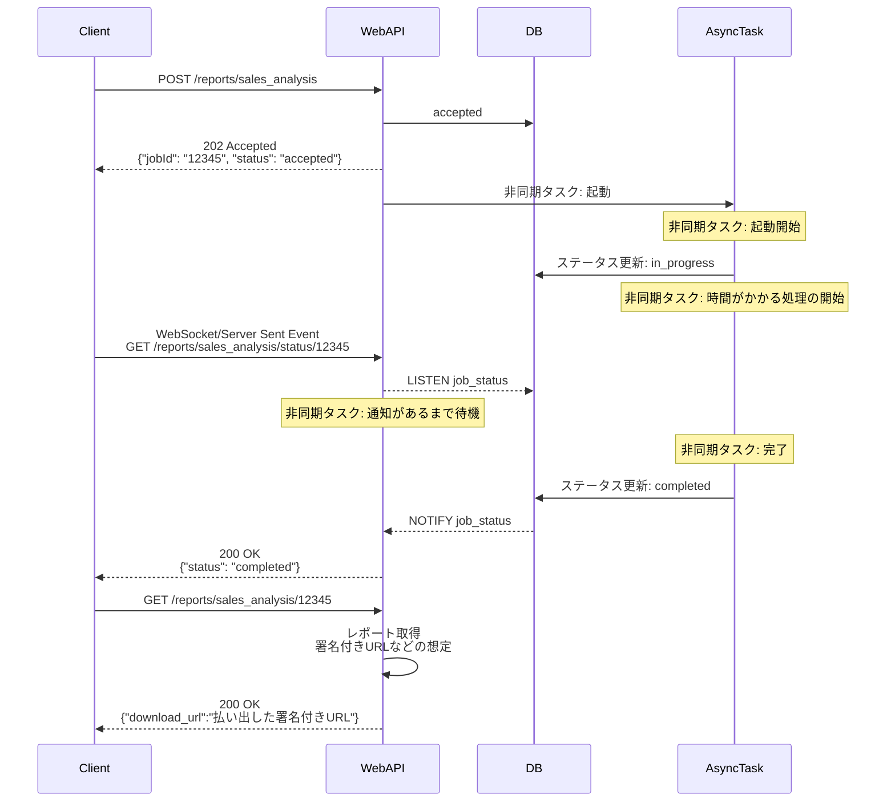

# 完了通知

完了通知はポーリング方式かオンデマンド確認方式を第一に検討し、プッシュ通知は本当に必要な場合のみ採用する。
サーバープッシュが必要な場合、一方向の完了通知であれば Server Sent Event を推奨し、双方向が必要なときのみ WebSocket を検討する。
出典は [非同期設計ガイドライン](about.md) (CC BY 4.0) で、OKF の形式に合わせて分割、変更している。

## 通知

非同期処理が終了したかどうかを、エンドユーザーへ通知すべきという要求事項には、以下の検討観点がある。

- **即時性**: ユーザーは処理完了をどの程度、リアルタイムで知る必要があるか。別の作業ついでに確認する程度で良いか（≒プッシュ通知は不要）
- **ユーザーの状態**: ユーザーは完了を画面上で待機しているか、それとも別の画面で操作しているかなど

主な実現手段は以下の設計パターンがある。

| \#           | （1）ポーリング方式                                                                                | （2）プッシュ通知方式                                                                                                       | （3）オンデマンド確認方式                                                                  |
| :----------- | :------------------------------------------------------------------------------------------------- | :-------------------------------------------------------------------------------------------------------------------------- | :----------------------------------------------------------------------------------------- |
| 説明         | ブラウザやアプリがポーリングでステータスを確認する方式。ユーザーが画面を開いて待っている前提に近い | 処理完了時にサーバー側が、クライアントにWebSocketやモバイルデバイスに通知をプッシュする方式。画面を開いていなくても通知可能 | ユーザーが「ジョブ一覧」や「通知一覧」のような専用ページを、自らのタイミングで確認する方式 |
| フロー図     | 図1（表の下）                                                                                      | 図2（表の下）                                                                                                               | （省略）                                                                                   |
| 即時性       | ⚠️ポーリング間隔分の遅延が発生                                                                     | ✅リアルタイムに通知できる                                                                                                  | ❌ (低)ユーザーの操作に依存する                                                            |
| 実装コスト   | ⚠️UI側のポーリング・タイムアウト制御ロジックが必要                                                 | ❌ (高) WebSocket, AWS SNS, FCM/APNsといった通知基盤の設計・運用コストが高い                                                | ✅ (低) ステータス一覧APIの実装のみで済む                                                  |
| サーバー費用 | ✅️ポーリングリクエスト程度                                                                         | ❌ (高) WebSocketコネクションの常時維持や、SNS/FCM連携の費用                                                                | ✅ (低) ユーザーが必要な時のみに、リクエストが発生                                         |
| 接続性       | ✅高い                                                                                             | ⚠️プロトコルによっては、企業内プロキシ等でブロックされる可能性がある                                                        | ✅高い                                                                                     |

図1

図2

推奨は以下の通り。

- （1）または（3）を第一に検討する
  - プッシュ通知は構築・運用コストが大きく、ユーザーとしても通知で業務が中断されるため、チャットシステムなど本当に必要な場合のみに適用すべきである（多くの業務システムにおいて（2）はオーバースペックとなる傾向がある）

- （1）ポーリング方式を選択する場合
  - UX向上のため、処理時間が数分程度と短い場合に適している
  - ポーリング間隔に指数関数的バックオフを導入するなど、無駄なリクエストを削減する工夫を入れる
- （2）プッシュ通知方式を選択する場合
  - （1）では即時性などの要件を満たせない場合に検討する
  - メールやチャットツール（Slack、Teams）など、アプリ通知以外の既存の仕組みを利用できないかも同時に検討する
  - アプリ通知を用いる場合でも、ポーリングのタイムアウト対策として、（3）との併用が必要になるケースが多い
- （3）オンデマンド確認方式の実装
  - ステータス管理テーブルを参照するだけで実装可能だが、アプリケーション要件の表示項目については、別テーブルでの管理を推奨する（アプリ要件変更時のERD変更影響を局所化するため）

### サーバープッシュの方式

サーバープッシュには次の3方式がある。

|              | （2-A）ロングポーリング                                                                                | （2-B）Server Sent Event                                                                                                 | (2-C)WebSocket                                                                                                   |
| :----------- | :----------------------------------------------------------------------------------------------------- | :----------------------------------------------------------------------------------------------------------------------- | :--------------------------------------------------------------------------------------------------------------- |
| 説明         | サーバー側で更新があるまで待機し、更新があったタイミングで応答。再びクライアント側から再接続してもらう | HTTPプロトコルを使用し、クライアントからの一度のリクエストで接続を維持し、サーバーから継続的にデータをストリーム送信する | TCP上で双方向通信規格を使用し、サーバー / クライアント間でメッセージを送受信する。バイナリ送信も可能で効率が良い |
| 通信方向     | 一方向（擬似プッシュ）                                                                                 | 一方向（サーバー→クライアント）                                                                                          | 双方向                                                                                                           |
| 即時性       | ❌️1度のやり取りでヘッダーなどが付与されるためオーバーヘッドあり                                        | ⚠️高い                                                                                                                   | ✅️最も低レイテンシ                                                                                               |
| プロキシ対応 | ✅️高い                                                                                                 | ✅️高い                                                                                                                   | ⚠️ブロックされる可能性がほかと比較すると高い                                                                     |
| 接続維持     | ❌️自前実装（再接続実装）                                                                               | ✅️自動再接続機能がある                                                                                                   | ⚠️クライアント側で再接続ロジックを実装                                                                           |
| 保守運用性   | ⚠️古い手法である                                                                                       | ✅️比較的低い                                                                                                             | ⚠️ステートフルな通信のため、LBやデプロイ時の切断考慮など運用難易度が高い                                         |

推奨は以下の通り。

- 非同期処理の完了通知という目的（一方向の通知）であれば、（2-B）Server Sent Event (SSE) の採用を推奨する
  - HTTPベースであるため既存のWebインフラ（LB、プロキシ）との親和性が高く、WebSocketほど実装・運用が複雑にならないため
- 双方向のリアルタイム通信が必要な場合に限り、（2-C）WebSocketを検討する
