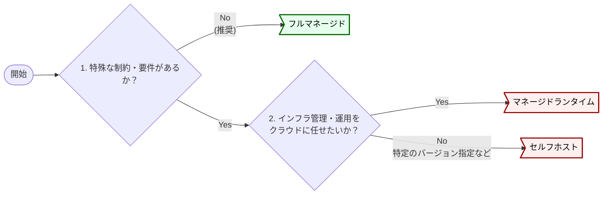

# キュー環境とプロトコル

キューの実行環境はフルマネージドを推奨し、オンプレやベンダーロックイン回避などの要件がある場合のみ他方式を採る。
プロトコル (AMQP、MQTT、Kafka) の選定はプロダクト選定に等しく、設計上の論点としては扱わない。
出典は [非同期設計ガイドライン](about.md) (CC BY 4.0) で、OKF の形式に合わせて分割、変更している。

## キュー環境

非同期処理に利用するキューの実行環境は以下の3パターンの方式がある。

| \#             | （1）フルマネージド                            | （2）マネージドランタイム                          | （3）セルフホスト                                  |
| :------------- | :--------------------------------------------- | :------------------------------------------------- | :------------------------------------------------- |
| 例             | Amazon SQS / Cloud Pub/Sub / Azure Service Bus | Amazon MQ / Azure Service BusのAMQP1.0互換         | RabbitMQまたはApache ActiveMQをECSやEC2にデプロイ  |
| 分類           | プロプライエタリ                               | オープンソース/標準プロトコル互換                  | オープンソース（ミドルウェア）                     |
| AMQP互換       | なし                                           | あり                                               | あり                                               |
| 可用性・拡張性 | ✅️高い                                         | ✅️高い                                             | ⚠️実装依存                                         |
| 設計コスト     | ✅️低い                                         | ⚠️やや高い                                         | ❌️高い                                             |
| 運用コスト     | ✅️インスタンス管理等が不要で使用に応じた課金   | ❌️インスタンスの管理が必要となり起動中は課金が発生 | ❌️インスタンスの管理が必要となり起動中は課金が発生 |

推奨は以下の通り。

- （1）を推奨する
- 以下の場合は（2）または（3）を採用するケースもある
  - オンプレミスまたはマルチクラウド環境に構築する場合
  - ベンダーロックインを回避すべき要件がある場合
  - 既に存在するRabbitMQまたはActiveMQのサーバーをクラウドシフトする場合

選定フローのイメージは以下の通り。

## プロトコル

現代のクラウド環境における非同期設計では、AMQP (Advanced Message Queuing Protocol) や MQTT (Message Queuing Telemetry Transport) といった古典的なメッセージングプロトコルそのものを開発者が直接意識する場面は稀である。

AWS SQSやSNSは、AWS SDKを介した HTTPS APIコールによって操作されるため、プロトコルレベルの詳細は抽象化されている。AMQP、MQTT、Kafkaプロトコルなどの選択は、どのプロトコルを使用するかではなく、どのメッセージングプロダクトを選定するかに等しい。そのため、プロトコル選定は本ガイドラインでは設計上の論点として取り扱わない。
