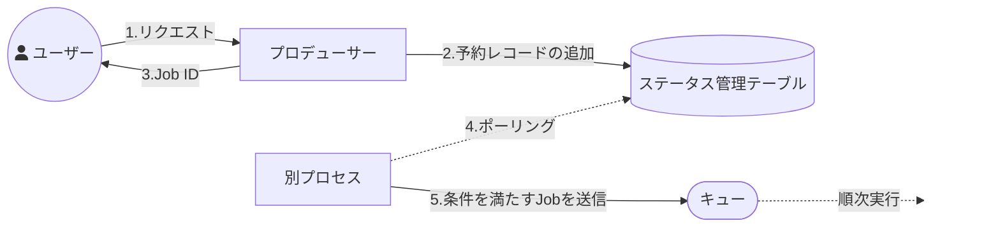

# 予約実行

予約実行はステータス管理テーブルを別プロセスでポーリングする方式を採用し、スケジューリングは非同期処理をキックする側の責務に分離する。
非同期処理の内部で実処理を特定時刻まで待機したり sleep loop したりしない。
出典は [非同期設計ガイドライン](about.md) (CC BY 4.0) で、OKF の形式に合わせて分割、変更している。

## 予約

特定の時刻に非同期処理を開始したいという需要がある。このためプロデューサーがメッセージを即時キューに入れるのではなく、適切なタイミングまで待機させる設計が必要となる場合がある。

例えば、以下のようなユースケースが考えられる。

- メールなどの予約送信
- Slackのようなチャットツールへの予約投稿（チャットサービス側に予約機能が無い想定）

このスケジューリングの責務をどこに持たせるかで以下の2パターンが考えられる。

| 設計案     | （1）外部スケジューラ                                                                                                                                                                  | （2）ステータス管理テーブルのポーリング                                                                                                                                                |
| :--------- | :------------------------------------------------------------------------------------------------------------------------------------------------------------------------------------- | :------------------------------------------------------------------------------------------------------------------------------------------------------------------------------------- |
| 説明       | 毎日N時実行、毎月M日実行など、特定の日時や条件が決まっている定期バッチを、各クラウドプロバイダーが提供するサービスをはじめ、各製品に備わっている予約機能を用いて非同期処理を開始する。 | 特定条件を満たすジョブを判定できるよう、たとえば条件が時間ならば`execute_at` カラムを管理テーブルに用意する。別プロセスで定期的に `WHERE execute_at <= NOW()` を検索してキューに積む。 |
| 実装コスト | ✅️ 低 (出来合いの設定ウィザードを使える)                                                                                                                                               | ✅️ 低 (開始条件次第ではあるが)                                                                                                                                                         |
| 柔軟性     | ❌️ 低 (cron式のような限定された条件のみ)                                                                                                                                               | ✅️ 高 (DB/アプリの記述で割と何でもできる)                                                                                                                                              |

推奨は以下の通り。

- （2）を採用する
- 条件に合致してからキューに入るまでのタイミングは別プロセスの動作間隔に依存するため、厳密性を要求するとコストが高くなる。一方で（1）の場合でも数分程度のラグが生じうるため、予約機能の実装に際してはある程度の妥協が必要である
- 非同期処理の内部で実際の処理を特定の時刻まで待機したり、処理の途中で特定の時間まで sleep loop したりするべきではない。予約を含めたスケジューリングは非同期処理をキックする側の責務として分離すべきである
  - 待機中にジョブがクラッシュした場合、リトライ制御が煩雑になるため。また、待機中もスレッドやメモリ、DBコネクションなどのリソースを占有し続けるおそれがある

