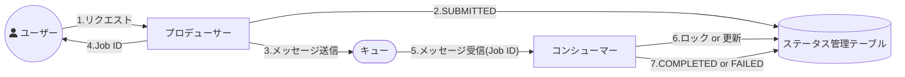
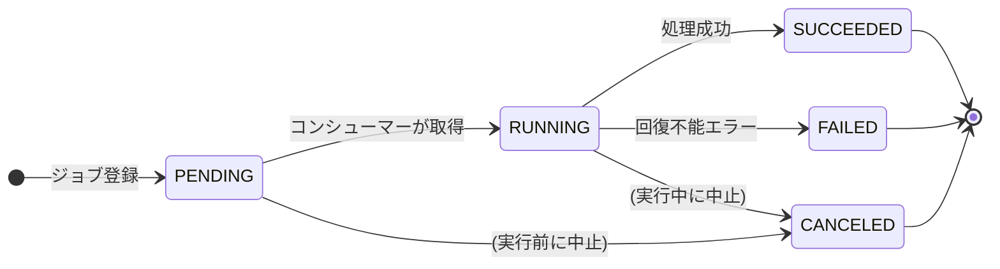

# 非同期処理ステータス設計

ステータス管理テーブルを作り、プロデューサーの送信前とコンシューマーの終了時に書き込むことで実行状況を DB から把握する。
ステータスの命名規則を定めて一貫利用し、こだわりがなければ Google Cloud Batch の語彙 (PENDING、RUNNING、SUCCEEDED、FAILED など) を用いる。
出典は [非同期設計ガイドライン](about.md) (CC BY 4.0) で、OKF の形式に合わせて分割、変更している。

## 非同期処理ステータス設計

非同期処理の実行状況をログなどから追うことはたいへんである。そのため、DBにステータス管理テーブルを作成し、キューにメッセージを送受信する前後で書き込む方式にすると運用上の利便性が高まる。

### ステータス管理テーブル

ステータス管理テーブルに、プロデューサーがキューへの送信前に、コンシューマーが終了時にアクセスすることで、進捗状況を明らかにできる。これにより、保守運用者が、DB検索から非同期タスクの実行状況を把握できる。

一般的な設計事項は以下の通り。

- コンシューマーが処理開始時にステータス管理テーブルを確認し、ジョブIDが実行中か処理済みになっていないかチェックする
  - もし、未処理、実行中、異常終了などのステータスのレコードが無ければ、INFO/WARNログを出して正常終了させる
  - あるいは、ロックが取れなければ、多重実行されたとして自処理はINFOログを出して正常終了させる
- コンシューマーが異常終了時は、通常業務テーブルはロールバックすることが自然であるため、ステータス管理テーブルの値をFAILEDにする場合は、自律型トランザクションでコミットさせる必要がある

推奨は以下の通り。

- 非同期の処理ステータス管理テーブルを作成し、DBで状況を把握できるようにする
- プロデューサー、コンシューマーがキューの前後で適切にこれらを処理する
- キーとなるジョブIDはトレースIDとは通常、別に採番する
  - 非同期が連鎖した場合には、一意制約になるため
  - トレースIDは紐づけ用に、ステータス管理テーブルの属性に持たせる
- RUNNINGを自律型トランザクションでコミットする必要はない。実装が楽な行ロックを推奨する

### 命名規則

各ステータスの区分値についての方針を決めておくと、複数のシステムを横断的に保守運用する際の認知負荷を下げられる。

主要なバッチ処理系での表現は下表である。

| \#                       | AWS Batch         | Google Cloud Batch | Azure Batch | Hitachi JP1                | Spring Batch |
| :----------------------- | :---------------- | :----------------- | :---------- | :------------------------- | :----------- |
| 先行タスク・リソース待機 | SUBMITTED         | PENDING            | Active      | 開始時刻待ち, 先行終了待ち | \-           |
| 実行可能                 | RUNNABLE          | ASSIGNED           | Preparing   | キューイング               | STARTING     |
| 実行中                   | STARTING, RUNNING | RUNNING            | Running     | 実行中                     | STARTED      |
| 成功/完了                | SUCCEEDED         | SUCCEEDED          | Completed   | 正常終了                   | COMPLETED    |
| 失敗/エラー              | FAILED            | FAILED             | Completed   | 異常終了                   | FAILED       |
| 停止/キャンセル          | \-                | (UNEXECUTED)       | \-          | 強制終了                   | STOPPED      |
| 保留/中断                | \-                | \-                 | \-          | 保留中                     | \-           |

主要な区分値の遷移図は以下。

推奨は以下の通り。

- ステータスの命名規則を定め、一貫して利用する
- 特にこだわりがなければ、Google Cloud Batchの語彙（PENDING、RUNNING、SUCCEEDED、FAILEDなど）を用いる
  - 比較的、簡易な単語で構成されており、またよく似た並びによる見間違え（STARTING, STARTEDなど）が無いため
- 設計変更でステータスをSUCCEEDED1, SUCCEEDED2 のように増やしたくなる場合は、処理自体を分割したほうがよい
- 保留/中断は先行処理の待機を除いて、非同期処理それ自体が保留となるステータスは作らない
  - 重複排除と冪等性 及び 順序制御 を前提に、呼び出し側で処理の実施有無をコントロールすべきであるため
