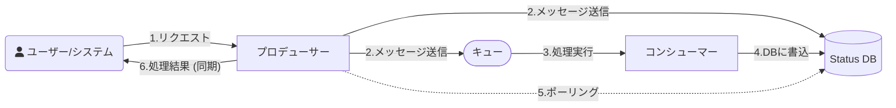

# 同期待ち合わせ

同期待ち合わせは構築難易度が高いため、まずクライアントのポーリングへ書き換えられないか検討する。
必要な場合はリプライキュー方式か DB ポーリング方式から選び、ステータス管理テーブルがある前提では DB ポーリングを第一の選択肢にする。
出典は [非同期設計ガイドライン](about.md) (CC BY 4.0) で、OKF の形式に合わせて分割、変更している。

## 同期待ち合わせ

非同期処理は元々、呼び出し元と実行側を分離するものである。しかし、処理自体は非同期化しつつも呼び出し元はその処理が完了するまで待機し、結果を同期的に受け取りたい以下のようなユースケースがある。本ガイドラインではこれを「同期待ち合わせ」と呼ぶ。

- 平準化目的で非同期化した高負荷な計算処理
  - 例えば、保険料見積もりのような、数万件のシミュレーションや複雑な数理モデルの実行を伴い、CPUとメモリを一時的かつ大量に消費する場合、それ専用のサーバーで実行する
  - Web APIの同期呼び出しで行った場合、バーストでシステムが不安定になるため、キューを経由した非同期で処理を行いたい
  - 保険料見積もり結果は即時ユーザーに通知させたいため、結果が出るまで待機する必要がある

本節では、以下のようにエンドユーザー側のポーリングは考慮せず、システム内での待ち合わせのみを範囲とする。

この場合、どのようにプロデューサーが処理完了の応答を受け取るかは、大きく以下の2方式が考えられる。

| \#         | （1）リプライキュー方式                                                                                                                                                                                                                              | （2）DBポーリング方式                                                                                  |
| :--------- | :--------------------------------------------------------------------------------------------------------------------------------------------------------------------------------------------------------------------------------------------------- | :----------------------------------------------------------------------------------------------------- |
| 説明       | Enterprise Integration Patternsにおける[Request-Replyパターン](https://www.enterpriseintegrationpatterns.com/patterns/messaging/RequestReply.html)。Producerが要求メッセージに「応答先キュー名」と「相関ID」を指定し、そのキューを監視して応答を待つ | 「ステータス管理テーブル」を利用する。プロデューサーが成功/失敗 ステータスになるまでDBをポーリングする |
| 実装コスト | ❌️高い。応答用キューの管理、相関IDによる紐付け、タイムアウト処理の配慮が必要                                                                                                                                                                         | ⚠️中。ステータス管理テーブルが前提。プロデューサー側にポーリングとタイムアウトのロジックが必要         |
| 即時性     | ✅️高い。応答メッセージが来たら即座に検知できる                                                                                                                                                                                                       | ⚠️中。検知までにポーリング間隔分の遅延                                                                 |
| インフラ   | ⚠️応答専用のキューが別途必要                                                                                                                                                                                                                         | ✅️ステータス管理テーブルを再利用できる                                                                 |
| 耐障害性   | ✅️プロデューサーが応答待機中に落ちても、キューによるデータ保護が働く                                                                                                                                                                                 | ✅️高。ステータスはDBに永続化されるため、プロデューサーが落ちても再ポーリングが可能                     |

推奨は以下の通り。

- （1）（2）の設計案自体を無くせないかまず検討する。例えば、[通知](notification.md#通知) 章にあるように、クライアントからのポーリングに書き換えることが最もシンプルである。即時性が犠牲になるが、同期待ち合わせは構築難易度が上がるため、よほどの業務効果が無い限りは非推奨である
- 即時性などの要件のため同期待ち合わせする必要がある場合は、（1）（2）案から選択する
- 前述した「ステータス管理テーブル」を導入する前提であれば、（2）を第一の選択肢とする
  - 「ステータス管理テーブル」を再利用でき、DBをそのままポーリングするだけであり設計・運用をシンプルにできるため
- どのケースであっても、タイムアウトの設計が必要。例えば（2）であれば、ポーリングのキャンセルが必要
  - バックエンド内での待ち合わせをやめ、クライアントに応答を返す設計が必要
  - タイムアウト後に、応答が来た場合のハンドリングも検討が必要

> [!TIP]
> **SQS temporary Queue Client**
>
> 応答キューを実装する場合、AWS SQS temporary Queue Clientライブラリを利用すると、 応答用の一時キューの作成・管理・削除を自動化できる。
>
> - [Amazon SQS一時キュー \- Amazon Simple Queue Service](https://docs.aws.amazon.com/ja_jp/AWSSimpleQueueService/latest/SQSDeveloperGuide/sqs-temporary-queues.html)
