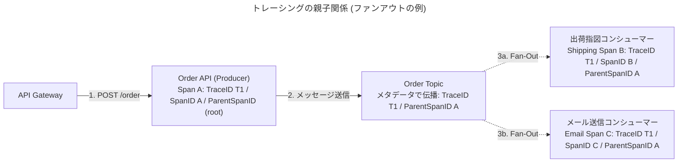

# トレーシング

非同期処理の呼び出し時にトレース ID の設定を必須とし、上流で UUID v4/v7 を採番してメタデータとして引き回す。
親子関係を管理したい場合は SpanID・ParentSpanID を導入し、実行管理テーブルに trace_id・span_id・parent_span_id を持たせる。
出典は [非同期設計ガイドライン](about.md) (CC BY 4.0) で、OKF の形式に合わせて分割、変更している。

## トレーシング

非同期処理が複数のサービスやキューをまたいで連鎖すると、障害調査や性能ボトルネックの調査などの難易度が高まる。そのため、トレースID（トランザクションID）を非同期処理の呼び出し時に設定し、それらを引き回すことで紐づけを容易にするという、分散トレーシングは必須であるとされる。

推奨は以下の通り。

- 非同期処理の呼び出し時に、トレースIDの設定は必須とする
- トレースIDは、呼び出し元のシステムなど、なるべくシステムの上流で採番する（Web APIであれば、API Gatewayなどの層。バッチであればバッチ実行時に採番する）
  - Web API設計ガイドライン > [トレースIDをどこで払い出すべきか](../web-api/observability.md#トレースidをどこで払い出すべきか) を参考にする
- トレースIDは、UUID v4かv7を用いる
  - 基本的には推測困難性は不要だと考えられるため、v7で良いと考えられる
- トレースIDは、非同期処理・それらから呼び出される別の非同期処理などの全てのログ項目や、DBのシステム共通項目で必須とする
- トレースIDは、ペイロードの本文に含めず、できる限りメッセージのメタデータとして付与させる（例えば、HTTPヘッダーやSQSのメッセージ属性）
  - リラン、リカバリ時に切り替えさせることができるようにしたいため
- 各プログラムから、トレースIDの引き回しは、JavaであればMDC (Mapped Diagnostic Context)や、Goであればcontext などの機能を利用する（[ログ設計ガイドライン](../logging/messages.md#メッセージの書き方)を参照する）

> [!TIP]
> **AWS X-Rayを利用する**
>
> AWS環境で非同期処理のトレーシングを行う場合、[AWS X-Ray](https://aws.amazon.com/jp/xray/)の利用を推奨する。
>
> この場合アプリケーションのSDK（例: AWS X-Ray SDK for Java）を導入し、設定を有効化するだけで、SDKが自動的にトレースID（X-Rayでは `Trace ID`、 `Segment ID` と呼ばれる）の採番と引き回しを行う。特にSQSとの連携では、プロデューサーの `SendMessage` 側で自動的に `Trace ID` がメッセージ属性に追加され、コンシューマーの `ReceiveMessage` 側でSDKがそれを自動的に読み取り、トレースの親子関係を連結してくれる。これにより、開発者が手動でIDを引き回す実装（MDCへの設定など）の多くを省略でき、X-Rayのコンソール上でサービスマップや処理のボトルネックを可視化できるようになる。この場合は、スクラッチで採番したトレースIDは、以下のように別名で追加して紐づける。ALBの場合は自動で`X-Amzn-Trace-Id` が付与され、API Gatewayの「X-Ray トレースを有効にする」ことで有効になる。X-Rayを利用する場合は、自前でのトレースID採番を止め、AWS側の自動採番を用いることを推奨する。
>
> ```java
> XRay.putAnnotation("CorrelationID", <紐づけ用のキー>);
> ```

### トレーシングの親子関係

トレースIDは、ユーザーのリクエストから始まる一連の処理全体を紐づけるIDである。OpenTelemetryなどの分散トレーシングシステムの文脈では、トレースを構成する個々の作業単位をスパンと呼ぶ。ある親スパンが子スパンを呼び出すという親子関係も定義されている。親子関係が存在することで、例えばファンアウトのような分岐構造を把握できる。



```txt
Trace: T1
[Span A: Order API (Root)] ---------------------------------
     [Span B: Shipping Consumer] -----------------------
     [Span C: Email Consumer] ---------------------------
```

親子関係を記録することで、トレースID(T1)だけでは分からなかった「API(A)が2つのConsumer(B, C)を並列で呼び出した」という分岐構造（ファンアウト）が可視化される。

このような管理手法以外に、トレースIDを「親ID\_子供ID\_孫ID\_…」のように区切り文字で結合して保持するという直感的だが少し原始的な設計案も考えられる。これはキーが長大になりすぎるというデメリットもよく聞かれる。

推奨は以下の通り。

- 原則、分散トレーシングの考えに則り、親子関係を管理したい場合は、SpanID, ParentSpanIDを導入する
- 非同期の実行管理テーブルに、trace_id, span_id, parent_span_id を列として持たせる。起動順序を特定したい場合、これらの情報を元にSQLで再帰CTEなどのクエリを利用してトレースする
- トレーシング基盤が存在する場合は、 W3C Trace Contextなどが定める標準（\`traceparent\`ヘッダーなど）に従い紐づけ情報を連携する
