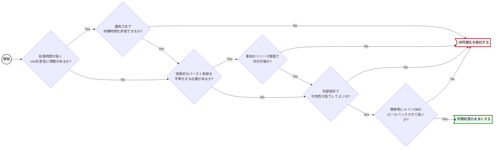

# 非同期化の判断基準

非同期処理は運用・保守コストを増大させるため、安易に導入せず必要最低限の範囲で検討する。
処理時間と応答性、負荷の平準化、レジリエンスの向上の3観点と検討フローで非同期化を判断する。
出典は [非同期設計ガイドライン](about.md) (CC BY 4.0) で、OKF の形式に合わせて分割、変更している。

## 非同期化の判断基準

非同期処理は同期処理と比較して処理のトレースやデバッグの難易度が上がり、運用・保守コストは増大する。そのため、安易に導入するのではなく必要最低限の範囲で検討することが重要である。

ある処理を非同期化するかどうかは、次の観点と検討フローで判断する。

### 処理時間と応答性

ある処理の処理時間が長く、呼び出し元が同期的な応答を待つことができない場合は非同期化を検討する。

例えば、ファイルのダウンロードの要求を受け付けてからダウンロードファイルを長時間生成する場合が該当する。同期的に生成するとエンドユーザーを待たせるため UX が低下する恐れがある。この場合、メッセージをキューに登録し呼び出し元には即時応答を返す。ファイルの生成処理は非同期処理として裏側で行い、処理完了後に呼び出し元へ通知することで、UX を最適化できる。

なお、応答時間の長い処理が呼ばれることは業務上限定的であり、呼ばれた場合に業務運用上の工夫で応答時間の長さが許容できる場合は、非同期化は不要と判断もできる。

### 負荷の平準化

ある処理が突発的に、大量に呼び出される可能性がある場合、負荷を時間的に分散するために非同期化を検討する。この場合、メッセージをキューに登録し実処理は非同期処理として裏側で行うことで、バーストによる負荷を平準化しつつスループットを最適化できる。

なお、バーストの規模と時期が予測でき、事前のリソース増強で運用上対応できる場合は、非同期化は不要と判断もできる。

### レジリエンスの向上

ある処理が外部のシステムや複数のデータストアに依存しており、依存している部分の処理をメインの処理とは独立して切り離せる場合は、非同期化を検討する。

例えば、あるメイン処理の終了処理として、外部システムの Web API を呼び出して処理結果を通知する場合が該当する。このようなケースでは Web API 呼び出しを非同期化することで、外部システムがダウンしていたとしてもメインの処理を継続させ、システムの継続性を高められる。

またDBにデータを登録した後、オブジェクトストレージにもデータを登録するケースなども該当する。どちらかの処理が失敗した場合にデータが不整合な状態で残り続ける（どちらか一方にしかデータが存在しない）ことを許容できない場合は、キューを介してデータストアへの書き込みを直列化する。非同期処理側で適切なリトライを行うことで、結果的なデータの整合性を担保できる。

なお、「外部システムダウン時にメイン処理自体がエラー終了すること」を許容でき、かつ「失敗したデータのリカバリを手動やバッチ等で行う運用コスト」が見合う場合は、非同期化による複雑さを避けて同期処理を選択することも合理的である。
