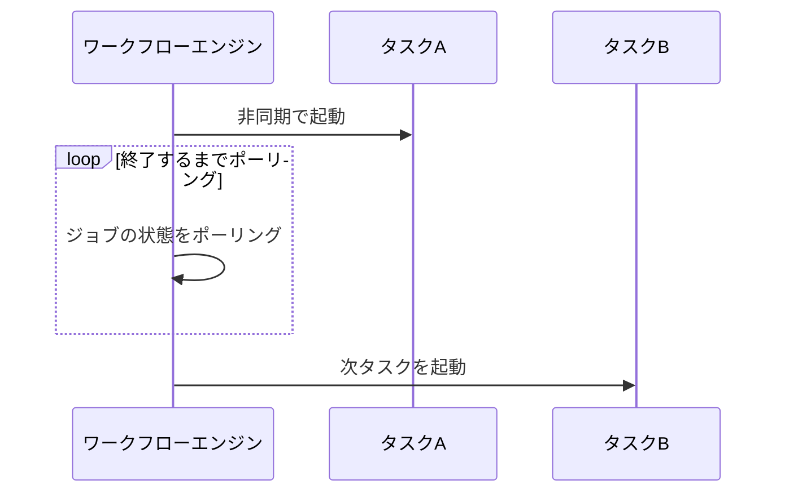
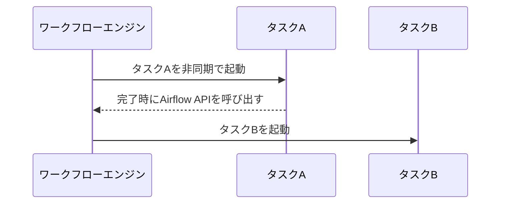
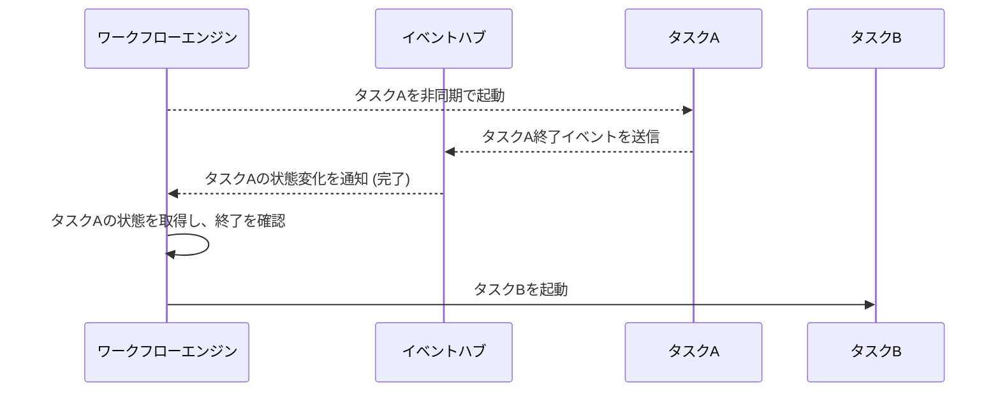

# 非同期タスクの呼び出し

ワークフローエンジンからの非同期タスクの終了判定は、原則ポーリングを採用し、API 呼び出し数がネックならイベント通知を検討する。
あるジョブから別のジョブを非同期・同期で呼び出すことは、運用やリカバリが難しくなるため原則非推奨とする。
出典は [バッチ設計ガイドライン](about.md) (CC BY 4.0) で、OKF の形式に合わせて分割、変更している。

## 非同期タスク

非同期タスクとは、呼び出された後はタスクの終了を待たずバックグラウンドで実行されるタスクである。マイクロサービスアーキテクチャやイベント駆動型アーキテクチャの普及に伴い、非同期ジョブの活用も広がってきている。キューイング（AWSにおけるSQS）などを経由して呼び出される場合や、サーバーレスでスタンドアローンタスクを非同期呼び出しする場合が該当する。バッチ処理の実行も非同期で呼び出される場合がある。

> [!NOTE]
> **参考**
>
> 実行環境は[バッチ実行モデル](batch-execution-model.md#バッチ実行モデルaws)の章に記載がある。本章では非同期の呼び出し方の方針をまとめる。

### 画面操作による非同期ジョブ呼び出し

重い処理を非同期化すれば、ユーザーの待機時間が短くなりUXの向上につながる。例えば帳票作成処理やアップロードファイルの取り込み（エンコーディングなど）を非同期化する。

> [!NOTE]
> **参考**
>
> 処理方式や注意点は[Web API設計ガイドライン \> 非同期](https://future-architect.github.io/arch-guidelines/documents/forWebAPI/web_api_guidelines.html#%E9%9D%9E%E5%90%8C%E6%9C%9F)に記載している。

### ワークフローエンジンから非同期ジョブ呼び出し

ワークフローエンジンからは、キューイングサービスの利用有無に関わらず非同期タスクを呼び出すことが多々ある。AWSの `ecs run task` はそもそも非同期呼び出しである。終了の判定には `ecs describe tasks` などでポーリング監視するか、アプリケーションレベルで終了イベントをコールバックする必要がある。

| \#           | （1）ポーリング                                                                                                                                                                                                  | （2）コールバック                                                                                                                                                                                                    | （3）イベント通知                                                                                                                            |
| :----------- | :--------------------------------------------------------------------------------------------------------------------------------------------------------------------------------------------------------------- | :------------------------------------------------------------------------------------------------------------------------------------------------------------------------------------------------------------------- | :------------------------------------------------------------------------------------------------------------------------------------------- |
| 図           | 図1（表の下）                                                                                                                                                                                                    | 図2（表の下）                                                                                                                                                                                                        | 図3（表の下）                                                                                                                                |
| 説明         | ワークフローエンジン側から非同期タスクの状態をポーリングして監視する手法                                                                                                                                         | アプリケーション側からワークフローエンジンのREST APIを呼び出し、次のタスクを起動する手法。直接呼び出す代わりに、キューイングシステムを経由してファンクションなどからREST APIを呼び出す構成もコールバックの一種とする | イベント連携サービス（AWSの場合はEventBridge）がタスク終了を取得できる場合に、そのイベントをワークフローエンジンが受信して終了を把握する方法 |
| 即時性       | ❌️ポーリング分遅延があり                                                                                                                                                                                         | ✅️随時連携が可能                                                                                                                                                                                                     | ✅️随時連携が可能                                                                                                                             |
| 信頼性       | ⚠️タスクが突如、異常終了した場合にワークフローエンジン側からの検知が難しい                                                                                                                                       | ❌️タスク異常終了時の検知および、コールバックの到達保証など障害ポイントが多い                                                                                                                                         | ✅️イベントハブへの連携が、クラウドベンダー側の責務であれば確実性が高い                                                                       |
| 制限         | ⚠️`ecs describe tasks` はAPI呼び出しのレート制限があるため、大規模システムでは採用しにくい。回避策として、アプリケーション側でオブジェクトストレージやDBにレコードを登録し、それをポーリングする方式が考えられる | ✅️なし                                                                                                                                                                                                               | ✅️なし。`ecs describe tasks` の呼び出し回数は削減できる                                                                                      |
| 結合度       | ⚠️オブジェクトストレージに状態を保存すると、外部サービスとの依存性が増える。ネイティブの状態取得サービスのみを利用する場合、結合度は下がる                                                                       | ⚠️コールバック呼び出し分、ワークフローエンジンと各タスクの結合度が増す                                                                                                                                               | ⚠️イベントハブの連携分、ロックイン度が高まる                                                                                                 |
| セキュリティ | ✅️なし                                                                                                                                                                                                           | ❌️ワークフローエンジン側のREST APIを呼び出し可能とするネットワーク設計/権限設計が必要                                                                                                                                | ✅️なし                                                                                                                                       |
| リソース     | ⚠️ポーリング中にリソースを占有する懸念がある（tipに緩和策を記載）                                                                                                                                                | ✅️なし                                                                                                                                                                                                               | ⚠️イベント受信待機でリソースを占有する懸念がある（tipに緩和策を記載）                                                                        |

図1

図2

図3

推奨は以下。

- 原則、（1）の方式を採用する
  - バッチ処理である以上、一定の遅延は許容されることが多いため
  - よりシンプルな構成にできるため
- 机上計算でAPI呼び出し数がネックになる場合は、（3）の導入を検討する

> [!TIP]
> **Airflowでのリソース占有の緩和策について**
>
> [MWAAでのリソース管理：Deferrable Operatorsによるワーカースロット解放の実践 \- Qiita](https://qiita.com/yust0724/items/3136179e4646db4430c5) が参考になる。

### あるジョブから非同期ジョブ呼び出し

あるジョブ（同期/非同期を問わない）から非同期ジョブを呼び出すと、ワークフローエンジンから制御しにくい（リランなどの運用も特殊になる）。そのため原則、非推奨とする。代替として、ワークフローエンジン側からの呼び出しに変えられないか検討する。

### あるジョブから同期ジョブ呼び出し

あるジョブ（同期/非同期を問わない）からの同期ジョブ呼び出しは、DBトランザクションが分離するため実質的に2相コミットとなる。エラー時のハンドリングやリカバリが難しくなりやすいため（※同期ジョブ側を冪等にすることで緩和は可能）、原則、非推奨とする。代替として、ワークフローエンジン側からの呼び出しに変えるか、同期ジョブのロジックをライブラリ化し関数呼び出しにできないか検討する。
