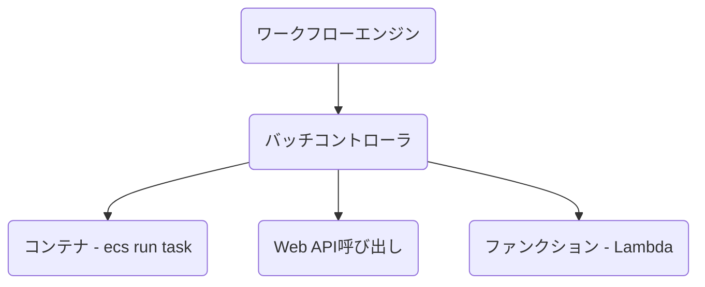

# バッチコントローラ

バッチコントローラは本ガイドライン独自の用語で、計算資源の呼び出し・流量制御・リトライ・終了判定を担う層である。
原則はバッチコントローラレス構成を採用し、ワークフローエンジンから直接コンピューティングを呼び出す。
出典は [バッチ設計ガイドライン](about.md) (CC BY 4.0) で、OKF の形式に合わせて分割、変更している。

## バッチコントローラ

バッチコントローラとは本ガイドライン独自の用語である。これを利用すると、ワークフローエンジンからバッチ処理を呼び出す際に、バッチコントローラを経由してコンピューティングリソースを起動する構成を取れる。バッチコントローラは、透過的な計算資源の呼び出し・流量制御・リトライ・タスクの終了判定などを責務として持つことも多い。これにより、ワークフローエンジンの責務を小さくし、バッチ呼び出しの統制を効かせられる。

【バッチコントローライメージ】

バッチコントローラ導入の是非を判断する観点を、下表にまとめる。

| \#         | （1）バッチコントローラあり構成                                                                                                                                            | （2）バッチコントローラレス構成                                                                                                                                                    |
| :--------- | :------------------------------------------------------------------------------------------------------------------------------------------------------------------------- | :--------------------------------------------------------------------------------------------------------------------------------------------------------------------------------- |
| 説明       | バッチ処理用のコンピューティングリソースの呼び出しを、バッチコントローラ経由で行う構成。バッチコントローラは任意の言語で実装できるため、技術スタックを揃えたい場合には有利 | ワークフローエンジンから直接、コンピューティングエンジンを呼び出す方式。SDKをワークフローエンジン側にインストールする必要がある。AirflowであればPythonでの実装量が増える傾向がある |
| 開発生産性 | ⚠️バッチコントローラ側に定義情報の登録が必要となることが多く、ワークフローエンジンのフロー定義以外の設定が必要                                                             | ✅️フロー定義は一箇所になる                                                                                                                                                         |
| 開発難易度 | ✅️バッチコントローラにバッチ呼び出しを集約可                                                                                                                               | ⚠️各ワークフロー定義にて、振り分けやリトライなどの制御を入れる必要がある。Airflowでは関数化などで緩和可能                                                                          |
| 運用性     | ⚠️バッチコントローラ分、障害ポイントが増える                                                                                                                               | ✅️必要最小限の構成                                                                                                                                                                 |
| 費用       | ❌️バッチコントローラ分のリソースが追加で必要。SPOFにならないよう冗長構成を取ることが多く、DBも必要となることが多い                                                         | ✅️必要最小限の構成                                                                                                                                                                 |

推奨は以下。

- 原則、（2）の方式を採用する
  - Airflowであれば、コンピューティングの呼び出しやリランなどの制御が比較的容易
  - レイヤーを減らすことで、管理対象を減らせる
