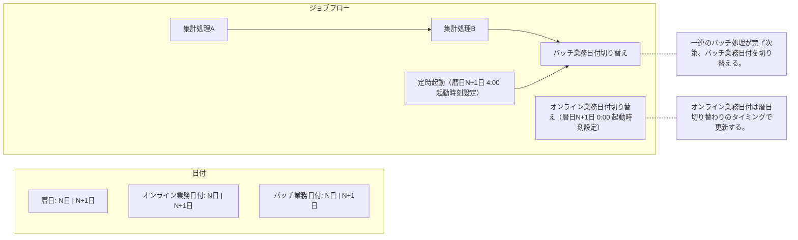
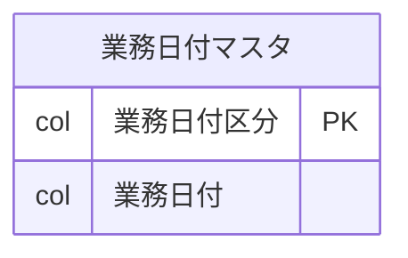
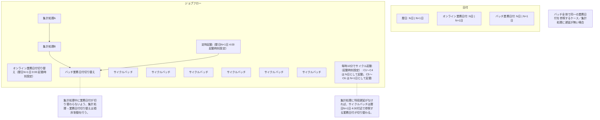
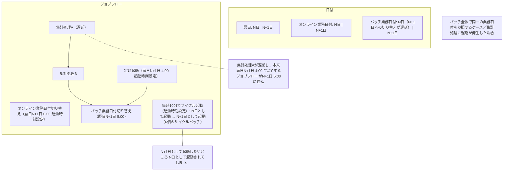
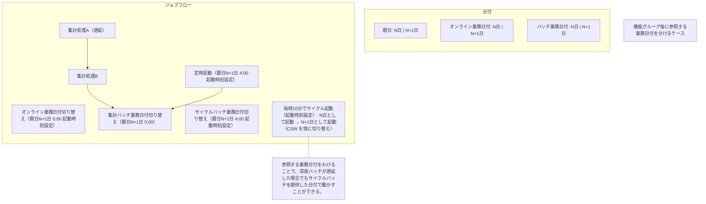
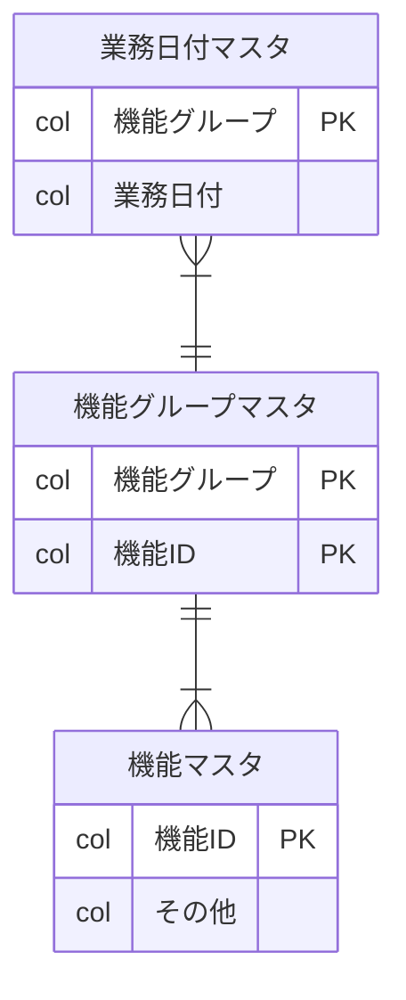

# 業務日付の日替わり管理パターン

業務日付管理には、暦日を直接参照する簡単なパターンから、機能グループ毎に切り替える複雑なパターンまで考えられる。
オンラインとバッチ、機能グループの単位で業務日付を分けると、深夜バッチが遅延してもサイクルバッチを期待した日付で動かせる。
出典は [バッチ設計ガイドライン](about.md) (CC BY 4.0) で、OKF の形式に合わせて分割、変更している。

## 業務日付管理パターン

業務日付管理には、暦日を直接参照する最も簡単なパターンから、機能ごとに業務日付を切り替える複雑なパターンまで考えられる。

### 暦日（システム日付を使用）

最も簡単なパターンとして、システム日付を使用して暦日を参照する方式がある。起動タイミングと処理対象データのズレが考えられない簡易なシステムであれば、あえて業務日付を管理しなくて良いケースもある。

原則、この方式は非推奨とする。ジョブのリカバリのため、翌日に前日のデータを処理したいといったことが難しくなるため。  
万が一採用する場合は、テストや後々の仕様変更に備え、参照日付を変更できるよう日付取得関数は共通化する。システムテストやリランのため、環境変数（例えば `BIZ_YMD` があればそれを利用する）の仕組みを予め備えておくと良い。

### オンラインとバッチで分離するパターン

オンライン機能とバッチで参照する日付をコントロールしたい場合、業務日付マスタのPKとして業務日付区分を定義するパターンが考えられる。オンライン機能は暦日と同様の日替わりタイミングとし、バッチ機能は一連のジョブフローが完了した後で業務日付を切り替える。オンラインは開局させ業務継続させつつ、一部のバッチだけは翌日の日中時間帯にリランさせるといった運用が可能となる。そのため通常、分離して管理することが望ましい。

また派生パターンとして、オンライン機能ではシステム日付を使用し、バッチ機能のみ業務日付マスタを参照する構成も考えられる。どういったタイミングで締めになるかが不透明であれば、両方とも業務日付マスタとして管理すべきである。オンライン側が暦日と同じにして良い場合は、以下のパターンも選択できる。

データ構造:

データイメージ:

| 業務日付区分 | 業務日付   |
| :----------- | :--------- |
| オンライン   | 2025/02/05 |
| バッチ       | 2025/02/04 |

> [!WARNING]
> **オンライン業務日付更新ジョブの起動方式として、起動に時間がかかる実行モデルを採用する場合、意図した更新タイミングから数分遅延し得る点に注意する。**
>
> 例えばECSスタンドアローンタスク（`ecs run task`）で業務日付を更新する場合、タスク起動指示から処理開始までは数分のラグが発生する。その分を予見して数分前に起動したとしても、数秒の誤差は発生してしまう。この遅延を許容できない場合はシステム日付を使用するか、Web API等の遅延が少ない処理方式を採用すると良い。

### 機能グループ毎に分離するパターン

さらに詳細に管理したい場合、機能グループ（たとえばサブシステム）を定義し、グループ毎に業務日付を切り替えるパターンも考えられる。

例として、以下3種類が存在する場合を考える。

- 暦日通りの日替わりタイミングを持つ業務日付を参照するオンライン機能
- 処理遅延などに備え、業務日付切り替えを遅らせたい深夜集計バッチ機能
- 暦日とは別タイミングで業務日付を遅延無く切り替えたいサイクルバッチ機能
  - 深夜集計バッチとサイクルバッチには依存関係が無いものとする

まず、バッチ全体で同一の業務日付を参照するケースを考える（悪い例である）。

- 集計処理→業務日付切り替えのジョブは順序制御、業務日付切り替えジョブには起動時刻設定を行い、合流設定とする。このケースではAM4:00に設定する
  - 順序制御により、集計処理が遅延しても途中で業務日付が切り替わることは無くなる
  - 起動時刻の設定により、想定より早く集計処理が完了しても、意図したタイミングで業務日付が切り替わる
- サイクルバッチは集計処理と同様の業務日付を参照しており、**集計処理に遅延がない場合**はAM4:00に参照する業務日付が次の日付に切り替わる

一方、集計処理が遅延した場合、AM4:00付近で起動するサイクルバッチはN+1日として起動するべきところ、N日として起動されてしまう。

この問題は、機能グループ毎に業務日付を定義するパターン（良い例である）で解消できる。

- 集計バッチとサイクルバッチで業務日付を分け、サイクルバッチ業務日付はAM4:00に切り替わるようジョブを設定する
- それぞれの業務日付が独立することで、ジョブ遅延による影響を受けない構成にできる

|               |               |
| ------------- | ------------- |
| 図1（表の下） | 図2（表の下） |

図1

図2

なお、このケースでも一部の業務日付をシステム日付とするなどの派生パターンが考えられる。適宜使い分けること。
