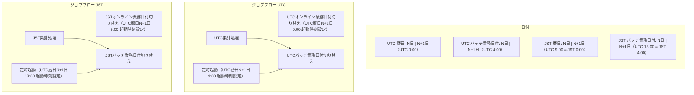
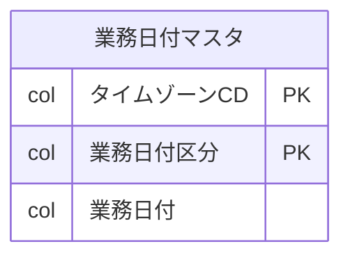

# 業務日付のタイムゾーン分離

2つ以上のタイムゾーンを扱う場合は、業務日付マスタの PK にタイムゾーンを追加して業務日付を分割する。
業務日付の取り扱いが複雑になりすぎないよう、必要最低限度の制御とする。
出典は [バッチ設計ガイドライン](about.md) (CC BY 4.0) で、OKF の形式に合わせて分割、変更している。

## タイムゾーン毎に分離するパターン

2つ以上のタイムゾーンを扱う場合、タイムゾーン別の業務日付管理を検討する必要がある。

RDBを業務日付の管理場所とする場合は、PKにタイムゾーンを追加することで業務日付を分割できる。前述した機能グループ毎の業務日付分割も必要な場合は、PKに機能グループIDを追加することで、さらに詳細な業務日付制御ができる。ただし、業務日付の取り扱いが複雑になりすぎるとアプリケーション品質に影響しかねないため、必要最低限度の制御とするよう留意する。

【管理イメージの例（記載簡略化のためオンライン業務日付=暦日として記載する）】

|               |               |
| ------------- | ------------- |
| 図1（表の下） | 図2（表の下） |

図1

図2

データイメージ:

| タイムゾーンCD | 業務日付区分 | 業務日付   |
| :------------- | :----------- | :--------- |
| UTC            | オンライン   | 2025/02/05 |
| UTC            | バッチ       | 2025/02/04 |
| JST            | オンライン   | 2025/02/04 |
| JST            | バッチ       | 2025/02/04 |
