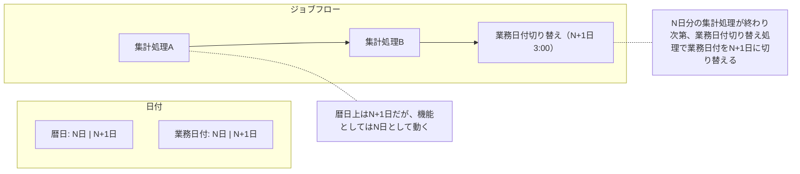

# 業務日付の定義と管理場所

業務日付は、暦日とは異なる日替わりタイミングを持つ日付で、起動タイミングに関わらず処理対象データを特定できる。
管理場所はシステムグローバルに参照できればよいが、本ガイドラインでは RDB で管理する前提とする。
出典は [バッチ設計ガイドライン](about.md) (CC BY 4.0) で、OKF の形式に合わせて分割、変更している。

## 業務日付

業務日付とは、特定の業務において一定のルールに基づく変わり目を持つ日付である。多くの場合、暦日とは異なる日替わりタイミングを持つ。例えば暦日上N+1日の夜間にN日分の集計処理をする場合、バッチ機能が参照する日付を暦日ではなく業務日付とすれば、起動タイミングに関わらず処理対象データを特定できる。

> [!TIP]
> 暦日を直接参照するパターンでN+1日にN日分の処理を行う場合、暦日-1日という指定をどこかで行う必要がある。この場合、起動タイミングをN日に変更しようとすると改修が必要になってしまう。

動作イメージとして、一連の夜間バッチが完了した後、業務日付切り替え機能からN+1日に更新する（DBであれば業務日付の値をUPDATEする）。

本ガイドラインでは業務日付と呼称する。ただし必ずしも「業務」範疇で使用する日付である必要はなく、文脈によってはバッチ日付と呼称する場合もある。

## 業務日付の管理場所

システムグローバルに参照できるのであれば、オブジェクトストレージ、RDB、KVS、DWH等いずれの管理場所でも問題は発生しない。ただし本ガイドラインではRDBで管理する前提とする。SQLの扱いやすさから通常、DBテーブルに保持することが多いため。
