# システムタイムチャート

ジョブ間に依存関係がある場合は、起動タイミング・依存関係・門限・バッチウィンドウをまとめたシステムタイムチャートをガントチャートなどで作成する。
出典は [バッチ設計ガイドライン](about.md) (CC BY 4.0) で、OKF の形式に合わせて分割、変更している。

## ドキュメント

バッチ処理がいつどのようなタイミングで起動するか、それぞれの依存関係、門限、各バッチウィンドウ（バッチ処理を動かしても良い最大の期間）を把握することは、保守運用の観点で非常に重要である。これを「システムタイムチャート」 「バッチスケジュール表」 「ジョブバーチャート」 などと呼ぶ。本ガイドラインでは「システムタイムチャート」と呼ぶ。

【簡易版: システムタイムチャートの例】

```mermaid
gantt
    dateFormat  HH:mm:ss
    axisFormat %H:%M
    tickInterval 15minute

    JOB001      :a1, 01:55:00, 15m
    JOB002      :a2, after a1, 25m
    JOB003      :a3, after a1, 40m
    JOB004      :a4, 02:35:30, 10m
    JOB005      :a5, after a3, 15m
    JOB006      :a6, after a5, 5m
    JOB007      :a7, after a5, 10m
    JOB008      :a8, after a5, 15m
    JOB009      :a9, after a8, 10m
    JOB010      :a10, after a9, 20m
```

最低限、どのジョブがどのように動くかを「ガントチャート」 や「バーチャート」の形式で記載する。門限となるイベント（開局や対向システムへのデータ送信の門限など）も記載すると良い。上図はmermaid.js で記載しているため、ジョブ間の依存関係を線で表現できないが、本来は記載したほうが分かりやすい。draw.io など別の作画ツールの利用も検討すると良い。PlantUMLではガントチャートに依存関係を書けるようである。

こういったシステムタイムチャートには以下のようなユースケースがある。

- あるジョブが失敗した場合、影響を受けるジョブと業務が何か把握して、暫定対応案の検討、エスカレーション、アナウンスを行いたい
- 新規にジョブを追加する場合、どれくらい時間的余力があるか確認したい

推奨は以下。

- ジョブ間に依存関係が発生する場合は、システムタイムチャートを作成しておく
  - 必要に応じて、ジョブの依存関係や定時起動などの起動条件を追記する

> [!NOTE]
> **参考**
>
> - [EXCELでバッチジョブのバーチャートを作る \- makaishiの日記](https://makaishi.hatenadiary.org/entry/20110216/1297868544)
> - [PlantUML でガントチャートを試した](https://zenn.dev/hokorobi/articles/573541863e7d0d6ac75b)
