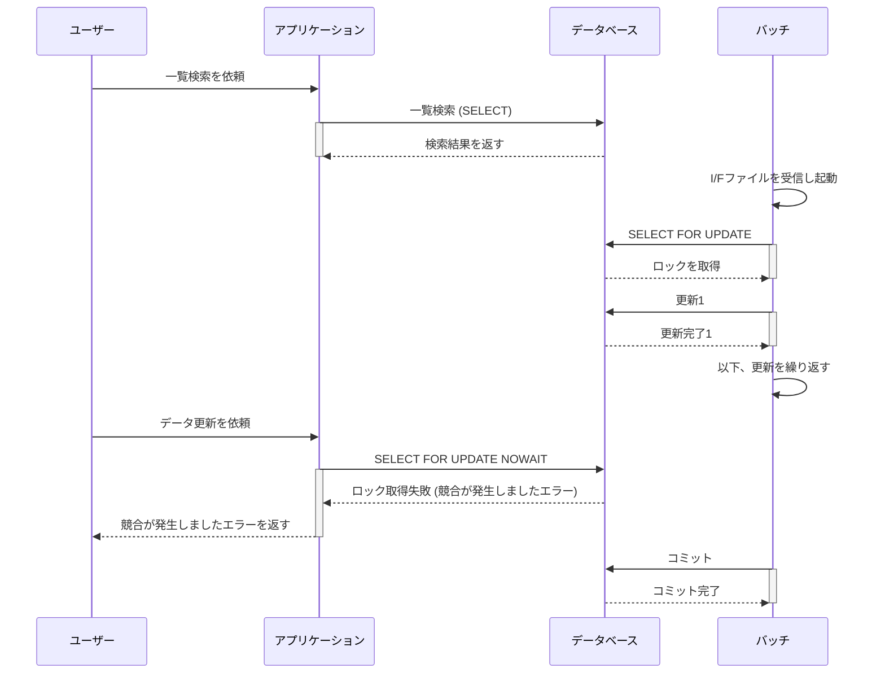
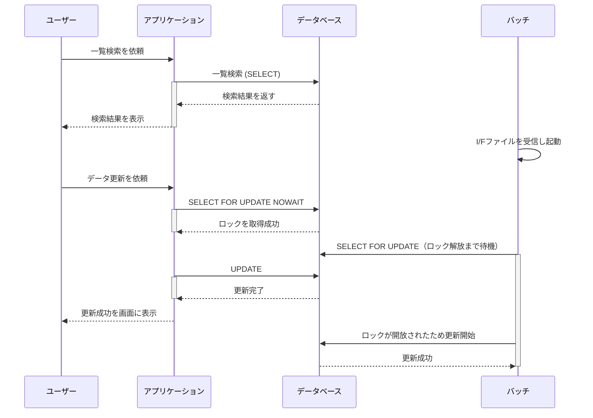
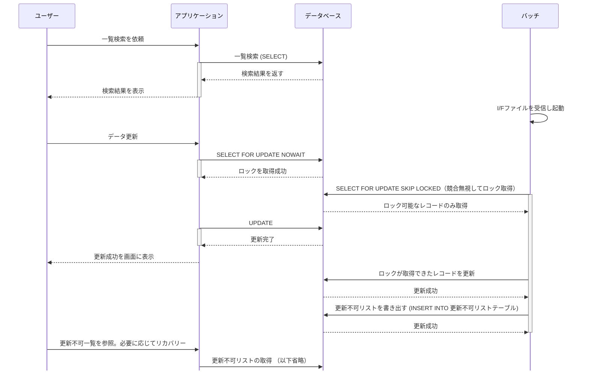

# オンラインとの排他制御

オンライン中バッチは、同一時間帯・同一テーブル・同一カラムの更新が重なるケースで排他制御を検討する。
対応は、常にバッチで上書きする方式か、部分更新して更新できなかったレコードを NG リストに出す方式から選ぶ。
出典は [バッチ設計ガイドライン](about.md) (CC BY 4.0) で、OKF の形式に合わせて分割、変更している。

## オンラインとの排他制御

オンライン中に実行されるバッチ処理を「オンライン中バッチ」（※現場によっては「オン中バッチ」とも呼ぶ）と定義する。

2C/2Bのアプリは画面の閉局が通常は存在しないため、定期メンテナンス時間で実行されるジョブ以外は全てオンライン中バッチとも言える。例えば以下のユースケースが存在する。

- ユーザーが商品在庫を手動で調整している最中にバッチ処理で自動在庫補充が行われる
- ECでユーザーから注文が入ったタイミングで、ちょうど商品在庫の自動発注バッチが動く
- 従業員のロール変更を登録している最中に、バッチ処理でリストが更新される

バッチ起動のトリガーは例えば以下が考えられる。

- システムI/Fファイルを日中オンライン開局中に受信し、テーブルを更新するバッチが起動
- ユーザーが一括取り込みファイル（数千～数万件程度）をアップロードし、一括で更新するバッチが起動
- WMS（倉庫管理システム）への発送配送指示の締め時間になり、バッチが起動

オンライン中バッチのうち、考慮が必要なケースを下表に記載する。

| 項目                   | 1.通常バッチ | 2.オンライン中バッチA | 3.オンライン中バッチB                                                                                                                                                                                                    | 4.オンライン中バッチC   |
| :--------------------- | :----------- | :-------------------- | :----------------------------------------------------------------------------------------------------------------------------------------------------------------------------------------------------------------------- | :---------------------- |
| 条件: 同一時間帯に起動 | ー           | ✔                     | ✔                                                                                                                                                                                                                        | ✔                       |
| 条件: 同一テーブル更新 | ー           | ー                    | ✔                                                                                                                                                                                                                        | ✔                       |
| 条件: 同一カラム更新   | ー           | ー                    | ー                                                                                                                                                                                                                       | ✔                       |
| 排他制御の要否         | 不要         | 不要                  | 4と同様にするか、[lock_no](https://future-architect.github.io/arch-guidelines/documents/forDB/postgresql_guidelines.html#共通カラム)の更新無しでレコードを更新する。バッチ同士の多重起動は別で制御するか冪等な作りとする | 個別検討が必要（※後述） |

3については、排他制御をシンプルにするためテーブルを分割するのも手である（例えばバッチはテーブルロック、オンラインは行ロックのように排他制御の粒度が異なる場合、区別したほうが業務効率を上げられる可能性がある）。

4の対応方法は大別すると以下2つがある。

| \#            | 1.バッチの起動スケジュール調整                                                                                           | 2.排他制御を加える                                               |
| :------------ | :----------------------------------------------------------------------------------------------------------------------- | :--------------------------------------------------------------- |
| 説明          | 業務システムであれば閉局中に、2C/2Bアプリであればメンテナンス期間にバッチを実行できないか検討する                        | オンライン側とバッチ側の排他制御を加える                         |
| UX/業務効率性 | ❌️業務遂行時間への制約が生じる可能性や、バッチ処理実行で得られるはずだったユーザビリティやデータ鮮度が犠牲になってしまう | ✅️適切な排他制御を加えれば、整合性を守りつつ業務効率を上げられる |
| 対応工数      | ✅️システム的な対応は最小限にできる                                                                                       | ❌️状況に適した排他制御方針を設計、テストする必要がある           |

1が難しい場合は、2の対応を検討する。次のような対応案がある。

|      | 1.常にバッチで上書き                                                                                                                                                          | 2.部分更新+NGリスト表示                                                                              |
| :--- | :---------------------------------------------------------------------------------------------------------------------------------------------------------------------------- | :--------------------------------------------------------------------------------------------------- |
| 説明 | バッチは操作するユーザーがいないため、バッチでの更新を常に優先して後勝ちで更新する。場合によっては起動時にテーブルロックを取得し、悲観ロックする                              | バッチ起動時にロックが取れなかった、あるいはバッチ起動時刻より最終更新時刻が新しい場合はスキップする |
| Pro  | ✅️実装がシンプル                                                                                                                                                              | ✅️ユーザー入力がバッチ競合で登録できない点は救済可能 ✅️競合が無いレコードへの処理は遂行できる        |
| Cons | ❌️ユーザーの入力情報がバッチ競合で登録不可になる可能性 ❌️更新内容がバッチで知らないうちに上書きされるおそれがあり、通知やリカバリの有無などの設計や業務調整が必要となる可能性 | ❌️スキップした一覧を表示する画面の準備や、業務運用が必要                                             |

それぞれ詳細を説明する。

### 常にバッチで上書き

オンライン側の更新フローでは悲観ロック (SELECT FOR UPDATE) をしてもらう。ロックが競合した場合に常にバッチが勝つよう、画面側はNO WAITを指定する。バッチ側は一定期間（例えば数分）WAITする。待ち時間はバッチウィンドウを加味して決定する。

バッチ処理でオンライン処理と同じデータを編集する場合は、更新前にSELECT FOR UPDATEを取り、かつ画面側でも後述のケース2とすることで、バッチ実行中のオンライン変更を禁止（待たせる）ことができる。

PostgreSQLではデフォルトのロック取得タイムアウトが無限であるため、オンライン側ではNO WAIT（ないしは数秒のタイムアウト）、バッチ側ではオンライン側の処理タイムアウトより長い時間まで待機させると良い。これにより、バッチ実行前にたまたまオンラインで変更があったとしても、楽観的ロックによる失敗をリトライする実装無しでバッチ処理を継続できる（※バッチの書き込みを常に優先させて良い場合）。

ロックをバッチ・オンラインのどちらで取得したかでケース1・ケース2のような排他制御となる。

| ケース1: バッチがロックを先取り | ケース2: オンラインがロックを先取り |
| :------------------------------ | :---------------------------------- |
| 図1（表の下）                   | 図2（表の下）                       |

図1

図2

ケース1に該当すると、ユーザーは入力したフォーム内容が無効化される。発生頻度の想定や再入力支援（入力値をLocal Storageに記録しておくなど）を検討すること。

### 部分更新+NGリスト表示

オンライン側の更新フローでは悲観ロック (SELECT FOR UPDATE) をしてもらう。ロックが競合した場合、バッチ側は対象レコードをスキップ (SKIP LOCKED) し、ロックが取れたレコードのみを更新する。このパターンには、ユーザー操作で更新したレコードをバッチでなるべく上書きしたくない背景が考えられる。そのため、特定の更新日時以降のレコードは一律更新をスキップするなどの合わせ技な要件になることもある。

また、更新が失敗したレコードのリカバリを諦めるか、復帰業務を追加するか、次回ジョブで救済するかといった判断が必要となる。

> [!NOTE]
> **参考**
>
> [図解でなっとく！トラブル知らずのシステム設計　エラー制御・排他制御編](https://www.amazon.co.jp/dp/B07B649FBM) 9話でバッチ処理の排他制御が詳しく説明されており、お勧めである
