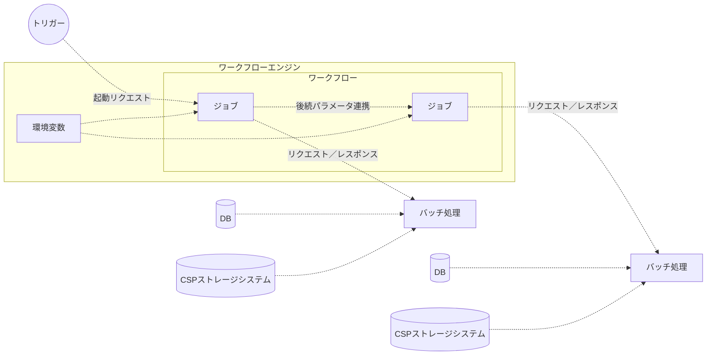

# バッチのパラメータ管理

値が変わり得るパラメータはコードに宣言せず、環境変数などでワークフローエンジンから渡す。
パラメータは特性ごとに管理場所 (起動時引数・ジョブ間連携・環境変数・内部定数・コード定数・DB・CSPストレージ) を使い分ける。
出典は [バッチ設計ガイドライン](about.md) (CC BY 4.0) で、OKF の形式に合わせて分割、変更している。

## パラメータ

[Twelve-Factor App](https://12factor.net/ja/) にも記載されている通り、デプロイメント環境等によって値の変わり得るパラメータやチューニングパラメータはコード上で宣言せず、環境変数としてワークフローエンジンから渡すか、envファイル等で管理することが望ましい。環境変数化しておくと、変更可能な箇所がより明示的になり保守運用フレンドリーでもある。また、あるジョブが動いたことによって決まる動的なパラメータも存在する。これらの受け渡し手法を統一しておかないと、影響度調査や改修などの運用コストが高くなる。リラン操作を簡易にするには、ワークフローエンジンからパラメータを上書きできるようにすると便利な場合もある。

このように、ジョブに受け渡すパラメータは、種類ごとにどこで管理するかという方針を決めておく必要がある。

### パラメータの管理

パラメータの特性に応じて管理場所を使い分ける必要がある。

#### ワークフロー起動時のパラメータ

外部プログラムや管理画面から実行時にパラメータを受け取る。

- 管理対象
  - 実行の度に変動し、ワークフロー全体で利用するパラメータの連携に利用する
- 理由
  - リトライ時にパラメータを一部修正して実行可能であるため
  - 時刻といった時間によって変動する情報をワークフロー内で固定して扱うため
- 利用方針
  - 外部プログラムとの結合度が高くなることを避けるため、パラメータ数は最小化する
  - パラメータ数が動的に変わる場合は、リスト形式で全量をバッチ処理に引き渡す方式を検討する
- 例
  - 処理対象日付、処理対象ファイル名

#### ジョブ間での後続連携

依存関係を持つ上流ジョブからパラメータを受け取る。

- 管理対象
  - 後続ジョブの処理対象を特定するキー情報の連携に利用する
- 理由
  - ジョブの結果によって後続ジョブで利用するデータが動的に変動する場合、DBに保存しない一時的な情報及びDBへ保存するデータのキー情報を引き渡す必要があるため
- 利用方針
  - タスク間での依存度が高くなることを避けるため、ジョブ間で連携するパラメータ数は最小化する
- 例
  - 中間ファイル名、中間テーブルのキー情報

#### ワークフローエンジンの環境変数（AirflowのVariables等）

すべてのワークフローから参照可能な値を指す。

- 管理対象
  - 複数のワークフローで共通して利用するパラメータの管理に利用する
  - デプロイメント環境ごとに異なる情報（エンドポイント等）の管理、デフォルトのリトライ回数やタイムアウト設定の保持、特定の機能を有効化・無効化するフラグなど、用途は様々である
- 理由
  - Twelve-Factor Appなど、業界標準の考え方に準拠するため
- 利用方針
  - Git等で変更履歴を管理し、容易にデプロイ可能な環境を構築することを推奨する
  - 秘匿情報を含む情報の場合はCSPストレージシステム（AWS Secrets Manager等）の利用を検討する
- 例
  - タスク定義のARN、ログレベル

#### ワークフロー内部定数（AirflowのDAGのparams等）

単一のワークフロー内で利用する静的なパラメータを指す。

- 管理対象
  - ワークフローやタスク固有のパラメータの管理に利用する
- 理由
  - ワークフローやタスク固有のパラメータを環境変数等で保持すると、ワークフロー数の増加に伴い環境変数等の肥大化を招く恐れがあるため個別定義する
- 利用方針
  - 値を変更する際にワークフロー定義のデプロイを許容できる程度の変更頻度であるパラメータのみ利用する
  - 変更頻度の高いパラメータは環境変数やリクエストパラメータとして管理することを検討する
- 例
  - リトライ回数、タイムアウト設定

#### コード上の定数

アプリケーションのみで利用する定数を指す。当然ながら、パラメータの変更にはアプリケーションのリリースが必要となる。

- 管理対象
  - アプリケーションの起動中に変更されないパラメータの管理に利用する
  - デプロイメント環境でも変化しない、全環境同一で良い値であることを前提とする
- 理由
  - 変更が無い値は環境変数化しないことで、管理コストを減らすため
- 利用方針
  - アプリケーションのリリース無しに変更する必要がある値は、DBに保持するか、環境変数を利用しワークフローエンジンから受け取る方式とする
- 例
  - 出力ディレクトリ名

#### DB

アプリケーションから参照可能なパラメータを管理する。DBの値を更新すれば、アプリケーションのリリースなしにパラメータを変更できる（ただし、DBのデータパッチは何かしら承認フローを設定することが望ましい）。

- 管理対象
  - ユーザー操作やバッチ処理等によって更新されるパラメータの管理に利用する
- 理由
  - アプリケーションの操作やバッチ処理によって変動したパラメータを用いてバッチ処理を実行する場合、最新の値を取得する必要がある。データ操作の容易性やトランザクション管理の観点からDBの利用を推奨する
- 利用方針
  - 大量のデータを後続ジョブに引き継ぐ場合は、ワークフローエンジンの負荷・データ整合性・保守性の観点から、キー情報のみジョブ間での後続連携を行い、実データは後続ジョブから直接取得する方針とする
  - 複数の業務処理から同一のテーブルを参照・更新する場合は、デッドロックやロックの競合による遅延に配慮した設計とする
- 例
  - 各種マスタ情報、中間テーブル

#### CSPストレージシステム（AWS Secrets Manager等）

アプリケーションから参照可能なパラメータを管理する。認証情報の管理にAWS Secrets Managerといったサービスを利用することを想定する。暗号化要件が厳しいなどDBで管理できない場合は、パラメータの特性に応じてストレージを使い分ける方針とする。

- 管理対象
  - 要件に応じてDB外に保存する情報の管理に利用する
- 理由
  - セキュリティや性能、コストといった要件に応じて適切なストレージシステムを選択する必要がある
- 利用方針
  - 紐づく情報（認証情報のID、S3のキー等）をDBに保存し、アプリケーションから容易に利用できるものとする
  - データの登録・更新時はDBとその他ストレージシステムの2箇所を更新する必要がある。そのため、データの整合性担保に配慮した設計とする
- 例
  - クライアントID、クライアントシークレット、画像データ、大規模ファイル

### バッチ処理起動時のパラメータの指定

前節の通り、デプロイメント環境別の設定は原則、環境変数を利用することを推奨する。

Amazon ECSを利用する場合、コンテナ起動時は事前に定義したタスク定義と呼ばれるテンプレートを利用する。その一部パラメータを上書きすることで、柔軟な実行が可能である。上書きできるパラメータは以下の通りである。

- ネットワーク設定
- ロール
- コンピューティングリソースの種類（EC2 or Fargate）
- 実行環境のスペック
- 実行引数
- 環境変数

環境変数を上書きすれば、同一イメージを利用するタスク定義を異なる設定値で起動できる。一方、環境変数以外の値の上書きは下記のようなデメリットが考えられるため、非推奨とする。

- 管理の複雑さ
  - どの設定がいつ使用されたのか把握しづらく、設定の追跡や管理が複雑となる
  - IaCでインフラ設定をコード化している場合、インフラでの設定値が実態と乖離する
  - 実行環境の種類やスペックを動的に変更できるようにすると、コスト管理が煩雑になる
- セキュリティリスク
  - ロールやネットワーク設定などを動的に変更可能とすると、セキュリティリスクが高まる
  - 実行引数で特定の環境や設定を強制すると、依存するライブラリやパッケージの動作の不正な変更や、特定のセキュリティ対策の無効化につながる可能性がある。例えば、デバッグモードの有効化は、本番環境では情報露出の原因になり得る
