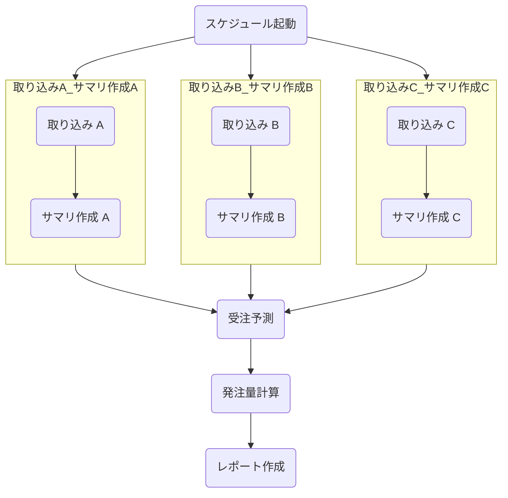
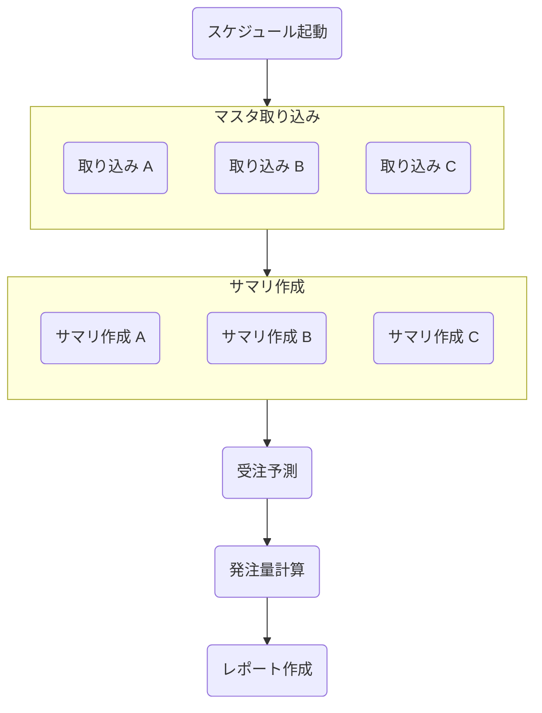
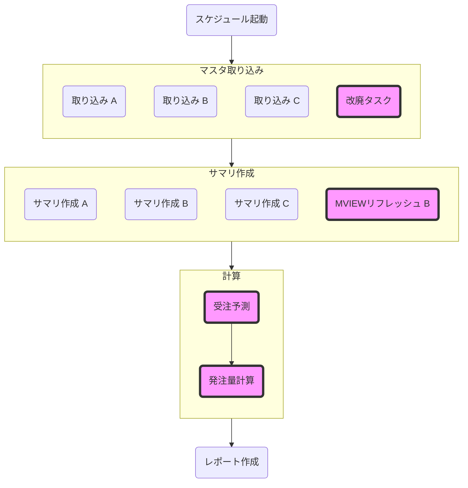

# ワークフロー設計（命名・ネスト・依存）

ワークフローは目的や役割が分かる名前を付け、ネストは原則3階層までに抑えてフラットに管理する。
フロー間の依存は原則ワークフローエンジンのイベント通知で表現し、浅い層から呼び出す。
出典は [バッチ設計ガイドライン](about.md) (CC BY 4.0) で、OKF の形式に合わせて分割、変更している。

## ワークフロー設計

主な設計観点として以下の項目がある。

1. ワークフロー命名規則
2. ネスト階層数
3. フロー間の依存設定

### ワークフロー命名規則

ワークフローの命名は保守運用性に直結する。`dag1` や `task1` といった連番ではなく、目的や役割が明確な命名をすべきである。[ワークフローエンジン導入パターン](workflow-engine-adoption.md#ワークフローエンジン導入パターン) 章の通りシステムごとに構築する前提であれば、システム名などのプレフィックス・サフィックスは不要である。

推奨は以下。

- 表示名: {メインの機能名}
  - 日本語にしても良い
- ID: {メインの機能名}
  - `calc_order など`

✅️発注量計算するワークフローの命名

```text
calc_order
```

❌️不適切なワークフローの命名

```text
dev_myproject_calc_order_v1
```

### ネスト設計

ワークフローは、AirflowではTaskのグループ化、JP1ではジョブネットを用いてネストさせ、抽象的に管理できる。

全体のタスク数の規模や複雑度に大きく依存するが、一般的にネストを深くしすぎると、運用時の操作性が複雑になり、過度な抽象化で具体的な処理内容の把握も難しくなるというトレードオフが存在する。

推奨は以下。

- 原則、最大のネスト数を3階層に抑える（※基準となる数値はチームごとに決めて良い）
- ワークフローはできる限りフラットに管理し、見通しが悪くなってきた場合にネスト化を検討する
- ネスト化は、処理レイヤー（例えばファイル受信、加工・ファイル送信など）や、機能分類など、関連性がある場合に用いる（良い命名ができる場合にのみ留める）
- リランのしやすさを考慮して、ネストを設計する
  - 例えば、処理レイヤー（ファイル受信など）単位でネスト化すると、リランは全ファイル種別を再取り込みする、という意味合いが生まれる
  - あるファイル種別のみリランしたい場合を考えると、ネスト化は処理レイヤーではなく機能分類の方が望ましい可能性もある
- ネスト化させる場合、レベル感が同一のタスクのみとする（例えば、特定のタスクのみ際立って実行時間が長い場合は、分離することを検討する）

以下の場合はネストしたワークフローを作成しない。

- 全体のタスク数が20未満と少ない場合（※基準となる数値はチームごとに決めて良い）
- ネスト対象のタスク数が、2以下である場合（※基準となる数値はチームごとに決めて良い）
- ネストしたタスクの集合を示す、良い命名ができない場合

| ✅️例: 機能分類でネスト化                                                         | ❌️例: 関連性は高いが処理レイヤーでネスト化                                                                           | ❌️例: レベル感が不揃いのネスト化                                                                                                                  |
| :------------------------------------------------------------------------------- | :------------------------------------------------------------------------------------------------------------------- | :------------------------------------------------------------------------------------------------------------------------------------------------ |
| 関連度の高いタスクを集約し視認性を上げ、リランはファイル種別単位で行うことを想定 | 関連度の高いタスクを集約し視認性を上げているが、リランのユースケースとして、全ファイル種別をやり直すことは考えにくい | マスタ取り込みに改廃処理が存在し名称と不一致。サマリ作成にMVIEWリフレッシュがありレベル感が不一致。受注予測と発注量を束ねた名称の抽象度が高すぎる |
| 図1（表の下）                                                                    | 図2（表の下）                                                                                                        | 図3（表の下）                                                                                                                                     |

図1



図2



図3



> [!NOTE]
> **参考**
>
> [JP1ジョブ設計のポイント（初級） | フューチャー技術ブログ](https://future-architect.github.io/articles/20210204/)

### フロー間の依存関係

フローAの終了後に、フローBを呼び出したい場合がある。結合度が高ければA、Bを統合することも考えられるが、業務的な区切りを表現したいなど、分離させたまま管理したい場合も多い。この時、フロー同士の依存関係の表現・管理には、いくつかの方式が考えられる。

| \#       | （1）ワークフローエンジンのイベント通知                                                            | （2）外部データストア経由                                                                                  |
| :------- | :------------------------------------------------------------------------------------------------- | :--------------------------------------------------------------------------------------------------------- |
| 説明     | 上流のフローの完了を下流のフローが監視するか、上流のフローの最後に下流のフローの起動を呼び出す方式 | DAG間で直接依存関係を持たせず、データストア（S3, GCS, DBなど）を介してデータを連携する方式                 |
| 例       | Airflowでは `ExternalTaskSensor` や `TriggerDagRunOperator`、JP1ではイベント送信が該当             | オブジェクトストレージへのputイベントなどが該当                                                            |
| 視認性   | ✅️ワークフローエンジン側のビューアなどで依存関係が表示され便利                                     | ❌️ビューア上は依存関係が表示されない                                                                       |
| 柔軟性   | ⚠️連携対象のフローを明示的に指定する必要があるため、結合度が上がる                                 | ✅️各DAGは独立性を高くしてデプロイできる                                                                    |
| 運用性   | ✅️リランや手動実行などの運用は通常の差が無い                                                       | ⚠️リランはデータストアへの操作が必要になり、運用難易度が上がる。ただしリラン用のタスクを作成すれば緩和可能 |
| 保守対象 | ✅️インフラ対象としては最小限                                                                       | ❌️外部データストアのインフラ管理対象が増える                                                               |

推奨は以下。

- 原則、（1）を採用する
  - Airflowであれば実装コストが低い（外部データストアを経由させるほうが、手数が増える）
- （1）を採用し、上流のフローから下流のフローを明示的に呼び出す場合は、ネストの深いところではなく浅い層から呼び出す
  - 依存関係を明示的にし、視認性を上げるため
