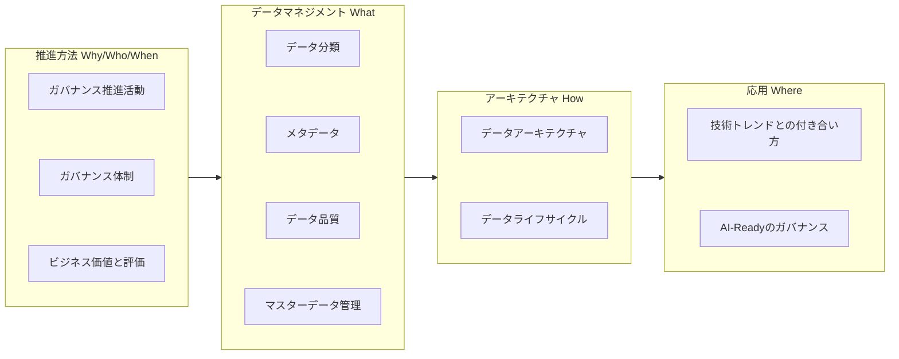

# データガバナンス設計ガイドラインの出典と適用範囲

`docs/data-governance/` の文書は、フューチャー株式会社の [データガバナンス設計ガイドライン](https://future-architect.github.io/arch-guidelines/documents/forDataGovernance/) を元にしている。
データをビジネス資産として活用するための、全社的なルールと体制（ガバナンス）の設計と実行を対象にする。

## 出典とライセンス

- 原文: [データガバナンス設計ガイドライン](https://future-architect.github.io/arch-guidelines/documents/forDataGovernance/data_governance_guidelines.html) (フューチャー株式会社、[future-architect/arch-guidelines](https://github.com/future-architect/arch-guidelines))
- ライセンス: [CC BY 4.0](https://creativecommons.org/licenses/by/4.0/deed.ja)
- 作成者: 真野隼記、加藤剛、柴田健太、市川裕也、曽田弘規、藤田春佳
- レビュアー: 中神孝士

### 原文からの変更点

- 1つの文書を、責務ごとに複数の文書に分けた。
- 各文書に OKF の frontmatter と、冒頭の要約を足した。
- VitePress の記法 (`<page-title/>`、`::: tip` などのコンテナ、見出しの `{#id}`) を、GitHub の Markdown の記法 (`> [!TIP]` など) に置き換えた。
- 原文の章へのリンクを、分割後の文書へのリンクにした。他のガイドラインへのリンクは、原文のサイトの URL にした。
- 原文のトップページ (VitePress のホーム) にあった全体像の図を、下の「位置づけ」の節に mermaid のコードブロックとして移した。

## 位置づけ

本ガイドラインは、読者がデータガバナンスの全体像を体系的に理解できるよう、物理的な章立てはフラットに記載しつつも、論理的には4つのグループで構成されている。

1. **推進方法（Why / Who / When）:** なぜガバナンスを推進し、どんなビジネス価値を生むのか（Why）。誰がそのルールを作り推進するのか（Who）。そして、組織の成熟度に合わせて「いつ」どのルールを段階的に適用していくのか（When）という戦略と体制を定義する
2. **データマネジメント（What）:** データ分類、メタデータ、データ品質、マスタ管理といった、具体的に何を管理対象とするのか（What）、各領域の指針を定める
3. **アーキテクチャ（How）:** データ基盤への連携方針やライフサイクルなど、定めたルールをシステムとしてどのように実現・運用するのか（How）を定義する
4. **応用（Where）:** 最新の技術トレンドや生成AIに対して、このガバナンスをどこへ適用し、将来的にどう発展させていくのか（Where）を示す

全体像と各章の論理的なマッピングは以下の通りである。

## 適用範囲と前提条件

- **対象スコープ**
  - データをビジネス資産として活用するための、全社的なルールと体制（データガバナンス）が対象
  - 「誰が、どのデータに、どのような権限と責任を持ち、どう管理するか」という意思決定の枠組みを扱う
  - 具体的な実装（ETL の構築、DB の運用など）を担うデータマネジメントは、本ガイドラインの対象外とし、[データマネジメント設計ガイドライン](https://future-architect.github.io/arch-guidelines/documents/forDataManagement/datamanagement_guidelines.html) に委ねる
- **前提条件**
  - クラウド型のデータ基盤 (Snowflake、BigQuery など) の利用を基本とする
  - 完璧なルールを最初から作るのではなく、組織の成熟度に合わせて段階的に進化させることを前提とする

## 免責事項

原文の免責事項を引用する。

> [!WARNING]
>
> - 有志で作成したドキュメントである。フューチャーには多様なプロジェクトが存在し、それぞれの状況に合わせて工夫された開発プロセスや高度な開発支援環境が存在する。本ガイドラインはフューチャーの全ての部署 / プロジェクトで適用されているわけではなく、有志が観点を持ち寄って新たに整理したものである
> - 相容れない部分があればその領域を書き換えて利用することを想定している。プロジェクト固有の背景や要件への配慮は、ガイドライン利用者が最終的に判断すること。本ガイドラインに必ず従うことは求めておらず、設計案の提示と、それらの評価観点を利用者に提供することを主目的としている
> - 掲載内容および利用に際して発生した問題、それに伴う損害については、フューチャー株式会社は一切の責務を負わないものとする。掲載している情報は予告なく変更する場合がある
