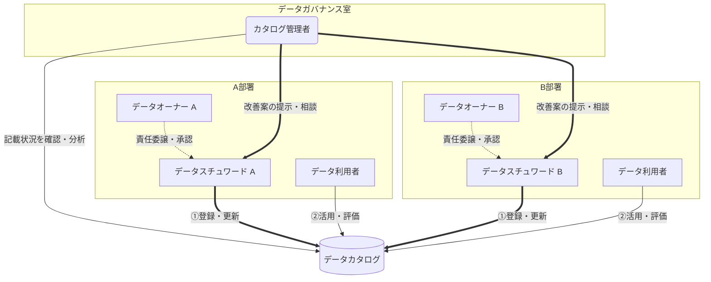
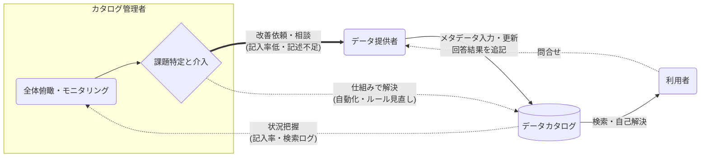

# メタデータの入力責任と観測

メタデータはデータオーナーが入力責任を持ち、カタログ管理者が記入状況を俯瞰して推進する。自動化とAIで持続可能性を高める。
カタログの利用ログやメタデータの統計を観測してファクトベースで施策を打ち、データリネージは自動生成する。
出典は [データガバナンス設計ガイドライン](about.md) (CC BY 4.0) で、OKF の形式に合わせて分割、変更している。

## 入力責任

ビジネスメタデータは、最終的に誰がオーナーシップを持つかで成否が決まる。また、方針の提示だけで後は「各チームにお任せ」スタイルでは基本的に前に進まない。そのため、入力を推進する旗振り役が必須である。

データカタログに関する、ロールごとの主な役割を以下に示す。

- データ提供者（データオーナー）の責務
  - ビジネスメタデータの入力・問い合わせ対応
  - データオーナーはそのデータの公開範囲の決定や、アクセス承認の判断をする責務がある。通常、忙しいのでメタデータ管理の実務は、データスチュワードに移譲しても良い
  - 問い合わせに対する回答は、カタログの「FAQ」や「説明文（descriptionなど）」に転記し、再発を防ぐ
- データカタログ利用者
  - お客様ではなく、コミュニティの一員としての振る舞いを期待する。そのため、まず記載内容を読むことを徹底する。カタログ内容を読まず、直接データオーナーへの問い合わせは禁止する
  - 記載内容のフィードバック（分かりにくい部分や改善案の提示）、口コミ、評価（助かったなど）を行い、提供者側の貢献を可視化する。カタログを読んだうえで、不明点を問い合わせる（ルールに則ることで、ログを蓄積する。これも立派な貢献活動である）
- カタログ管理者（推進者）
  - ビジネスメタデータの全体記入状況の確認、分析
  - チームごとに、記入が不完全、記入率が低い場合は推進依頼
    - もっと良い書き方が無いか提示し、サンプルを示す
    - 自チームのメタデータ記入を率先して行い、背中を見せる
    - 「メタデータ記入祭り」などのイベント/勉強会を開催してリードする
  - ブロッキング要素があれば、解消に向けてアクション、方針を決める
  - 利用者視点で、不足している管理項目が無いか、過剰な情報提供になっていないか確認
  - 提供者視点で、業務負荷が過剰になっていないか確認。システムによる自動化で省力化できる余地が無いか検討
  - ※後述する、[利用状況を観測する](#利用状況を観測する) 節の可視化も活用しながら実施する

ビジネスメタデータ記入により、「未来の自分の待ち時間を減らす」や「よくある質問としてカタログに還元される」という正のサイクルが維持される。このサイクルの中でどこに課題があるかの特定は、カタログ管理者（推進者）のような横断的・俯瞰的立場で行うしかない。カタログ管理者が介入することで、以下のようにサイクルを回せる。

例えば、「あるテーブルへの問い合わせが月に5件発生している」ことを管理者が検知した場合、オーナーへ「よくある質問としてカタログに追記しませんか？」と提案する。結果として翌月からの問い合わせがゼロになり、利用者の待ち時間も、オーナーの対応時間も減る。この実体験が、メタデータ入力を継続するためのモチベーションとなる。

## 自動化による持続可能性の向上

ビジネスメタデータの入力は、[入力責任](#入力責任) 節にあるように、推進側・入力側の双方の負荷が高く、利用者のフィードバックも欠かせないため実行コストが高い。さらに、手動メンテナンスは必ず陳腐化するため継続的な人的投資が必要となる。

そのため、基本原則として、AIにベットしテクノロジーで補完する方針に立つことが現実的である。AIの記載内容は担当者によるものに比べ、不正確かつ冗長になりがちであるため、上手く使い分ける。

- MUSTライン
  - 実際のテーブル定義、スキーマ情報から取得できる内容は全て自動化する（人手を介さない）
- 準MUSTライン
  - データプロファイル結果を表示する（総件数や、各列の最大、最小、平均、中央値など）
  - サンプルデータの表示（実データを見たほうが100倍早く理解できる場合も多い）
- WANTライン
  - 実行ログから補完したリネージ
  - よく結合して用いられる上位10テーブルを表示するなど
- チャレンジライン
  - テーブル説明のAIによる自動生成・補助
  - この場合、「✨️AIによるテーブル説明文の自動生成」といったラベルを用意し、人間による編集部分と区別する

## ツール選定

データマネジメント設計ガイドラインの[ツール選定の評価軸の例](https://future-architect.github.io/arch-guidelines/documents/forDataManagement/datamanagement_guidelines.html#%E3%83%86%E3%82%99%E3%83%BC%E3%82%BF%E3%82%AB%E3%82%BF%E3%83%AD%E3%82%AF%E3%82%99%E3%81%AE%E5%B0%8E%E5%85%A5%E3%81%AB%E5%90%91%E3%81%91%E3%81%A6)を参考にする。

## 利用状況を観測する

データ活用を推進する組織が、勘や経験則で施策を打っても説得力が無い。ガバナンスチーム自らが、カタログの利用ログやメタデータの統計情報を集計し、それを元にアクションを提示することで、データ駆動組織としてあるべき背中を見せる必要がある。

推奨は次の通り。

- カタログの利用ログやメタデータの統計情報を集計し、ダッシュボード化して公開する
  - 「もっとデータを記述してください」という依頼ではなく「記述率が〇〇％の部署は、他部署からのデータ利用申請がX倍多い」といったファクトベースで提案できると説得力が向上する。また、一律100％の記入ではなく、〇日までに記入率90％以上を狙っていく、といった社内キャンペーンも打ち出しやすい
  - 施策を評価しやすくするため（ROIが測定しやすい）
  - 使われていないデータ、メンテナンスされていないデータを定量的に検出し、破棄の判断材料とするため
- DMOのダッシュボードや、それに用いたテーブルもデータカタログに登録する
  - descriptionやその他ビジネスメタデータも適切に入力することで、各部署に背中を見せ、透明性を上げる

現状を把握するために、次の4つの観点でデータカタログを観測すると良い。

### 表: データカタログと基盤の観測メトリクス

| 観点（目的）                                                           | 監視指標（メトリクス）         | 概要・監視内容                                                                                                                                                       |
| :--------------------------------------------------------------------- | :----------------------------- | :------------------------------------------------------------------------------------------------------------------------------------------------------------------- |
| 1. データ資産の登録状況 （データがどのような状態で存在しているか把握） | テーブル総数とデータ分類の割合 | 全テーブル数に対する「L1（全社公開）」「L2（内部限定）」「L3（厳格管理）」の比率。「L3」ばかりのデータ鎖国になっていないか、野良テーブルが散乱していないかを監視する |
|                                                                        | BIダッシュボード資産数         | BIツールのダッシュボード総数と、その公開範囲の割合。テーブルと同様に資産の広がりを把握する                                                                           |
| 2. 品質の健全性 （探せる・使える状態か）                               | メタデータ記入率               | 全カラムのうち `description`（日本語論理名）が埋まっている割合。この数値が低いと検索にヒットせずカタログが無価値化する。AI利活用の精度にも直結する最重要KPI          |
|                                                                        | 鮮度維持率                     | ビジネスメタデータの「最終更新日」が1年以上前のテーブル数。メタデータが実体と乖離し、形骸化しているリスクを検知する                                                  |
| 3. 利用のアクティビティ （実際に使われているか）                       | カタログ利用状況               | データカタログ自体へのアクセスユーザー数（Weekly/Monthly）の推移                                                                                                     |
|                                                                        | テーブルアクセス数             | 実際にクエリが投げられている回数が多い「人気テーブル」と、長期間クエリされていない「不人気テーブル」を可視化し、データの棚卸しに繋げる                               |
|                                                                        | BIダッシュボード閲覧数         | 作られたものの、誰にも見られていない「幽霊ダッシュボード（PV数ゼロ）」を検出し、資産の整理を促す                                                                     |
| 4. 民主化の浸透度 （サイロの破壊）                                     | クロスドメイン利用率           | 「部署Aが提供したデータ」を「部署Bのユーザー」が利用しているクエリの数と比率。データカタログとガバナンス導入の真価（組織の壁の突破）を示す最重要指標                 |

上記のような実体を把握することは、データガバナンス組織の存在意義を経営陣に報告するときにも必要になる。活動のROIが分からないと、継続してよいか誰にも判断できないため、数値ベースでの素材をできる限り準備しておくことも重要である。

## データリネージ

データリネージとは、データがどの源泉システムから抽出され、どのような加工処理を経て、最終的にどのダッシュボード等で利用されているかを示す「データのつながり」の可視化である。システムから自動取得される「テクニカルメタデータ」の1つでもある。データガバナンスの攻めと守りの両面で不可欠である。

- **守りのユースケース（影響調査）**
  - 源泉テーブルを定義変更する際、誰が（どの部署が）このデータに依存しているかを特定するためのツールとして利用する
  - 具体的な変更プロセスについてはデータマネジメント設計ガイドライン \> データソースの変更・削除ポリシー節を参照
- **攻めのユースケース（信頼性の確認）**
  - データ利用者が、カタログで見つけたデータに対して「このデータは信頼できるシステムから来ているか？」「どの加工処理を経ているか？」を自己解決し、データへの信頼度を高めるために利用する

リネージ情報は手動での維持が困難であるため、dbt等のデータ変換ツールやBIツールのクエリログからシステム的に自動生成・可視化できるアーキテクチャを推奨する。
