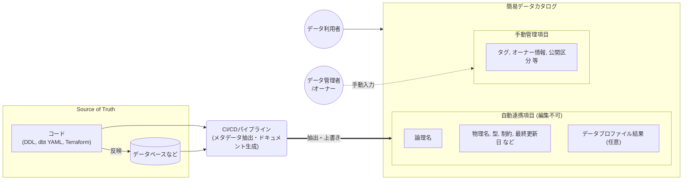

# メタデータとデータカタログの提供

専門ツールの前に、データ基盤の `description` と社内標準のドキュメントツールで簡易データカタログを最初から構築する。
「最終更新日」のラベルは連携日時とメタデータ更新日時に分け、専門ツールは問い合わせ増などの兆候が出てから導入する。
出典は [データガバナンス設計ガイドライン](about.md) (CC BY 4.0) で、OKF の形式に合わせて分割、変更している。

## メタデータ

利用者の「欲しいデータがどこにあるか分からない」「カラムの業務的な意味が分からない」といった悩みを解決しないと、データは結局使われないか、データオーナーへの問い合わせが殺到してしまう。

メタデータを適切に管理することで、データの意味や所在、鮮度といった「データについてのデータ」を明文化し、利用者が誰にも聞かずに自律的にデータを理解して活用できる「探せる・分かる状態」を作れる。

### descriptionの記入について

専門のデータカタログツールを導入せずとも、SnowflakeやBigQueryなどのデータ基盤ではテーブルの `description` を使えば、ビジネスメタデータを十分管理できる。例えば、BigQueryではテーブルのdescriptionは16KB、列のdescriptionは1KBを格納できる。制限はバイト単位のため日本語では約1/3（それぞれ約5,400文字、約340文字）だが、十分な文量を記述できる。

推奨は以下の通り。

- データカタログなどのツール導入以前として、`description` を最初から必ず記入するルールとする
  - `description` を後から記入してもらう運用は困難であるため。ETLなどで別のデータソースから受信している場合は、元テーブルにdescriptionをこのタイミングで入力してもらうなど利用方針を作っておく
- `description` は最低限、テーブルやカラムの日本語名を記入する
  - ✅️Good: カラム:employee_id, description: 従業員ID（退職者含む）
  - ❌️Bad: カラム:employee_id, description: (説明無し)
- 完璧を求めすぎない
  - descriptionを記入することで、将来的な問い合わせ件数を減らすという点で、自分を守るためにも有効であるし、AI利活用の面でも重要である。しかし、記載を求めれば求めるほど、データ提供側の部署の負担が大きくなる。そのため、日本語名を入力してもらう以上の要求は慎重になるべきである
  - データのサンプル値や、データプロファイル（最小値、最大値、中央値、平均値）などの結果で、値の説明は代替できることもあるため

> [!NOTE]
> **参考**
>
> - [割り当てと上限 | BigQuery | Google Cloud Documentation](https://docs.cloud.google.com/bigquery/quotas?hl=ja)

### 簡易データカタログを提供する

データカタログとは特定の製品を指すのではなく、データ利用者が必要な情報へアクセスできる状態にするためのツールを指すとする。そのため、初期段階ではNotion、Googleドキュメント、Confluenceなど社内で標準的に使われているドキュメントツールを、カタログの出力先として利用すれば、簡易データカタログとして扱える。

簡易データカタログの場合、正となるデータはBigQuery（INFORMATION_SCHEMA）、DDL、Terraformコード、dbtのYAMLファイルなどである。論理名などの変更は開発プロセスに則って行う。これらを入力にドキュメントツールへCI/CDなどで自動出力する流れとなる。

推奨は次の通り。

- 簡易データカタログは、データ基盤利用の最初から構築する（ツールは何でも良い）
  - 基本的に、コードや実機を正にする
  - 基本的に、閲覧/検索用途にする
- 簡易データカタログ側を “正” にする項目があっても良い
  - 任意のタグ付けなど。この場合は、簡易データカタログ側の履歴管理や、変更管理（更新権限の粒度など）は限界があるため、要求レベルを下げたり、運用ルールでカバーする方向となる
  - `この場合でも、description に該当する項目は、編集不可能にする（CI/CD実行の度に、変更は上書きさせる）`
- データ利活用のための管理項目も、簡易データカタログに合わせて管理すると楽である
  - 例えば、アクセス権限申請の要否を判断するデータオーナーや、問い合わせ担当者（データスチュワード）。所属部署や、データ分類（「全社公開」「厳格」など）
- システム表示項目は、システムから取得できる項目のうち必要最小限とする
  - 利用者の認知負荷を下げるため
  - 項目は次のようなベーシックなものをベースに考える
    - 「物理名」「論理名」「型」「PK」「外部キー」「NOT NULL」「パーティションキー」など
- データプロファイル結果を利用する
  - 機密データでなければ、データプロファイル結果も掲載できると、ユーザーフレンドリーである。初見のユーザーからすると情報量が多いため、折りたたみで表示するなど、一覧性とのバランスは考慮すると良い
- 簡易データカタログ側には、CI/CDが動いた時間（更新日時）を出力した方が良い
  - ちゃんと同期が取れていることが分かるようにするため

専用ツールの導入を第一に検討しないことがお勧めである。もっとも利用者が慣れた社内標準的なドキュメントツールでまず利用実態をMVP的に評価することで、後続の製品選定の確度を高められるためである。

### 最終更新日時の注意

データカタログの「最終更新日」という表記には注意が必要である。以下の複数の意味が含まれるためである。

- 源泉側でテーブルにInsert/Update/Deleteなど更新が発生した日時
- データ基盤に該当のテーブルが連携された日時
- データカタログに登録された、メタデータが更新された日時

利用者にとっては、自分が分析しようとしているデータが、いつ時点の鮮度なのかを把握することの優先度は高い。もしカタログ上に最終更新日時とだけ表記されていると、データ自体は1ヶ月前の古いままなのに、昨日descriptionを追記しただけで最新のデータだと誤認しかねない。その結果、誤った意思決定に繋がる恐れがある。

推奨は以下の通り。

- UI上のラベルを明確に分離・定義する
  - 簡易ポータルやカタログ画面では「最終更新日」という曖昧な表現を避け、利用者が混同しないようラベルを分割して明記する
  - 最新連携日時: データ基盤のテーブルに最新の実データがロード（反映）された日時。利用者が最も知りたい情報である
  - メタデータ更新日時: カタログの説明文（description）やタグが更新された日時。メタデータの形骸化を監視するために用いる
- 業務的な鮮度を補足する
  - バッチ処理で連携されている場合、「今朝6時に連携されたデータは、昨日の23:59時点までの業務データである」といったズレが生じる。可能であれば、「前日締めのデータを保持」といった業務的な意味をメタデータに追記しておくと、よりユーザーフレンドリーである

### 専門のデータカタログツールの導入タイミング

専門のデータカタログツールは利用費用や運用コストが高い傾向にある。導入が早すぎるとデータ管理者側の負担が増し、利用可能なデータの登録に及び腰となる。遅すぎると問い合わせ対応でデータ管理者が疲弊し、データ総数を増やすどころでは無くなってしまう。

導入に際しては最初から「高度なデータリネージ機能」や「AI自動タグ付け」といったフルスペックを求めない方が良い。高機能なツールは運用に乗せるまでの設定が重く、立ち上げ期にはオーバースペックとなり「導入しただけで使われない」失敗に陥りやすい。

次のような兆候があった場合に導入を検討することを推奨する。

- テーブル数が数百を超え、スプレッドシートなどの検索性や一覧性の限界に達した場合
  - ファイル分割などで延命もできるが、それ自体が利便性を下げてしまうため
- データリネージなどの可視化が必要になった場合
  - データの由来や利用先をトレースし、コンプライアンス対応など横断的なチェックが必要になった場合
  - データ作成元についての質問や、影響範囲など依存関係の調査は時間がかかるため
- データについての問い合わせ件数が増え、データ管理者の業務を圧迫し始めた時
  - 「このデータはある？」や「このカラムの意味は何か？」といったやりとりが増えてきた場合
  - 以前と同じ質問をFAQとしてまとめようとしているタイミング
- 属人化の兆し
  - 特定の有識者に聞かないとデータの正体が分からず、ボトルネックになった場合
- データ利用者の拡大
  - エンジニア以外の企画職や営業職が、BIやSQLを触る機会が増え、データの民主化が開始した場合
- 利用者側の方がデータに詳しいケースが出てきた場合
  - 利用者側が `description` などを直接、管理したいといった要望が上がってきたとき
- メタデータの表示/変更などの細かい権限管理や承認フロー管理が求められた場合
  - 承認フローについては、社内標準のツールで代用しても良いが、権限管理は鬼門である

もし、`description` の記入率や品質が悪い場合は、それを改善することで問い合わせ数を減らせると考えられる。また、利用者視点での追加情報も、簡易データカタログ側で編集可能な任意列を設けることでカバーできることも多い。データカタログ界隈は進化が激しい領域であるため、できる限り社内標準ツールで逃げ、判断を後ろ倒しにすることも悪くない選択肢である。

### 管理対象と優先度

基本的に、データ基盤上の全てのデータをデータカタログ化の対象にすべきである。もし、優先度を付けるのであれば、利活用される可能性が高いデータを優先すべきである。

- マスタデータ
  - 基本的にマスタデータは分析軸となり得るため、優先的にメンテナンスすべきだと考える
- イベントデータ（トランザクションデータ）
  - メインとなる分析対象のため
- 機密データ
  - 個人情報、新規製品開発、未公開の財務情報などインサイダーに関わるデータ
  - 誤って公開されないように、ビジネスメタデータレベルでも明確に区別しておき、少しでもリスクを軽減する

逆に優先度が低いと考えられるのは以下。

- 他部署へデータ共有していないデータ
  - 自分の部署のみが利用するなど、利用先が限定されている場合、データカタログに記入する必然性は低い。問い合わせ先だけあれば、運用で回避できると考えられる
