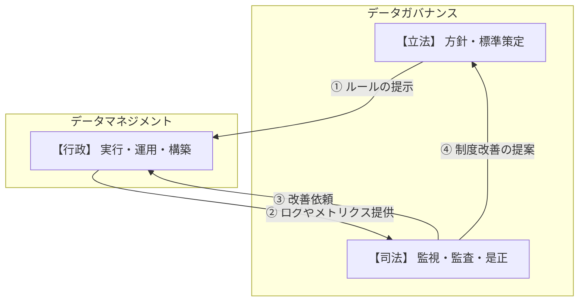

# データガバナンスとは何か

データガバナンスは、データを資産として活用するために、品質・統制・利便性のバランスを最適化する意思決定の枠組みである。
ガバナンスが「立法・司法」、マネジメントが「行政」を担う。両輪であり、どちらが欠けても機能しない。
出典は [データガバナンス設計ガイドライン](about.md) (CC BY 4.0) で、OKF の形式に合わせて分割、変更している。

## データガバナンスとは

データガバナンスとは、データをビジネス資産として最大限に活用するための仕組みである。「誰が、どのデータに、どのような権限と責任を持ち、どう管理するか」というルールと体制を定義したうえで継続的に監督・評価する。

単なる「ルール作り」ではなく、以下の3つのバランスを最適化する「意思決定の枠組み」を指す。

- **品質**: 信頼できるデータであること
- **統制**: 法令やセキュリティを遵守していること
- **利便性**: 必要な人が、必要な時に、必要なデータを使えること

### データマネジメントとデータガバナンス

両者は混同されやすいが、本ガイドラインでは以下のように定義して区別する。

| 項目     | データガバナンス                                 | データマネジメント                                |
| :------- | :----------------------------------------------- | :------------------------------------------------ |
| 役割     | 何をすべきかの方針・ルール策定と監視             | どう実現するかの具体的活動・実装                  |
| 位置付け | 意思決定・評価・監督                             | 実行・構築・運用                                  |
| 実務例   | データ品質基準の策定、アクセス権限ポリシーの定義 | ETLの実装、DBのバックアップ、マスタデータの名寄せ |

データガバナンスが「立法・司法」を担い、データマネジメントが「行政」を担う三権分立の関係に近い。適切なガバナンスなきマネジメントは秩序を乱し、マネジメントなきガバナンスは形骸化する。本ガイドラインでは、この両輪をアーキテクチャにどう組み込むかを解説する。

> [!TIP]
> **ガバナンスを形骸化させないための要諦**
>
> ❌️**よくある失敗: ルールの丸投げ**
> ガバナンスチームが方針だけを提示し、具体的な運用を現場（各事業部など）に一任した場合、現場の実態と合わず「ルールが無視される」か「対応優先度を極端に下げられる」結果に終わる。
>
> ✅️**成功に向けて運用の具体化まで伴走する**
> データガバナンス側は「方針を作って終わり」ではなく、データマネジメント側とすり合わせしながら、方針に準拠した具体的な運用フロー（簡単な手順書や申請フォーム）の作成まで踏み込むこと。現場が迷わず実行できるまで伴走しなければならない。

<!-- 前の注記と分ける -->

> [!NOTE]
> **参考**
>
> [データマネジメント設計ガイドライン](https://future-architect.github.io/arch-guidelines/documents/forDataManagement/datamanagement_guidelines.html) も合わせて参照すること。
