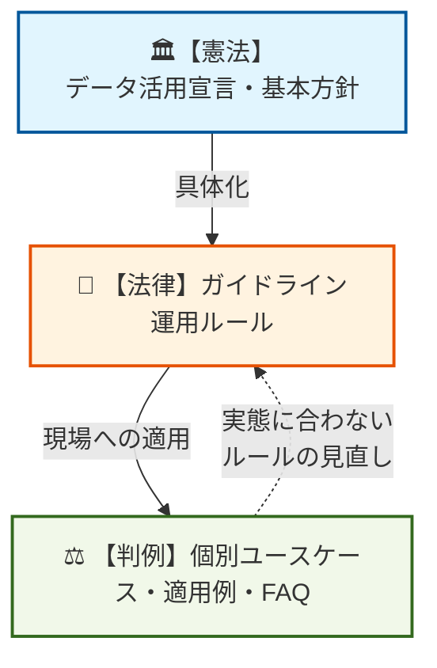

# ガバナンス推進活動の進め方

ガバナンスは「データを安心して使うためのルール作り」であり、攻めと守りのバランスを取る。
最初から精緻なルールを作らず、必要最小限のガードレールからスモールスタートし、成熟度に合わせて段階的に進化させる。
出典は [データガバナンス設計ガイドライン](about.md) (CC BY 4.0) で、OKF の形式に合わせて分割、変更している。

## ガバナンス推進活動

データガバナンスの活動で、最初に細かな運用ルールやツール選定から入るのは悪手である。また、ガバナンスを単なる「制限・統制」と捉え、リスク回避ばかりに気を取られて利活用を阻害するのは本末転倒である。

本章では、ガバナンスを「データを安心して武器として使うためのルール作り」と再定義し、それを組織にどう根付かせ、どう段階的に拡大していくべきかのロードマップを解説する。

### ガバナンス活動の考え方

データガバナンスは「制限・統制」と捉えられがちだが、本来は「データを安心して武器として使うためのルール作り」である。両者のバランスを言語化し、社内のコンセンサスを得ることが活動の前提である。ガバナンスは、次の「守り」と「攻め」の2つの側面から整理する。

- **守りのガバナンス（リスクの極小化）**
  - **観点:** 個人情報保護、セキュリティインシデントの防止、法規制（GDPR等）への対応
  - **考え方:** 「誰が、どのデータに、どこまでアクセスしてよいか」を厳格に定義し、企業の信頼失墜や損害賠償リスクを防ぐ。これは既存のセキュリティルールと密接に連携する
- **攻めのガバナンス（ビジネス価値の最大化）**
  - **観点:** データの品質担保、サイロの破壊、AIや高度分析の精度向上
  - **考え方:** 「ゴミデータからはゴミしか生まれない（Garbage In, Garbage Out）」。営業が入力したデータをマーケティングが信じて使えるよう、データの定義と品質基準（鮮度や正確性）を揃え、売上向上や意思決定スピードの加速に繋げる

### ボトムアップアプローチ

トップダウンで最初から精緻なデータガバナンスのルール（特に権限制御など）を作り上げようとすると、大半が「重厚で牛刀」なものになってしまう。

なぜなら、初期段階では具体的なユースケースが不明確であり、正確なリスク評価ができないためである。その状態で判断を迫られれば、担当者は「安全か、より安全でないか」の二者択一において、後者を選べない。必然的に安全側に倒す、つまり過剰に厳しいルールにするしかないためである。結果として理想的に作られたルールは、実態と乖離が大きくなり利活用の停滞やルールの形骸化を招いてしまう。

データ利活用の本来の目的は、業務体験を向上させつつ生産性や付加価値が高い働き方を実現することである。リスク回避ばかりに気を取られ、ルールを厳しくしすぎてこれらを阻害するのは本末転倒である。

推奨は以下の通り。

- 特に立ち上げ期は、安全性と透明性を確保するための必要最小限なルールのみを制定する、スモールスタートとする
- 最初から完璧で精緻なルールを作らない。「守るべきところは守りつつ、安心・安全にデータ活用できるよう現場に寄り添う」
- 現場に寄り添う進化型のルールとする。実務に合わせて継続的にブラッシュアップする姿勢を基本とする

> [!TIP]
> **❌️よくある失敗例: 守り偏重**
>
> リスクを潰そうと守りばかりを強化した結果、現場がデータにアクセスするまでに何重もの承認が必要となり、面倒だと思われてフェードアウト。
>
> **処方箋**
> 初期は攻め（ビジネス価値）の割合を80％に設定するなど、最低限の法令遵守に絞ってルールを作る。まずは「使えるデータ」を現場に届けることを優先する。

### ガバナンス活動の第一歩

データガバナンスを国家の「立法」に例えるならば、最初に策定すべきはルールの土台となる「憲法」である。その下に具体的な法律（運用ルールやマニュアル）があり、日々の業務における判例（ユースケースやFAQ）が積み重なっていく、という階層構造をイメージすると良い。

まずは組織全体で合意できる「目指すべき姿」を言語化した「データ活用宣言」や「データガバナンス基本方針」を作成し、経営層の本気度を全社に示すことが第一歩となる。

> [!TIP]
> **先行企業の事例：三菱電機グループの「データ活用宣言」**
>
> 優れた先行事例として、三菱電機グループが制定している「[データ活用宣言](https://www.mitsubishielectric.co.jp/serendie/stories/19/)」が挙げられる。同社は「データ資産価値の最大化（データ活用によりインサイトを得る、データ活用の文化を醸成するなど）」という攻めの姿勢と、「データの適切な取扱い（データを入手する・共有する・守るなど）」という守りの姿勢を両輪として明文化している。このように、宣言（憲法）の次に「データ活用マネジメント基本方針書（法律）」を整備するアプローチは、非常に理にかなっている。

### データガバナンスにおける憲法の制定

組織の憲法として掲げる大方針の例として、以下の「10ヶ条」を組織のカルチャーに合わせて定義し、全社に発信すると良い。最初はこれくらいシンプルな方が現場に浸透しやすい。これはあくまで例であり、「データ活用宣言」のような形式にしても良い。

1. **データは資産**: データは「部門の所有物」ではなく「全社の共有資産」である
2. **データ駆動文化の醸成**: 「勘と経験」を否定しない。客観的なデータと掛け合わせて最強の武器にする
3. **データの民主化**: データは一部の専門家のものではない。現場の全員が自律的にアクセスできる環境を作る
4. **挑戦心**: 「とりあえずやってみる」の精神。データを用いた小さな失敗と挑戦を称賛する
5. **ビジネス価値への還元**: 「データ分析して終わり」にしない。使われてビジネスに貢献して初めて価値が出る
6. **当事者意識**: データ品質は全員で育てる。入力者から利用者まで、リレーのようにデータの鮮度と正確性を守り抜く
7. **攻めのガバナンス**: ルールは「縛る」ためのブレーキではなく、安全に「加速」させるためのシートベルトである
8. **守りの徹底**: 大胆に攻めるためにこそ、個人情報や機密情報などの「急所」は全員で徹底的に守り抜こう
9. **AI-Ready**: AIが迷わず読めるコンテキストをデータに持たせ、常に新たな技術へアップデートし続ける
10. **相互リスペクト**: データ提供側と利用側は対立しない。互いの業務と痛みを理解し、常に対話で課題を解決する

あるいは、よりシンプルに意識改革を促すため、以下の3つのコア・バリューのようなBefore/Afterで宣言を定義するのも有効だと考えられる。

- **【所有から共有へ】** データを自部門に囲い込む文化から、全社横断でオープンに共有する文化へ
- **【統制から促進へ】** ガバナンスを「制限するブレーキ」から、「安全に使えるアクセル」へ
- **【感覚から事実へ】** 長年の勘や声の大きさに頼る意思決定から、データを共通言語としたファクトベースの意思決定へ

この「憲法」を、経営陣を含めた組織全体で合意し共通認識を作る。その上で組織体制や細かい法律（運用ルール）の整備へと進める。

### 必要最小限のガードレール定義

10ヶ条のような大方針の次には、安全性と透明性を確保するための必要最小限なルール（ガードレール）を作ることが望ましい。ガードレールを明文化することで、利用者に「この範囲内であれば会社が安全を保証する」という安心感を与え、個々の判断コストを削減できる。これにより、リスクを恐れて活用を躊躇する心理的ハードルを下げ、全社的なデータ利活用の加速へと繋げられる。ガードレールとして定める項目は、主に次の3点である。

- **絶対的な禁止事項:** 企業としての信頼失墜や法的リスクに直結する “絶対NG” を定義する
  - **受託・外部データの目的外利用禁止**: 顧客から預かったデータや、特定の目的で契約・購入した外部データ（SaaSの統計情報や外部調査データなど）を、元の契約範囲を超えて二次利用したり、別プロジェクトに流用したりすることを禁止する
  - **未公開情報の機密保持**: インサイダー取引規制に抵触する恐れのある未公開の財務情報や、未発表の経営戦略に関するデータの二次利用・加工・共有を制限する
  - **個人情報の非匿名化利用の制限**: 分析目的であっても、個人を特定できる情報（氏名、詳細な住所等）をそのまま扱うことは原則禁止とし、適切なマスキングや統計化処理を必須とする
- **安全な利用経路の提示**: 何がダメかだけではなく、どうすれば安全に使えるかの道筋を示す。すべてのデータを一律に保護するのではなく、データ分類（極秘・社内・公開等）を定義し、「L1（公開）データであれば、事前申請なしで誰でも自由に二次利用してよい」といったお墨付きのルールを設ける。これが利用者の最大の安心感に繋がる（詳細は [データ分類](data-classification.md#データ分類) 章で扱う）
- **エスカレーションパスの明確化**: 「このデータを使っていいか」と迷った際、現場の担当者が自分自身で法的・倫理的なリスクを抱え込まないためのセーフティネットを設ける。最終的なアクセス承認の権限を持つ「データオーナー」を明確にし、「オーナーの許可さえ得れば、利用者は免責される」という体制を構築する（詳細は [データオーナー](data-owner.md#データオーナー) 節で扱う）

### 社内の成熟度に合わせたガバナンスの段階的進化

ガバナンスは一度作って終わりではなく、社内のデータリテラシーやスキルの成熟度に合わせて、段階的に進化していくべきである。利用の実態を観測、分析しながら、攻めと守りのバランスを変えていく。

成熟度は単なる感覚ではなく、以下のような定量的な指標で把握する。

- **BI活用**: 公開されたダッシュボード数、PV数、アクティブユーザー数
- **基盤利用**: データ基盤のテーブル数、クエリ実行数
- **ナレッジ管理**: データカタログのPV数、アクティブユーザー数、登録テーブル数、ビジネスメタデータの記入率

これらの数が増え、利活用が本格化してきたタイミングこそが、新たなルールを適用すべき時期である。現場から上がる具体的なユースケース（要望・要求）に都度応えながら、実務を阻害しない範囲で「安全と再利用性のためのルール」を組み込んでいく。

社内の課題レベルに応じて、策定すべきルールの優先順位は次のように遷移する。

| 成熟度フェーズ | 課題例                                                | ルール例                                                 | ルールの目的                                   |
| :------------- | :---------------------------------------------------- | :------------------------------------------------------- | :--------------------------------------------- |
| 初期           | ・データの持ち出しが不安 ・誰が責任者か不明           | ・個人情報の取り扱い ・アクセス権管理                    | セキュリティ・法務面メインのリスク回避         |
| 導入期         | ・データの所在地不明 ・用語がバラバラ                 | ・データ所在の登録 ・項目名の定義 ・データオーナーの指定 | メタデータの整備による探す手間の削減           |
| 成長期         | ・データの値が不正確で分析に使えない                  | ・更新頻度の保証 ・名寄せ基準                            | データ品質・信頼性の担保における分析精度の向上 |
| 成熟期         | ・過剰なルールによるスピード低下 ・統制ルールの形骸化 | ・データリネージ ・自動クレンジング                      | 高度な運用ルールの整備によるDXの高速化         |

> [!NOTE]
> **参考**
>
> 監視すべきメトリクスについては [利用状況を観測する](metadata-operation.md#利用状況を観測する) 節を参考にする。

### ガバナンス適用の展開計画

「すべてのデータを統制する」という幻想を捨て、ガバナンスの適用範囲は摩擦の少ない領域で成功体験（ショーケース）を作ることから始める。展開に当たっては、以下のロードマップを基本として「機能軸」と「組織軸」を掛け合わせ、段階的に拡大していく。

1. **ローカル（特定ユースケース）**
   1. **対象:** 意欲の高い特定事業部内のデータのみ
   2. **目的:** 摩擦を抑え、最速で「データで儲かった・コストが下がった」という実績を作る
   3. **組織軸の視点**: 最初の部署で得られた運用ノウハウを「標準テンプレート」化し、次工程への展開準備を整える
2. **全社（国内グループや事業部間）**
   1. **対象:** 複数事業部を跨ぐデータ（顧客マスタ、主要な取引データ）
   2. **目的**: 本格的なデータカタログ整備や全社データリテラシー教育に投資する。共通マスタの統制と、各部門の自由な分析領域（データマート）を線引きする
   3. **機能軸の視点**: 不整合による損失が大きい重要データから着手する。一方で、各業務特有の取引データは現場の柔軟性を優先し、全社共通ルールは最小限に留める
3. **グローバル（海外拠点）**
   1. **対象:** 経営管理上不可欠な最重要KPIと、最小限のグローバル共通マスタのみ
   2. **目的:** グローバルの意思決定スピード向上
   3. **注意点:** 各国の商習慣や法規制（GDPR等）が異なるため、ローカルの取引データまでグローバルで統一しようとすると失敗しやすい。「中央でガチガチに統制するデータ」と「各国ローカルに委ねるデータ（共通ガードレールのみ）」を厳格に切り離す
4. **ゴール（理想状態）**
   1. **対象:** 全社のあらゆるデータドメイン
   2. **状態:** 全社で共通言語（マスタ）が通じ、各現場のデータオーナー・データスチュワードが自律的に自組織のデータに責任を持って管理・活用している状態。DMOの役割は直接的な統制から共通基盤の提供と支援（センター・オブ・エクセレンス）へと移行する
