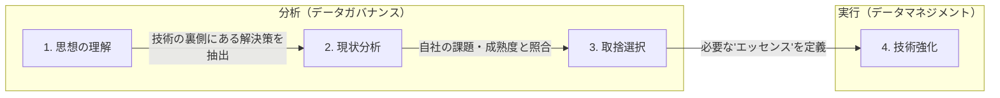

# 技術トレンドとの付き合い方

技術トレンドは流行で採り入れず、その裏側の思想を理解し自社の課題と照合して必要なエッセンスだけを取捨選択する。
分析（ガバナンス）フェーズの考え方が、目立つ技術強化（マネジメント）より遥かに重要である。
出典は [データガバナンス設計ガイドライン](about.md) (CC BY 4.0) で、OKF の形式に合わせて分割、変更している。

## 技術トレンドとの付き合い方

データガバナンスの領域では、データメッシュ、ゼロETL、データレイクハウスといった新しいキーワードが次々と登場し、それぞれ魅力的に感じる。しかし、データガバナンスの担当者として重要なのは、技術トレンドそのものを取り入れることではない。その裏側にある思想（パラダイム）を理解し、自社のデータガバナンスを進化させる糧とすることである。一方で、技術的な進化を見過ごすと時代にあったデータガバナンスにもならないため、知識をアップデートしつつ向き合う必要がある。

技術トレンドに対しては次の1〜4の流れで向き合うことを推奨する。

1. **思想の理解:** その技術が解決しようとしている「本質的な課題」は何かを見極める（例：データメッシュ）。

   | トピック       | データガバナンスとして考えること                                                                           | データマネジメントとして考えること                                                          |
   | :------------- | :--------------------------------------------------------------------------------------------------------- | :------------------------------------------------------------------------------------------ |
   | データメッシュ | 中央集権から分散型の統制へ変化させ、中央組織のボトルネックを解消すること。これを自社が必要としているか     | 具体的なドメイン間通信のプロトコル、セルフサービス基盤のTerraformコード、カタログ製品の選定 |
   | Zero ETL       | データの複製から発生源での直接参照による、鮮度要求の変化やコスト低減の効果がある。しかし境界が不明瞭になる | 特定のクラウドサービス（BigQuery/Snowflake等）の連携設定、コネクタの実装                    |
   | レイクハウス   | 用途別（DWH/レイク）の分離から、非構造化と構造化データを同一基盤で扱うことによる統制の向上                 | Sparkのチューニング、Iceberg/Delta Lakeのストレージ設計                                     |
   | AI-Ready       | AI利用を促進するデータガバナンス。学習させてよいデータの許諾管理などの観点を持つこと                       | ベクトルデータベースの選定、埋め込みモデル（Embedding）の選定・実装                         |

2. **現状分析:** 自社にその課題はあるか？また、その思想を受け入れる準備（組織文化、技術成熟度、組織的なオーナーシップなど）はあるか？
3. **取捨選択:** トレンドの中から、自社のデータガバナンスを成長させられる要素のみ取り入れる
   - 例: 「データメッシュが流行っているからドメイン駆動にする」のではなく、「ビジネスのスピードを上げるためにデータ責任を各現場に移譲する（ガバナンスの変更）」
4. **技術強化:** 3の帰結として、具体的な技術トレンド（データメッシュアーキテクチャ）を採用する

技術強化の部分は目新しさもあり目立つが、上流の分析フェーズの考え方の方が遥かに重要である。トレンドに振り回されないように注意すること。
