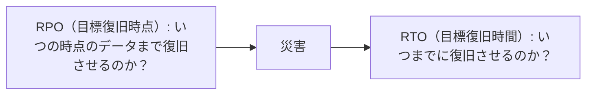

# DynamoDB の可用性

テーブルの誤削除と偶発的データ損失への日常保護を備える。
RPO/RTO に応じた DR の方針を定める。
出典は [DynamoDB設計ガイドライン](about.md) (CC BY 4.0) で、OKF の形式に合わせて分割、変更している。

## 可用性

### 日常保護（運用ミス対策）

#### テーブルの誤削除への備え

DynamoDBには誤操作によるテーブル削除を防ぐ「削除保護機能」がある。EC2 や RDS の削除保護機能と同様、IAMなどの権限を持っていても、削除保護機能を無効にしない限り削除できないため、誤操作の防止に有効である。

推奨は以下の通り。

- 原則、全てのデプロイメント環境の、全てのテーブルに対して有効にする

> [!TIP]
> **他のガイドラインとの整合性**
>
> [削除保護 | Terraform設計ガイドライン](https://future-architect.github.io/arch-guidelines/documents/forTerraform/terraform_guidelines.html#%E5%89%8A%E9%99%A4%E4%BF%9D%E8%AD%B7) にも「削除保護」が提供されている場合、原則有効にすると記載があり、整合性がある。

<!-- 前の注記と分ける -->

> [!NOTE]
> **参考**
>
> - [DynamoDB テーブルの基本的なオペレーション](https://docs.aws.amazon.com/ja_jp/amazondynamodb/latest/developerguide/WorkingWithTables.Basics.html#WorkingWithTables.Basics.DeletionProtection)
> - [皆さん待望の削除保護機能が Amazon DynamoDB でサポートされました | DevelopersIO](https://dev.classmethod.jp/articles/amazon-dynamodb-now-supports-delete-protection/)

#### 偶発的データ損失への備え

開発者の誤操作によるデータ削除やアプリケーションの不具合によるデータ破損は、起こしてはならないインシデントである。しかし発生した場合への備えは、多くの業務システムで考えておくべきである。ポイントインタイムリカバリ (PITR: Point-in-Time Recovery)を有効にすると、過去35日以内の任意の秒単位の状態にテーブルを復元できる。性能への影響は無く、リストアは基本的に新テーブル作成で復元する。そのため完了後は、必要に応じて環境変数の切り替えと、リストアまでに変更されたデータの反映などが必要となる。PITRは誤操作によるデータ損失を救済できるセーフティネットとして有効だが、ストレージ使用量による課金が発生する。

推奨は以下の通り。

- 原則、PITRは全てのマスタ・トラン系のテーブルで有効にする
  - 一時的なワークテーブルであれば、PITRは不要にしても良い
  - 費用などの観点で、別経路でリストア可能なバックアップが取れているのであれば、不要にしても良い（例えば、DynamoDB Streams経路でS3などにバックアップが時系列で蓄積されているなど）
- 期間は最大値（35日）を一律設定とする
  - 「[テーブルのサイズに基づいて PITR の料金を請求します。復旧期間を (35 日から 1 日などに) 変更しても、料金は削減されません。選択した復旧期間に関係なく、コストは変わりません](https://docs.aws.amazon.com/ja_jp/amazondynamodb/latest/developerguide/PointInTimeRecovery_Howitworks.html)」とあるため、コスト観点で短くする意味があまりない
  - ただし、一定期間に、更新/削除&登録が大量に繰り返されるなど特殊なワークロードの場合は、費用観点で期間を最適化することはありえる
  - また、コンプライアンス要件で「ユーザー退会は7日以内にユーザー情報を完全削除する」といった対応が必要な場合は、PITRもそれに合わせる必要がある

> [!NOTE]
> **参考**
>
> [DynamoDB でポイントインタイムリカバリを有効にする](https://docs.aws.amazon.com/ja_jp/amazondynamodb/latest/developerguide/PointInTimeRecovery_Howitworks.html)

### DR

DynamoDBには可用性について以下の選択肢がある。

- **シングルリージョン構成**: DynamoDBは自動的に複数AZにデータを複製し、AZ障害への耐性がある。リージョン全体の障害では数分～数時間のデータ損失が発生する可能性
- **グローバルテーブル**: 複数のリージョンにアクティブ-アクティブ構成でテーブルを複製する。リージョン障害時にリージョン切り替えでサービス継続が可能。追加費用が発生する。可用性SLAは99.999%

これらの選択は、DR（Disaster Recovery、災害回復）計画から策定する。DR対策は、リージョン障害が発生した場合の許容ダウンタイム (RTO: Recovery Time Objective、回復時間目標) とデータ損失 (RPO: Recovery Point Objective、回復ポイント目標) を元に行う。



RPO/RTOの値により決定する、復旧シナリオの対応パターンは以下の通り。

| \#           | アクティブスタンバイ                                                                                        |                                                                                                                                    |                                                                                                                      | アクティブアクティブ                                                                                                                |
| :----------- | :---------------------------------------------------------------------------------------------------------- | :--------------------------------------------------------------------------------------------------------------------------------- | :------------------------------------------------------------------------------------------------------------------- | :---------------------------------------------------------------------------------------------------------------------------------- |
| 復旧シナリオ | （1）バックアップ・リストア                                                                                 | （2）パイロットライト                                                                                                              | （3）ウォームスタンバイ                                                                                              | （4）マルチサイト                                                                                                                   |
| 説明         | On-DemandバックアップやPITRを使い、データを別リージョンに復元する。頻繁なバックアップスケジューリングが必要 | セカンダリリージョンに空テーブルを待機させ、障害時にデータをレプリケートして起動する。コストを抑えつつ中程度の回復速度を提供できる | セカンダリリージョンにスケールダウンしたアクティブ環境を維持する。リアルタイム同期と自動フェイルオーバーの実装が必要 | Global Tablesを使い、複数リージョンにレプリケートする。競合解決のため、アプリケーションはローカルエンドポイントのみ使用するなど注意 |
| RPO          | 数時間（バックアップ間隔依存）                                                                              | 数分                                                                                                                               | 数分                                                                                                                 | 秒単位                                                                                                                              |
| RTO          | 数時間（復元時間）                                                                                          | 数十分                                                                                                                             | 数分                                                                                                                 | ほぼゼロ                                                                                                                            |
| 主な実装技術 | On-Demandバックアップ, PITR, クロスリージョンコピー                                                         | Global Tablesの部分利用など                                                                                                        | DynamoDB Streams, Lambda, Route 53                                                                                   | Global Tables                                                                                                                       |
| コスト       | 低                                                                                                          | 中                                                                                                                                 | 中〜高                                                                                                               | 高。データ転送コストにも注意する                                                                                                    |

推奨は以下の通り。

- RPO、RTOに基づき復旧シナリオを選択する
- もし、明確な復旧計画を立てるようなプロダクト特性やプロダクトフェーズでなければ、（1）バックアップ・リストアから始めて、成長に応じて（2）パイロットライトに移行する

> [!NOTE]
> **参考**
>
> ```mermaid
> ---
> title: RTO / RPO に応じた復旧シナリオ
> ---
> flowchart LR
>   subgraph AP["アクティブ/パッシブ"]
>     direction LR
>     subgraph Low["Low（RPO/RTO が大きい・低コスト）"]
>       S1["バックアップリストア<br/>RPO/RTO: 時間単位<br/>平常時はバックアップを取得し、RTO に応じて常時サブサイトへバックアップを転送する。障害時に必要なデータをサブサイトでリストア。費用: $"]
>     end
>     subgraph Mid1["パイロットライト"]
>       S2["RPO/RTO: 数十分単位<br/>平常時はコアサービスのみに限定したサブサイトを運用（例 DBのみ常時運用 etc.）。障害時にその他のサービスを起動。費用: $$"]
>     end
>     subgraph Mid2["ウォームスタンバイ"]
>       S3["RPO/RTO: 分単位<br/>平常時からメインサイト同等機能をもち規模を縮小したサブサイトを運用。障害時に必要なリソースに拡張。費用: $$$"]
>     end
>   end
>   subgraph High["High（RPO/RTO が小さい・高コスト）"]
>     S4["マルチサイトアクティブ/アクティブ<br/>RPO/RTO: リアルタイム<br/>平常時からメインサイト同等構成のサイトを運用。それぞれのサイトでリクエストを受け付け、データが複製される。障害時は利用可能なサイトで処理を継続。費用: $$$$"]
>   end
>   S1 --> S2 --> S3 --> S4
> ```
>
> 画像は [事業継続性が求められる基幹システムの DR 戦略 | Amazon Web Services](https://aws.amazon.com/jp/blogs/news/disaster-recovery-strategy-in-the-cloud/) より。
>
> [REL 13 災害対策 (DR) はどのように計画するのですか? \- AWS Well-Architected Framework](https://docs.aws.amazon.com/ja_jp/wellarchitected/2022-03-31/framework/w44aac19b9c11c13.html) も参考になる。
