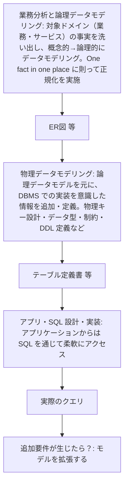
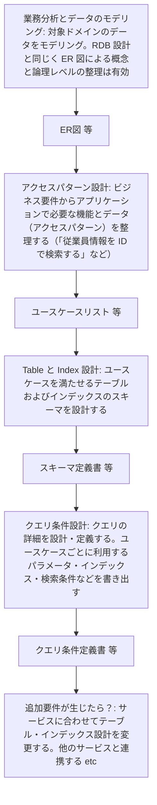

# DynamoDB のデータモデリング

アクセスパターンを起点に設計し、原則シングルテーブルを検討する。
プライマリーキー（パーティションキーとソートキー）をアクセスパターンから設計する。
出典は [DynamoDB設計ガイドライン](about.md) (CC BY 4.0) で、OKF の形式に合わせて分割、変更している。

## データモデリング

### 設計アプローチ

DynamoDBはスキーマレスであり、物理的なスキーマ変更自体は柔軟に行える。しかし、誤った設計ではホットパーティションやScan利用が必須となり、設計が根本から破綻する可能性がある。そのためRDBMSと同レベルの緻密な設計が求められる。

一方で、DynamoDBのデータモデリングの手順はRDBMSとは異なる。RDBMSはデータ構造を正規化し、その構造がビジネス要件を満たしていればクエリはSQL上の結合などで吸収できるため、柔軟性は高い。対してDynamoDBは基本的に結合ができないため、どのようなデータアクセスが行われるかを分析し、最終的なデータ構造を決める必要がある。これは [https://www.slideshare.net/slideshow/db-20190905/171086391](https://www.slideshare.net/slideshow/db-20190905/171086391) や [DynamoDB の基礎と設計 / DynamoDB Design Practice \- Speaker Deck](https://speakerdeck.com/_kensh/dynamodb-design-practice) などAWSの登壇資料でも述べられている。

|      | RDBMS                                                                                                        | DynamoDB                                                                                                     |
| :--- | :----------------------------------------------------------------------------------------------------------- | :----------------------------------------------------------------------------------------------------------- |
| 説明 | データの構造と正規化に重点を置いてデータモデルを設計する。その後でアプリケーション設計（クエリの作成）を行う | アプリケーションのデータ利用方法、すなわち「アクセスパターン」の分析とデータモデル設計を同時に行う必要がある |
| 図   | 図1（表の下）                                                                                                | 図2（表の下）                                                                                                |

図1

図2

推奨は以下の通り。

- DynamoDBのデータモデリング設計手順は、公式のモデリングプロセスに従い、下表のようなツールを利用する

| ステップ                                                | 成果物                                         | 利用ツール例                   |
| :------------------------------------------------------ | :--------------------------------------------- | :----------------------------- |
| （1）対象業務領域のデータモデリング                     | ERD                                            | A5:SQL Mk-2など                |
| （2）ユースケースとそれぞれのアクセスパターンの洗い出し | 業務（ユースケース）一覧、機能一覧、基本設計書 | スプレッドシート、Markdownなど |
| （3）スキーマ設計                                       | テーブル定義書、インデックス定義書             | Markdownなど                   |

- 一般的に、（3）のスキーマ設計は（2）のユースケースが分かるまで開始すべきではなく、（1）までに留めておく必要がある。ユースケースが不明瞭な場合は、DynamoDBだけでなくRDBMSへの切り替えや併用を検討する
- AWSが推奨するクエリ条件設計は、少なくとも条件付き更新/トランザクションが求められる特殊なアクセスパターンに絞って確実に実施する
- ユースケース一覧は、下記Tipsを参考にした形式とする

> [!TIP]
> **IoTメーターのデータモデリング例**
>
> （1）のモデリング結果から、以下の3テーブルが存在するとする。
>
> | テーブル名          | 用途                                                   | プライマリーキー   | ソートキー                           | 属性例                                                                            |
> | :------------------ | :----------------------------------------------------- | :----------------- | :----------------------------------- | :-------------------------------------------------------------------------------- |
> | MeterMeasurements   | 各種メーターから定期的に送信される時系列の測定値を保存 | MeterID (例: 001\) | Timestamp (例: YYYY-MM-DDTHH:MM:SSZ) | MeterType (ELECTRIC, WATER, GAS), Value（想定値）, Unit（単位）                   |
> | MeterStatus         | メーターの最新の状態情報を保存                         | MeterID            | CurrentStatus (固定値 CURRENT)       | MeterType (ELECTRIC, WATER, GAS), BatteryLevel, CommunicationStatus, WarningFlags |
> | MeterConfigurations | 各種メーターの設定変更の履歴を保存                     | MeterID            | Timestamp (例: YYYY-MM-DDTHH:MM:SSZ) | MeterType (ELECTRIC, WATER, GAS), ParameterName, NewValue, AppliedBy              |
>
> （2）のアクセスパターンの洗い出しは、以下のような一覧化を指す（※ユースケースは、ID管理した方が良い）。1つのユースケースで複数のテーブルにアクセスすることもありえる。
>
> | ユースケース                             | 対象テーブル        | アクセスキー                                      | CRUD |
> | :--------------------------------------- | :------------------ | :------------------------------------------------ | :--- |
> | 最新状況（測定値、メーター状態）の取得   | MeterMeasurements   | MeterID、Timestamp (降順ソート、Limit: 1\)        | R    |
> |                                          | MeterStatus         | MeterID、CurrentStatus                            | R    |
> | 期間指定で測定値の取得                   | MeterMeasurements   | MeterID、タイムスタンプの範囲                     | R    |
> | 設定変更履歴の取得                       | MeterConfigurations | MeterID、タイムスタンプの範囲またはプレフィックス | R    |
> | 特定のステータスを持つメーターの一覧取得 | MeterStatus         | StatusType、StatusValue (例: BATTERY\#LOW)        | R    |
> | メーターの設定変更                       | MeterConfigurations | MeterID、タイムスタンプ                           | C    |

<!-- 前の注記と分ける -->

> [!NOTE]
> **参考**
>
> - [DynamoDB 用の NoSQL](https://docs.aws.amazon.com/ja_jp/amazondynamodb/latest/developerguide/bp-general-nosql-design.html)
> - [DynamoDB でリレーショナルデータをモデル化するための最初のステップ](https://docs.aws.amazon.com/ja_jp/amazondynamodb/latest/developerguide/bp-modeling-nosql.html)
> - [DynamoDB でリレーショナルデータをモデル化する例](https://docs.aws.amazon.com/ja_jp/amazondynamodb/latest/developerguide/bp-modeling-nosql-B.html)
> - [DynamoDB で時系列データを処理するベストプラクティス。](https://docs.aws.amazon.com/ja_jp/amazondynamodb/latest/developerguide/bp-time-series.html)
> - [\[レポート\]DynamoDBデータモデリング (CMY304) \#reinvent | DevelopersIO](https://dev.classmethod.jp/articles/dynamodb-data-modeling-cmy304/#%E3%83%87%E3%83%BC%E3%82%BF%E3%83%A2%E3%83%87%E3%83%AA%E3%83%B3%E3%82%B0%E4%BE%8B)
> - [DynamoDBのテーブル設計に最適！NoSQL WorkbenchのData modelerで今度こそDynamoDBを使いこなす！ | DevelopersIO](https://dev.classmethod.jp/articles/dynamodb-nosql-workbench-datamodeling/)

### シングルテーブル/マルチテーブル

シングルテーブル設計とは、RDBMSのようにエンティティごと（例: Users, Orders, Products）にテーブルを分割するのではなく、関連する複数のエンティティを1つのテーブルに格納する設計方法である。これにより「隣接リストパターン」などのテクニックを用いて、RDBのJOINのように1回のQuery呼び出しでユーザーとその注文履歴をまとめて取得するといった処理が可能になる。

この設計パターンが広まった背景には、過去のDynamoDBの以下のような制約がある。

- 過去はオンデマンドキャパシティモードが存在せず、プロビジョニングモードのみだった
  - テーブルを細かく分割すると、アクセス頻度の低いテーブルでも最低限のRCU/WCUを確保する必要があり、無駄なコストが発生しがちだった。また、各テーブルのアクセスパターンは異なるため、個別にピーク性能を予測してプロビジョニングするのは困難だった
  - シングルテーブルに集約することで、RCU/WCUを共有・平準化できるメリットがあった
- 過去、1つのAWSアカウント・リージョンで作成できるテーブル数に256個の上限があった
  - 当時はAWSアカウントを用途ごとに分割することも少なく、よりテーブル数を節約する必要があった

現在では、オンデマンドモードの登場とテーブル数上限の変更（2500個まで）により、上記の制約は大きく緩和された。そのため、シングルテーブルを積極的に推す理由は減り、プロダクト特性で2つのパターンを使い分ける時代になっている。

| 観点                      | シングルテーブル設計                                               | マルチテーブル設計                                                                         |
| :------------------------ | :----------------------------------------------------------------- | :----------------------------------------------------------------------------------------- |
| 学習コスト                | ❌RDBMSと概念の乖離が大きい                                        | ✅ エンティティごとにテーブルが分かれており、理解しやすい                                  |
| GSI設計                   | ⚠️上限20に近づきやすい傾向                                         | ✅️個別最適な設計が可能                                                                     |
| 性能                      | ✅関連データを1回のクエリで取得可能なため、高い                    | ⚠️複数のエンティティ取得には、複数のAPIコールが必要                                        |
| キャパシティ ユニット調整 | ✅️一律のプロビジョニングが可能                                     | ✅️あるエンティティのみプロビジョニングモードで動かすなど、柔軟に対応可能                   |
| セキュリティ              | ⚠️IAMポリシーでのアクセス制御が複雑となる                          | ✅テーブル単位でのIAMポリシー設定が容易                                                    |
| 拡張性                    | ❌新しいエンティティ追加に大規模なデータ移行が必要になる場合もある | ✅新しいエンティティはテーブル追加であり、既存影響はない                                   |
| バックアップ              | ⚠️All or Nothingとなり、特定のエンティティだけを対象にできない     | ✅エンティティ単位でのバックアップやPITR（ポイントインタイムリカバリ）が可能               |
| OLAP連携（ScanやExport）  | ⚠️テーブル全体が対象となり、余計なレコードが入る場合があり非効率   | ✅️エンティティ単位で可能                                                                   |
| 費用分析                  | ⚠️各エンティティの費用内訳が不明瞭                                 | ✅テーブル単位で費用が明確に分離され、分析が容易                                           |
| テーブルクラス            | ⚠️エンティティごとの使い分けが不可                                 | ⚠️アクセス頻度が低い場合に、低頻度アクセスストレージクラスを有効にするといった最適化が可能 |
| 監視                      | ✅️メトリクスなどの作成数を抑えられる                               | ⚠️エンティティ単位でメトリクスなどを作成するため、費用増加要因にはなる                     |

また、シングルテーブル設計の「1Queryで取得できる」という利点も、BatchGetItemsを用いれば1リクエストかつRCUも同等である。シングルテーブル設計はキーにプレフィックスを付与して区別するため容量が増加し、GSIなどの余計なRCU/WCUも発生しうる。これらを考慮すると、費用面でプラスになるとは一律に言い難い。

推奨は以下の通り。

- マルチテーブル設計を第一に検討する
  - 開発速度、メンテナンス性、学習コストの観点が理由。特に顧客説明、新規参画者へのオンボーディング、引き継ぎ時などで大きなコストが発生する
  - ドキュメントを詳しく作成しても、理解できずに苦しむ人が出てくるため
- 以下のように尖った要件を満たす必要がある場合のみ、シングルテーブル設計を検討する
  - 超低レイテンシが必須のシステム: 広告配信やリアルタイムゲームのバックエンドなど、リクエストのたびに複数のエンティティをミリ秒単位で取得する必要がある
- シングルテーブルを採用する場合も、全てを1テーブルに集約するのではなく、必要最小限の数に留める

> [!TIP]
> **隣接リストデザインパターン**
>
> シングルテーブル設計を実現する代表的なテクニック。1つのテーブル内でエンティティ間の階層関係（1対多）を表現し、関連データをまとめて取得するために使われる。

<!-- 前の注記と分ける -->

> [!NOTE]
> **参考**
>
> - [AWS Week in Review – 2022 年 3 月 14 日 | Amazon Web Services](https://aws.amazon.com/jp/blogs/news/aws-week-in-review-march-14-2022/)
> - [DynamoDB のデータモデリングの基盤](https://docs.aws.amazon.com/ja_jp/amazondynamodb/latest/developerguide/data-modeling-foundations.html)
> - [Amazon DynamoDB におけるシングルテーブル vs マルチテーブル設計 | Amazon Web Services ブログ](https://aws.amazon.com/jp/blogs/news/single-table-vs-multi-table-design-in-amazon-dynamodb/)
> - [https://pages.awscloud.com/rs/112-TZM-766/images/DOL_09_AWSSummit_JP_2024.pdf?version=0](https://pages.awscloud.com/rs/112-TZM-766/images/DOL_09_AWSSummit_JP_2024.pdf?version=0)
> - [DynamoDB、シングルテーブルにするか否か \- maybe daily dev notes](https://tmokmss.hatenablog.com/entry/20220528/1653672966)
> - [AWS DynamoDB: シングルテーブル設計 vs マルチテーブル設計 \- Qiita](https://qiita.com/kazuya-sugawara/items/4f1c1d3147e82f9829ac)
> - [DynamoDBのシングルテーブル設計：現実解 \- Momento](https://www.gomomento.com/jp/resources/blog-jp/single-table-design-for-dynamodb-the-reality/)

### プライマリーキーの設計

DynamoDBのプライマリーキーには以下の2パターンが存在する。

- 「パーティションキー（PK）」のみの単一のキー
  - 以前は、ハッシュキーと呼ばれた
  - DynamoDBの物理的なパーティションのどこに保存されるかを決定するキー。負荷分散の要になるため、各パーティションへのアクセスが均一になるように設計する
  - パーティションキーのみで一意である必要がある
- 「パーティションキー」と「ソートキー（SK）」の複合キー
  - パーティションキーとソートキーで一意である必要がある
  - 2025/11/19のアップデートで、パーティションキーとソートキーにはそれぞれ最大4つの属性を指定できるようになった

どちらの場合も、パーティションキーによって実データが複数ノードに分散される。アクセスが特定のパーティションキーに集中すると性能ネックになるため、カーディナリティが高いキーを選定する必要がある。

推奨は以下の通り。

- 基本的に、複合キーを積極的に活用する。特に時系列データにはPKにID、SKにタイムスタンプを指定すると良い
  - Queryにより、同一パーティションキー内でソートキーの範囲を指定（例：特定の日時以降のデータを取得）するなど、効果的な検索が可能になる
- 連番をパーティションキーにする場合、性能劣化に注意する
  - 単調増加の連番の場合、同一パーティションに書き込まれる傾向がある。これをキーにする場合は処理性能が要件を満たすか確認する
- タイムスタンプを利用する場合は、ソートキーにISO 8601形式（YYYY-MM-DDTHH:MM:SSZ）を使用する
  - 形式やタイムゾーンも、システムで固定する（検索ミスを無くすため）
  - UNIXタイムスタンプより可読性が高く、またBetweenなどのクエリ条件も直感的に指定しやすいため
- 数値をソートキーにする場合、数値型と文字列型の特性を理解して選択する
  - 数値型はBETWEENや \>, \< といった比較演算子など、範囲指定する場合にマッチする
  - 文字列型で大小関係を維持したい場合は0埋め（例："01", "02", "10"）する必要がある。ステータスコードのような固定長の区分値は、文字列型で管理することが望ましい
- 3項目以上の複合キーにする場合は、ソートキー側をコンポジットキーにすることを第一に考える
  - パーティションキーは必ず特定する必要があるため（特定できない場合は、テーブルフルScanになるため）
  - ソートキーは2025年11月以前の、\[属性1\]\#\[属性2\] のような形式で連結せず、マルチ属性ソートキーを利用する。begins_with 演算子を利用して前方一致での柔軟な検索が可能になるよう、キーの順番は検索要件に合わせて入れ替える

> [!TIP]
> **パーティションキーやソートキーには、List・Map・Set型は利用できない**
>
> プライマリーキーやインデックスのキーは、プリミティブなデータ型（Number, String, Binary）のみをサポートする。これらのコレクションはLSI、GSIのキー属性で利用できない。

<!-- 前の注記と分ける -->

> [!NOTE]
> **参考**
>
> PK、SKなどの関係性は、 [【AWS Database Blog】DynamoDB におけるパーティションキー設計の手引き](https://aws.typepad.com/sajp/2017/02/choosing-the-right-dynamodb-partition-key.html) にある図が分かりやすい。
> （図: DynamoDB の Products テーブルの例。プライマリーキーはパーティションキー Product ID とソートキー Type からなり、Attributes はアイテムごとにスキーマが異なる。例: Product ID=1 / Type=Book ID の Attributes は Odyssey, Homer, 1871、Product ID=2 / Type=Album ID は 6 Partitas, Bach、Product ID=2 / Type=Album ID: Track ID は Partita No. 1、Product ID=3 / Type=Movie ID は The Kid, Drama, Comedy, Chaplin）

<!-- 前の注記と分ける -->

> [!TIP]
> **ハッシュキーやソートキーのマルチ属性サポート**
>
> 2025/11/19 [Amazon DynamoDB now supports multi-attribute composite keys in global secondary indexes](https://aws.amazon.com/jp/about-aws/whats-new/2025/11/amazon-dynamodb-multi-attribute-composite-keys-global-secondary-indexes/) のアップデートで、ハッシュキーやソートキーもそれぞれ4つの属性まで指定できるようになった。それ以前は `#` などで文字列連結したキーを独自に作成する必要があった。ほとんどのケースで4項目あればハッシュキー、ソートキーとして充足すると考えられる。従来の文字列結合による独自キー生成はストレージ容量面で不利なため、不要になると考えられる。
