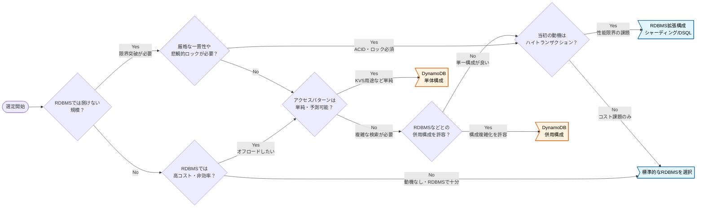

# DynamoDB の技術選定

DynamoDB は予測可能なアクセスパターンで低遅延を提供するが、クエリの柔軟性を犠牲にしている。
将来のアクセスパターンを定義できない、アドホックなクエリや厳格な一貫性が必要などの場合は RDBMS を検討する。
出典は [DynamoDB設計ガイドライン](about.md) (CC BY 4.0) で、OKF の形式に合わせて分割、変更している。

## DynamoDB選定

DynamoDBは、フルマネージドで高い拡張性を持つ反面、性能を最大化するために機能が意図的に絞り込まれている。RDBMSとは全く異なるクセの強い特性を持つため、技術選定ではそれらを理解した上での慎重な判断が求められる。

DynamoDBとRDBMSの特性や用途は以下の通り。

- **DynamoDBの特性と用途**
  - 予測可能なアクセスパターンに対して、大規模なトラフィックでも安定した低遅延を提供できる
  - ECのカートなど、シンプルなキーによる高速な読み書きの要件に向く。性能と拡張性を最大化するために、クエリの柔軟性を犠牲にしているとも言える
- **RDBMSの特性と用途**
  - Amazon Aurora PostgreSQLなどのRDBMSは、SQLによるクエリの柔軟性と、厳格なトランザクションによる一貫性に強みを持つ。データの関連性が複雑な業務システムや、多角的なデータ分析・集計が求められる要件に向く
  - 正規化されたデータモデルとJOINは、将来の未知の要求に対する変化対応力を担保する

推奨は以下の通り。

- 以下のいずれかに該当する場合、DynamoDB採用のノックアウト要件である。原則、RDBMSの選択または併用を検討する
  1. 将来にわたる全てのアクセスパターンを、設計段階で定義できない場合。ビジネス要件の変更に伴い未知の検索・集計要件が発生しうるシステムでは、途方もない開発/運用コストやインフラ費用がかかり技術的負債となる
     - S3 Export \+ Athenaで緩和も可能だが、リアルタイム性はなく、データ転送やクエリ実行にもコストと手間がかかる点は変わらない
  2. BIツールやデータサイエンティストによるアドホックなクエリ要求や、エンドユーザーによる組み合わせの検索条件が求められる場合。GSIなどでカバーできる範囲もあるが、結果整合性であるため一貫性に課題があり、SQLを利用できるRDBMSが優位
  3. 複数のデータ集約をまたがる、厳格な一貫性が求められる場合。DynamoDBにもトランザクションはあるが、最大100アイテムの制限がある。また、RDBMSのような悲観的ロック（行ロック）とは異なり、競合発生時のエラーハンドリングがアプリケーション側に求められる

検討フローのサンプルを以下に示す。

> [!TIP]
> **適材適所で判断する**
>
> システムの全てのデータストアを単一技術で統一する必要はない。コアとなるSoR（System of Record）はRDBMS、キャッシュはDynamoDBといったように、機能要件ごとに最適なデータストアを組み合わせるポリグロットパーシステンスを常に考慮に入れる。

<!-- 前の注記と分ける -->

> [!TIP]
> **迷ったらRDBMSを選定する**
>
> 技術選定で確信が持てない場合、特に業務システムにおいては、まずRDBMSで実現できないかを検討すると安全である。DynamoDBは「RDBMSでは解決できない明確な課題（特に拡張性や遅延）」がある場合に採用を検討する、という判断手順が良い。

<!-- 前の注記と分ける -->

> [!TIP]
> **DynamoDBとAuroraとの併用の是非**
>
> 大量のINSERT/UPDATEが発生するユースケース（ECや証券など）では、Aurora（PostgreSQL） 側の負荷軽減のため、DynamoDBでリクエストを受け止めDynamoDB StreamsなどでAuroraに反映する構成を考えたい場合がある。この場合も安易なDynamoDB導入は避けた方が良い。
>
> 例えば過去のプロジェクトでは、適切なインスタンスサイズとクエリチューニングを前提に、秒間700トランザクション（1トランザクションあたり3SQL程度）をAurora（PostgreSQL）で処理できた実績もある。高負荷を理由に単純にDynamoDBを導入するのではなく、まずはRDBMSで対応可能かを見極めるべきである。構成をシンプルにすることで、相当量の設計開発/運用コストを減らせるためである。負荷軽減を目的に部分的なDynamoDB導入を検討する場合は、負荷試験などで必要性を慎重に見極める。
>
> 注意点を紹介する。
>
> - DynamoDBとAurora間でデータ反映が非同期（結果整合性）となるため、遅延や障害時にデータ不整合となるリスクを内包する。例えば在庫数のように、DynamoDBとAurora間で強い一貫性が求められる業務特性にはフィットさせにくい
> - NoSQLとRDBのデータモデルの差異や実装上の課題は多い。特に倉庫在庫棚卸しのような絶対値での在庫数を洗替する処理など、RDB側に加えられた大量のレコード更新をDynamoDB側へ反映させる双方向同期の要件がある場合は、データ整合性の担保が難しく適さない
>
> なお、DynamoDBを ”正” のメインデータストアとして導入する場合は、こうしたデータ整合性の問題が発生しないため、この限りではない。
