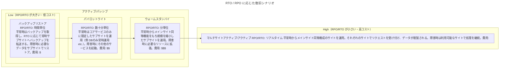

# PostgreSQL の BCP/DR

BCP/DR の考え方と、RPO/RTO に応じた復旧要件を定める。
バックアップ/リストアと世代管理の方針を定める。
出典は [PostgreSQL設計ガイドライン](about.md) (CC BY 4.0) で、OKF の形式に合わせて分割、変更している。

## BCP/DR

本ガイドラインにおけるBCP、DRは以下を指す。

| 名称                          | 説明                                                                                                               |
| :---------------------------- | :----------------------------------------------------------------------------------------------------------------- |
| BCP: Business Continuity Plan | 災害やテロ、パンデミックなどの緊急事態が発生した際に損害を最小限にし、事業の継続や復旧を図るための計画のこと       |
| DR: Disaster Recovery         | 災害復旧のことでシステムが壊滅的な状況になった際に損害が最小限で済むように備えること、速やかに復旧させる対策のこと |

事業の継続性のために、例えば災害をどこまで考慮するかが観点となる。

| 想定する緊急事態              | 対策                                       | 対応コスト | 対応必須 |
| :---------------------------- | :----------------------------------------- | :--------- | :------- |
| DC内のサーバーが障害          | オートヒーリング                           | 低         | ✔        |
| 落雷、竜巻でDCが停電 / 破損   | マルチAZで構成を組む                       | 低         | ✔        |
| 関東一帯で天災                | 東京 / 大阪のマルチリージョン構成          | 中～高     | ❓️       |
| 関東 / 関西で同時多発的な天災 | シンガポールなど海外のマルチリージョン構成 | 中～高     | ❓️       |

推奨は以下の通り。

- オートヒーリング / マルチAZ 構成をできる限り構築する（SPOFはつくらない）
- マルチリージョン構成は、各プロジェクトで決める

理由は以下の通り。

- システムとしてどのレベルまで担保する方針にするかは、BCP計画次第でありシステムだけで閉じる話ではない（例えばビジネスが関東でのみ展開されている場合に、マルチリージョン構成を取るとバランスを欠く）
- マルチリージョン構成は設計コスト / クラウド費用が通常、高くなるため

### 復旧要件

RPO、RTOを定義し、それにより復旧シナリオを4パターンに分類して検討を進めること。

| 名称                          | 説明                                                                 |
| :---------------------------- | :------------------------------------------------------------------- |
| RPO：Recovery Point Objective | 目標復旧時点。どの時点までデータを戻す必要があるかということ         |
| RTO：Recovery Time Objective  | 目標復旧時間。システムの復旧にどれぐらい時間をかけられるかということ |

復旧シナリオは下図の通り。

※上記画像は、[事業継続性が求められる基幹システムの DR 戦略 | Amazon Web Services](https://aws.amazon.com/jp/blogs/news/disaster-recovery-strategy-in-the-cloud/) より引用。

> [!NOTE]
> **参考**
>
> [REL 13 災害対策 (DR) はどのように計画するのですか? - AWS Well-Architected Framework](https://docs.aws.amazon.com/ja_jp/wellarchitected/2022-03-31/framework/w44aac19b9c11c13.html)

### バックアップ / リストア

この節では、あるBCP計画に基づく一例を示す。

DR対策でRTO/RPOが以下のように決まったとする。

- RTO 4時間
- RPO 4時間

復旧の要件から、復旧シナリオは「バックアップ / リストア」に決めることができたとする。

Amazon RDS（Aurora） PostgreSQLにおいては、以下のデータバックアップ方法がある。

|                           | 説明                                                    |
| :------------------------ | :------------------------------------------------------ |
| （1）自動バックアップ     | 指定した日時（1\~35日）に戻すことができる機能           |
| （2）手動スナップショット | 1の保持期間外のデータを保存するために行ったバックアップ |

推奨は以下の通り。

- 基本的には（1）を利用する
- 範囲外の断面を保存したい場合に（2）を利用する

### 世代管理

世代管理とは、直近のデータだけでなく、それ以前のデータも保存するバックアップ方法を指す。RPOとしては直近の断面でリストアすることを想定するが、別の断面でのリストアも可能にしておくことで、リスクヘッジできる。誤操作によるデータ書き換えの発覚が数週間後になった場合や、ランサムウェアによるデータ汚染などを想定している。

推奨は以下の通り。

- コストとの兼ね合いであるが、直近保持（日次3世代など）以外の断面でバックアップ（週次4世代など）取得する
  - 上記の場合は自動バックアップで3日、手動スナップショットを週次で実行する
- 手動バックアップしたデータを、別のリージョンにコピーする

理由は以下の通り。

- DRリカバリとしては直近世代のデータでリカバリ。何かしらのデータ汚染が発生したシナリオにおけるリカバリは、直近であれば自動バックアップから、長期間経過して検知した場合は手動スナップショットからリストアできるため
- 手動バックアップを取るということは、データの安全性へ強い配慮があることから、マルチリージョンで保持し、信頼性を高める。S3間のデータコピーは手間がそこまでかからないため

> [!WARNING]
> **バックアップの順序に気をつける**
>
> 例えば、バックアップ開始前に古いバックアップを消すと、規定する世代数未満しか保持できていない瞬間が生まれてしまう。実行順序に気をつけること。

<!-- 前の注記と分ける -->

> [!NOTE]
> **参考**
>
> - [Amazon Aurora バックアップストレージの使用状況を確認する - Amazon Aurora](https://docs.aws.amazon.com/ja_jp/AmazonRDS/latest/AuroraUserGuide/aurora-storage-backup.html)
> - [【バックアップ基礎知識】世代管理とは｜何世代まで取るのがおすすめか](https://business.ntt-east.co.jp/service/coworkstorage/column/sedaikanri/index.html)
