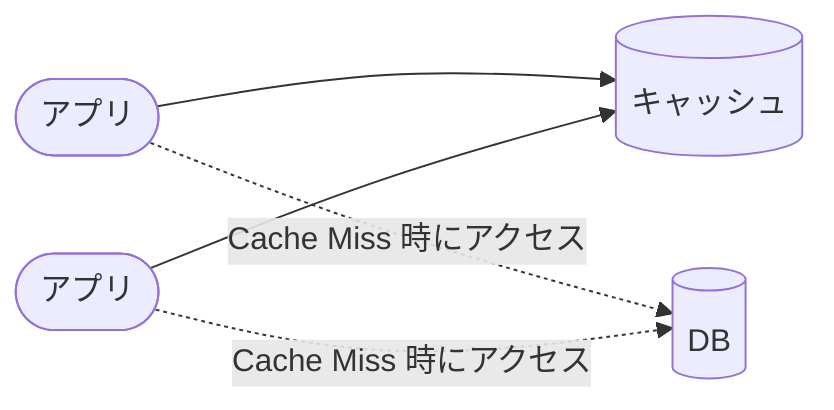
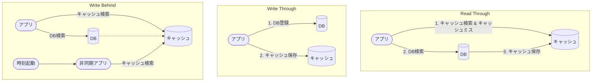

# PostgreSQL のキャッシュ

バッファキャッシュの考え方と、リモートキャッシュの読み書きパターン・破棄ポリシーを定める。
出典は [PostgreSQL設計ガイドライン](about.md) (CC BY 4.0) で、OKF の形式に合わせて分割、変更している。

## キャッシュ

### バッファキャッシュ

どのテーブルのブロックをバッファキャッシュに載せるかは、通常PostgreSQL側に任せる。ただし、以下のような場合は明示的に指定した方が良い。

- PostgreSQLサーバーを再起動した場合で、普段よく使うマスタテーブルなどのキャッシュがないため想定外に初回の画面応答が劣化 / タイムアウトした
- 夜間に実行されたバッチ処理で、画面からの要求で用いるテーブルのキャッシュが落ちたことで、翌日の初回画面応答が劣化 / タイムアウトした

以下の拡張機能を用いると、テーブルやインデックスのキャッシュウォーミングができる。

- [pg_prewarm](https://www.postgresql.jp/document/16/html/pgprewarm.html)
- [pg_buffercache](https://www.postgresql.jp/document/16/html/pgbuffercache.html)

pg_prewarmには以下の実行モードがあり、概要と推奨を下表に示す。

|          | 概要                                                                         | 推奨                |
| :------- | :--------------------------------------------------------------------------- | :------------------ |
| buffer   | 指定したテーブルやインデックスの全ブロックを共有バッファにロードする。       | ✅️ 扱いが容易なため |
| prefetch | OSに非同期のプリフェッチをリクエストし、共有バッファキャッシュにロードする。 |                     |
| read     | ディスクから直接ファイルを読み込む。バッファキャッシュを利用しない           |                     |

実行例は以下である。

```sql
-- 確実にキャッシュに乗せたいテーブルは最後尾の行に追加する
SELECT pg_prewarm('item', 'buffer');
SELECT pg_prewarm('color', 'buffer');
SELECT pg_prewarm('size', 'buffer');
```

テーブルがキャッシュに載っているか確認するには、 `pg_buffercache` から確認ができる。

```sql
SELECT
    c.relname,
    count(*) AS buffers
FROM
    pg_buffercache b
JOIN
    pg_class c ON b.relfilenode = pg_relation_filenode(c.oid)
JOIN
    pg_database d ON (b.reldatabase = d.oid AND d.datname = current_database())
WHERE
    c.relname = 'my_table'
GROUP BY
    c.relname
ORDER BY
    buffers DESC;
```

> [!NOTE]
> **参考**
>
> - [F.30. pg_prewarm — リレーションデータをバッファキャッシュにプリロードする](https://www.postgresql.jp/document/16/html/pgprewarm.html)
> - [PostgreSQL共有バッファと関連ツール | PPT](https://www.slideshare.net/slideshow/postgresql-38768325/38768325)

### ミドルウェアによるリモートキャッシュ

性能観点で、リソース増強などのスケールアップや、リードレプリカ追加などのスケールアウトが有効でない場合、アプリケーションから見たDBの前段にキャッシュサーバー（Redisなど）を配備した構成を取ることがある。



推奨は以下の通り。

- なるべくキャッシュサーバーを導入しないチューニングをまず行う

理由は以下の通り。

- データ整合性の担保が難しい
  - キャッシュとDBの値の整合性をどのように保つか、あるいは不整合を許容する場合にフォールバックする仕組みを考慮するなど、DB単一の構成よりも難易度が高まる
  - キャッシュの無効化、更新タイミング、キャッシュとDBの参照方針を決める必要がある
- キャッシュ管理とインフラの複雑性により負荷が高まる
  - 構成要素が1つ増えることにより、運用 / 監視の負荷があがる
  - 開発時においても、ローカルでの構築対象が増え、テスト時の検証対象も増加し、開発生産性にネガティブな影響がある
- リードレプリカによるスケールアウトで代替できる
  - Amazon Auroraなど、読み取り専用のリードレプリカでスケールアウトできるサービスが増えており、キャッシュサーバーの導入が適するケースは減っていると考えられる

一方で、次のようにDBへの明らかな高負荷に繋がるケースは、引き続きキャッシュサーバーの導入を検討する。

1. リードヘビーなワークロード
   - ECサイトなどで、特にメディア掲載時やキャンペーン時にアクセス数が大きくスパイクするようなサービスなど
2. セッション管理
   - ユーザーセッション管理で、読み取りによる負荷が高い場合
3. 計算結果や集計結果のキャッシュ
   - ダッシュボードアプリケーションでのリアルタイム集計結果のキャッシュ

キャッシュサーバーを利用する方針になった場合、キャッシュへの保存処理方針を次から選択する。

- Read Through（Lazy Caching、Read Aside）
- Write Through
- Write Behind

※他にもWrite Backのようにキャッシュのみに書き込み、DBには非同期で永続化する方式もあるが、データ欠損のリスクは業務システムで許容できないと考えられるので、省略する。



> [!TIP]
> 本来のRead Throughは、CDNのようにキャッシュ機構から透過的にアクセスし、呼び出し元が意識することなくキャッシュを利用する（≒インラインキャッシュ）仕組みである。上図のRead Throughはそれと区別するため、Read Aside（または、Cache Aside）と呼ぶことも多い。本紙では上記を区別せず、Read Throughとデフォルメして表現している。

それぞれの特徴を下表にまとめる。

|               | 概要                                                                                     | Pro                                                                                                                                                              | Cons                                                                                                                                                                                                                  |
| :------------ | :--------------------------------------------------------------------------------------- | :--------------------------------------------------------------------------------------------------------------------------------------------------------------- | :-------------------------------------------------------------------------------------------------------------------------------------------------------------------------------------------------------------------- |
| Read Through  | キャッシュにデータが存在しない場合、DB参照して値をキャッシュに保存、値を呼び出し元に返す | ・クライアントは常にキャッシュを通してデータを取得するため、操作が単純かつ統一的                                                                                 | ・初回アクセス時にキャッシュミスが発生、DBアクセスが発生するため、遅延が生じる ・キャッシュが古いデータを保持している可能性があり、TTL設計が必須                                                                      |
| Write Through | DB書き込みと同時にキャッシュにも書き込む                                                 | ・キャッシュが最新の状態を維持可能 ・読み取りが高速                                                                                                              | ・書き込みがキャッシュサーバーとDBの2フェーズコミットとなるため、整合性の維持の設計が必要                                                                                                                             |
| Write Behind  | 定期間隔でキャッシュにDBのデータを書き込む                                               | ・キャッシュ対象を集計結果など時間がかかる処理でもアプリの読み取り / 書き込みに影響無しで行える ・アプリケーションからはキャッシュに書き込む操作を意識せずに済む | ・非同期更新になるためキャッシュとDBで整合性差異が発生する ・一定間隔で起動するジョブ用のスケジューラやプロセスが必要となり、インフラレベルの構成要素が増えること、単体テストの事前データ登録する対象が増えることなど |

推奨は以下の通り。

- 「Write Through」 「Write Behind」方式のいずれか採用する
  - 「Read Through」の課題であるキャッシュとDBの整合性差異の許容が通常難しいため
  - 「Write Through」はキャッシュが常に最新である想定であり、アプリ設計の難易度を比較的下げられるため。また、キャッシュを配備する目的が参照処理の高速化とすると、読み取り性能に悪影響が少ないことは利点である
  - 「Write Behind」は、集計処理（例えば、何かしらの集計軸を元にした在庫数計算など）など時間かかる処理を非同期で切り出せば、アプリ性能に影響を与えずキャッシュに載せやすいメリットがある。データ整合性差異が出るため、最終的にはDBを正としてビジネスロジックを実装する必要がある

#### キャッシュの破棄ポリシー

- TTLを適切に設定する
- LRU（Least Recently Used. 直近に参照した時刻が一番古いものを捨てる）などのポリシーで、もっとも効果的なものを推奨とする
