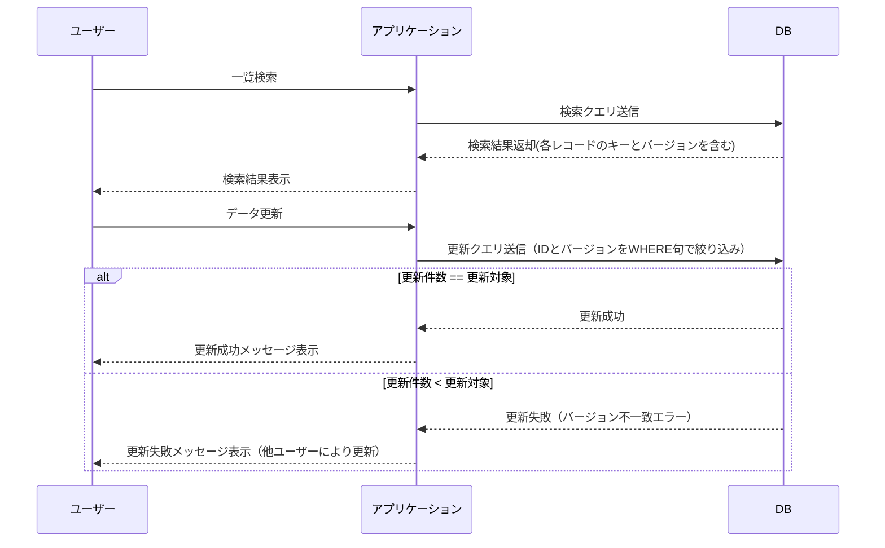
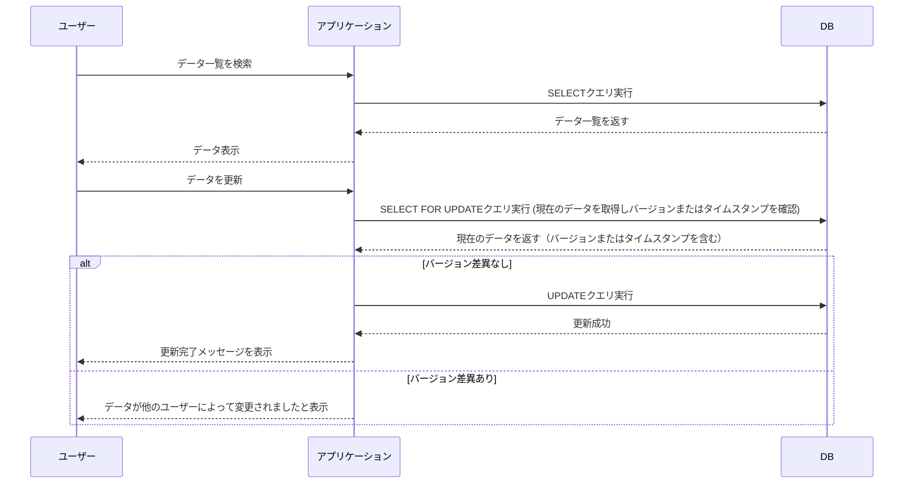
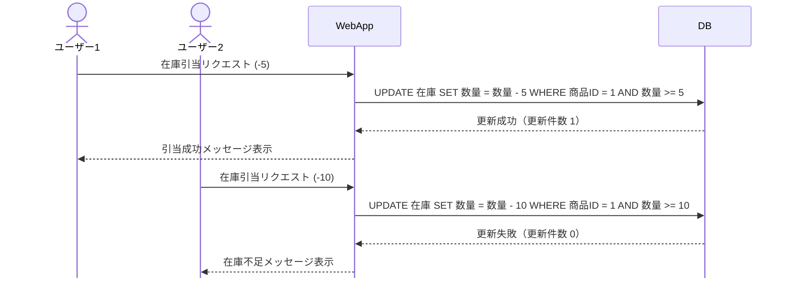

# PostgreSQL の排他制御

トランザクション分離レベルの選び方を定める。
楽観的ロックは SELECT FOR UPDATE でバージョン比較する方式を推奨する。
出典は [PostgreSQL設計ガイドライン](about.md) (CC BY 4.0) で、OKF の形式に合わせて分割、変更している。

## 排他制御

排他制御とは、複数のトランザクションが同時に同じデータへアクセスする際に、データの一貫性や整合性を保つための制御方法を指す。データの競合や不整合を防ぐことを目的とする。

### トランザクション分離レベル

トランザクションの分離レベルは、標準SQLでは下表で規定されている。

| 分離レベル       | 説明                                                                                                                                     | 補足                   |
| :--------------- | :--------------------------------------------------------------------------------------------------------------------------------------- | :--------------------- |
| READ UNCOMMITTED | 未コミットの変更を読み取る可能性                                                                                                         | PostgreSQLでは利用不可 |
| READ COMMITTED   | コミット済みの変更のみを読み取る。                                                                                                       | デフォルト             |
| REPEATABLE READ  | トランザクション開始〜終了 まで一貫した読み取りが保証される。ファントムリードは防げない                                                  |                        |
| SERIALIZABLE     | トランザクションは完全にシリアル化され、同時に実行された複数のトランザクションが順序づけられるかのように扱われ、一貫性が最も保証される。 |                        |

推奨は以下の通り。

- PostgreSQLデフォルトである「READ COMMITTED」で動作させる
  - 理由1: SELECT FOR UPDATEで排他ロックを取ることで、業務処理で必要な整合性を守れる
  - 理由2: PostgreSQLでは「REPEATABLE READ」以上のレベルにすると、MySQL よりも積極的・予防的に競合エラーを起こすようになっているため

> [!NOTE]
> **参考**
>
> [WHERE 条件のフィールドを UPDATE するのって，明示的にロックしてなくても安全？全パターン調べてみました！ #MySQL - Qiita](https://qiita.com/mpyw/items/14925c499b689a0cbc59)

「REPEATABLE READ」を利用する方針としては以下のいずれかの条件に一致する場合とする。

- 条件1: WHERE 句に含まれるサブクエリの SELECT から自己参照が発生する場合（業務上、利用することはほとんど無い想定）

```sql
-- WHERE 条件のフィールドを UPDATE するのって，明示的にロックしてなくても安全？全パターン調べてみました！ #MySQL - Qiita より引用
UPDATE products
SET remaining_amount=remaining_amount-1
WHERE EXISTS(
  SELECT * FROM (
    SELECT * FROM products WHERE id=1 AND remaining_amount>0
  ) tmp
);
```

- 条件2: 複雑なレポート生成など、トランザクション中での数値計算の整合性を保ちたい場合（業務上、利用することはほとんど無い想定）。ただし、ファントムリードは防げないため、REPEATABLE READを信用しすぎないこと。また本当に業務要件で求められる整合性はよく整理すること。

> [!NOTE]
> **参考**
>
> [SQLトランザクション分離 実践ガイド | POSTD](https://postd.cc/practical-guide-sql-isolation/)

### アプリケーション排他制御

バッチ処理の同時実行数制御などは、共有ファイルを用いた手法が存在するが、本ガイドラインの対象外とする。DBを用いてのロック手法には以下の3種類が存在する。

| ロック手法       | 説明                                                                                                                                                                                           | 主な特徴                                                                                                                                                                                |
| :--------------- | :--------------------------------------------------------------------------------------------------------------------------------------------------------------------------------------------- | :-------------------------------------------------------------------------------------------------------------------------------------------------------------------------------------- |
| 楽観的ロック     | データを変更する前にロックを取得せず、更新時にデータのバージョンを確認し、競合がないことを確認し整合性を担保する                                                                               | 主に読み取りが多いシナリオで効率的。競合が発生した場合、トランザクションをリトライする必要がある≒**変更内容を再入力してもらうことが許容できるか**の考慮が必要                           |
| 悲観的ロック     | データ変更前にロックを取得し、他のトランザクションが該当レコードにアクセス不可にさせる手法だが、Webシステムでは通常、実現が難しい。ロック / ロック解放もアプリケーションで実装する必要がある。 | 変更前に検知できるため、競合を確実に回避可能（手戻りを無くせる）。長時間ロックを保持してしまうとユーザビリティが低下する懸念                                                            |
| DBによる行ロック | UPDATEなどの更新処理で`RowExclusiveLock`を取るため、他のトランザクションからの更新を待たせることができる。そのことから更新条件や更新結果を上手く扱うと整合性を担保できる                       | SQL単発のため最も効率的。一方で更新条件、更新件数などの結果で、業務上正しく更新できたか判定する必要がある。在庫引当のような数量の更新では有効、マスタの設定変更のようなケースには不向き |

推奨は以下の通り。

- 複数のユーザーやバッチ処理が、あるテーブルのレコードを同時に変更しうる場合は、上記ロックを取得して競合を防ぐ（ユーザー間の別のだれかの変更を誤って上書きしないようにする）
- 楽観的ロックを優先的に採用する
- 業務上不可欠でなければ（入力中データの破棄がどうしても許容できない限り）悲観的ロックな思想の画面設計を可能な限り避ける
- DBによる行ロックは在庫の引き当てなど性能上クリティカルになりえる処理においてのみ検討する

#### 楽観的ロック

以下の2案の設計方式があり、案2が推奨である。

| 項目     | １．条件にバージョンを指定しUPDATEの更新件数で比較                                                                                                                                                                    | ２．更新直前でSELECT FOR UPDATEしバージョンを比較 ☆推奨                                                                                                                                                                                        |
| :------- | :-------------------------------------------------------------------------------------------------------------------------------------------------------------------------------------------------------------------- | :--------------------------------------------------------------------------------------------------------------------------------------------------------------------------------------------------------------------------------------------- |
| フロー図 | 図1（表の下）                                                                                                                                                                                                         | 図2（表の下）                                                                                                                                                                                                                                  |
| 説明     | 更新レコードのPK＋バージョンを指定してUPDATE。更新件数 \< 想定件数 だった場合にROLLBACKする。そのため件数一致を必ずアプリケーション上で行う必要がある。                                                               | 更新直前にSELECT FOR UPDATEで行の排他ロックを取り、取得したレコードのバージョンを比較。異なった場合はROLLBACK                                                                                                                                  |
| 注意     | ・更新時にロック番号の加算を必ず行う必要                                                                                                                                                                              | ・更新時にロック番号の加算を必ず行う必要 ・SELECT FOR UPDATEで行ロックを取る際は、デットロックを防ぐため、ロックを取るテーブルの順序、レコードのソート順（PK順など）を決め、全てのアプリケーションがそれに従う必要                             |
| Pros     | SELECT FOR UPDATE分のDBアクセスを減らせる                                                                                                                                                                             | ・ロックするテーブル順さえ守れば、1よりエラーハンドリングがシンプル ・競合した場合は1より早く検知できるため、フィードバックを早められる。UPDATE処理が長い場合はUXが高められる ・バッチと同一時間帯・同一データを更新する要件の場合に相性が良い |
| Cons     | ・更新件数のハンドリングを確実に行う必要がある。特に複数テーブルを更新する場合は、都度件数チェックが必要となる ・UPDATE処理が長い場合、他のトランザクションの更新が走ってしまう余地が生まれそれを取り消すコストがある | ・1よりわずかにスループット性能上不利                                                                                                                                                                                                          |

図1



図2



なお、ロックについては以下のオプションがある。画面からの要求に対するロックはNOWAITを指定することが多いが、要件に合わせて待機時間を調整する。

| オプション                       | SQL例                                                                         | 説明                                                                 |
| :------------------------------- | :---------------------------------------------------------------------------- | :------------------------------------------------------------------- |
| オプション無し                   | `SELECT * FROM sales WHERE id = 1 for update;`                                | デフォルトで待機時間は無限                                           |
| タイムアウト指定                 | `SET LOCAL lock_timeout = 5000; SELECT * FROM sales WHERE id = 1 for update;` | ミリ秒単位で待機時間を指定                                           |
| 待機時間無し                     | `SELECT * FROM sales WHERE id = 1 for update NOWAIT;`                         | 待機時間無し（ロック未取得の場合即時エラー）                         |
| ロック取得不可レコードはスキップ | `SELECT * FROM sales WHERE id = 1 for update SKIP LOCKED;`                    | ロック取得不可のレコードはスキップし、その他のレコードはロックを取る |

> [!TIP]
> ロック番号はバージョン番号と呼ぶこともある。
> ロック番号の代わりに、最終更新日時で比較することもあるが、より厳密に制御できるロック番号の利用を推奨する。

#### 悲観的ロック

3層型C/Sアプリケーションにおいて、最初の一覧表示時点でSELECT FOR UPDATEにより行ロックを取得して悲観的ロックを実現できない。HTTPリクエスト / レスポンスでDBトランザクション境界を超えるためである。そのため、SELECT FOR UPDATEは「楽観的ロック」節の方式2にあるような使用方法となる。

もし、3層型C/Sアプリケーションにおいて画面表示時点で悲観的ロックが必要になる要件があった場合は、要件の調整を推奨する。どうしても業務上必要な場合は、ロックテーブルを作成し、行ロックのような仕組みをアプリケーション上で再現する。その際はロックの解放をどのようなタイミングで行うかも同時に設計する。

> [!NOTE]
> **参考**
>
> [Webアプリケーションにおける誤った悲観ロックの実装方法（Q\&A形式）](https://satob.hatenablog.com/entry/2023/08/20/223055)

#### DBによる行ロック

処理フローを下図に示す。



上図ではユーザー2の在庫不足により、在庫引当が失敗したとする。この場合は、在庫不足である旨をユーザー2に通知し、業務判断を委ねることを想定する。ユーザー1とユーザー2の処理が全く同時であったとしても、PostgreSQL上で`RowExclusiveLock`を先取りした側の処理が優先され、もう片方は待機することになる。

「DBによる行ロック」が適用できないケースは多い。

- マスタメンテナンスのように、前回の値が重要であるケース（後勝ちでの上書きが許容できないケース）
- 仮受付 -> 受付 -> 完了 といったステータス遷移を伴う更新

特に理由がない場合は、楽観的ロックによる実装を推奨する。

> [!NOTE]
> **参考**
>
> - [WHERE 条件のフィールドを UPDATE するのって，明示的にロックしてなくても安全？全パターン調べてみました！ - Qiita](https://qiita.com/mpyw/items/14925c499b689a0cbc59)
> - [データベースの排他制御](https://fintan.jp/wp-content/uploads/2022/03/Database-Exclusion-Control.pdf)
> - [https://terasolunaorg.github.io/guideline/5.9.0.RELEASE/ja/ArchitectureInDetail/DataAccessDetail/ExclusionControl.html](https://terasolunaorg.github.io/guideline/5.9.0.RELEASE/ja/ArchitectureInDetail/DataAccessDetail/ExclusionControl.html#id4)

#### オンライン中バッチ

[バッチ設計ガイドライン](https://future-architect.github.io/arch-guidelines/documents/forBatch/batch_guidelines.html#%E3%82%AA%E3%83%B3%E3%83%A9%E3%82%A4%E3%83%B3%E3%81%A8%E3%81%AE%E6%8E%92%E4%BB%96%E5%88%B6%E5%BE%A1) を参照すること。
