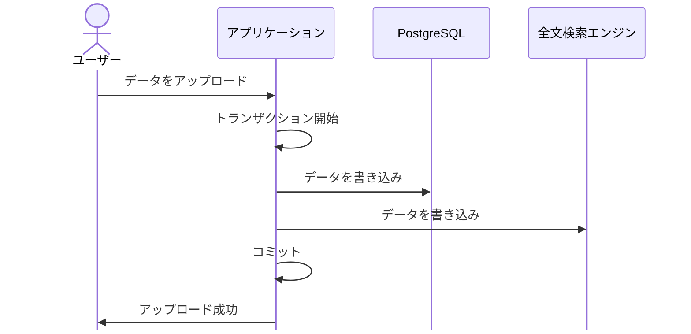
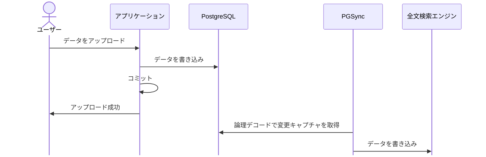

# PostgreSQL のデータ連携方式

マスタデータ配布、全文検索エンジン連携、OLAP 連携、ゼロETL の連携方式を定める。
出典は [PostgreSQL設計ガイドライン](about.md) (CC BY 4.0) で、OKF の形式に合わせて分割、変更している。

## データ連携方式

### マスタデータ配布

あるシステムがメンテナンスするマスタデータを他のシステムで利用することはしばしば発生する。この時、該当のレコードを複数のシステムが編集したい場合は、マスタデータ管理（MDM）のような仕組みを検討することが多い。一方、下流のシステムが参照しか必要としない場合も多い。本節ではこのような場合の連携方式を考える。

以下のような連携パターン方式が考えられる。

| 手法                 | 説明                                                                 | 主な課題や制約                                                                                                                                                    |
| :------------------- | :------------------------------------------------------------------- | :---------------------------------------------------------------------------------------------------------------------------------------------------------------- |
| （1）DBリンク        | dblink/fdwを用いた、DB共有を行う                                     | システム間の結合度が大きく、将来的な負債に陥りやすい                                                                                                              |
| （2）バッチ          | 定期的に連携先システム向けにマスタデータを抽出したファイルを作成する | 鮮度問題（遅延が大きい）                                                                                                                                          |
| （3）非同期（Push）  | マスタデータの変更があったタイミングで、非同期で差分を連携する       | 実装難度が高い（データ整合性を担保することが難しい）                                                                                                              |
| （4）Web API（Pull） | 他システムが利用する際に、Web API形式でマスタを参照してもらう        | 参照レコード数が大きい場合は、性能劣化の懸念。チューニングのため結局呼び出し元でキャッシュ（腹持ち）になりがち。Web API呼び出しが随時になる場合は、結合度が高まる |

推奨は以下の通り。

- 1, 4の手法は採用しない
  - 性能 / システム結合度の問題が看過しにくい
- 2また3の手法を選択、組み合わせる
  - 枯れた手法である2を推奨。要件に応じて3を組み合わせる

2については下表で示すような手法がある。要件次第であるが、数百万件レベルであれば全件反映を採用する。

| 分類 | 抽出方法           | 説明                                                                                    |
| :--- | :----------------- | :-------------------------------------------------------------------------------------- |
| 全件 | -                  | 件数が少ない場合は、一番楽。連携先は受信の都度マスタテーブルを洗替する（TRUNCATE+COPY） |
| 差分 | 最終更新日でSELECT | 定時起動のバッチ処理で実現                                                              |

差分 / 全件に問わず、以下の点に注意する。

- 関連した複数テーブルを連携する場合、実行タイミングによっては不整合データを含むことがある
  - マスタ配信テーブルなどを作成し、整合性が保てたデータのみを連携するなどの工夫が必要
- テーブルのジョインを行った連携ファイルにはできる限りしない
  - 連携先の要望に応えると、連携先が増えるたびにファイル数が増えることになるため

3については、下表で示すような手法がある。リアルタイム性が必要な場合は、CDCなどイベント駆動の処理方式を採用する。

| 手法       | 説明                                                                                                                        |
| :--------- | :-------------------------------------------------------------------------------------------------------------------------- |
| CDC利用    | AWS DMS、Debeziumなどの利用し随時反映する                                                                                   |
| ミニバッチ | 1時間単位など、定時起動のバッチから最終更新日でSELECTする。DB負荷が問題になることもあるため、リードレプリカからの参照が必須 |

### 全文検索エンジン連携

DB（PostgreSQL）と全文検索エンジン（例: OpenSearch）の2つのデータストアを利用する場合の、データ連携方式について記載する。

構成の前提は以下の通り。

- データ永続のプライマリーデータストアはPostgreSQL（正のデータはPostgreSQL）
- 全文検索エンジンはプライマリーデータストアのデータの一部をコピーし、検索処理がオフロードされる構成

PostgreSQLから全文検索エンジンへのデータコピーは、「1.同期 / 2.非同期」の2方式が考えられる（※詳細は後述）。

推奨は以下の通り。

- できる限り「1.同期」で行う
- 同期がレイテンシなど何かしらの制約で実現が難しい場合は、「2.非同期」を検討する

#### 1. 同期

アプリケーション上で、PostgreSQLと全文検索エンジンに両投げする方式である。アプリケーションは多少煩雑になるが、責任分界点は明確で、ローカルを含めた各環境でのテストもしやすいメリットがある。

#### 2. 非同期

通常、全文検索エンジンはデータ登録が高速であるため、「1.同期」の全文検索において、キューイングシステム（例えばAWS SQS）を経由する意味があまりない。追加でRedisが必要となるが、PostgreSQLの[論理デコード](https://www.postgresql.org/docs/current/logicaldecoding.html)を利用したPGSyncによる構成案も考えられる。

> [!NOTE]
> **参考**
>
> - [GitHub - toluaina/pgsync: Postgres to Elasticsearch/OpenSearch sync](https://github.com/toluaina/pgsync)
> - [ECS 外部デプロイコントローラーで PGSync と Elasticsearch を安全にデプロイする - ミツモア Tech blog](https://engineering.meetsmore.com/entry/2023/12/07/143025)

### OLAP連携

業務システムによっては同じシステムドメインにOLAP（DWH）が存在することも多い。例えば、経営管理のように集計処理を多用し、BIで随時レポートが作成される場合は、OLTP/OLAPでDBを分離する設計が取られることもある。本節ではこのような場合の連携方式を考える。

| 手法                              | 説明                                                                                 | 主な課題や制約                                                                                            |
| :-------------------------------- | :----------------------------------------------------------------------------------- | :-------------------------------------------------------------------------------------------------------- |
| （1）アプリで両方投げ             | OLTP、OLAPの両DBにアプリケーションから両投げする                                     | OLAP側の性能に引きずられ、レイテンシ / スループットの性能劣化の懸念がある。キューイングを挟むケースも含む |
| （2）同期アプリをバッチ実行       | 定期的にOLAPに連携用のファイルを作成し、投入する                                     | リアルタイムに新製品の売上動向などを確認したいなどの場合に、鮮度が課題になる事が多い                      |
| （3）定時でOLAPから外部表でロード | dblink/fdwを活用し、OLAP側からOLTPのテーブルをSELECTし、OLAP側のテーブルにINSERTする | 依存度が高まるが、実装コストは低い                                                                        |

推奨は以下の通り。

- OLAPがそのドメインでしか利用しないのであれば、3の方式を許容
- 後々、データ基盤に育ってくるようであれば、依存度を下げるため2にする
- 1はデータ鮮度がどうしても必要な場合にのみ採用する
- AWSを利用している場合は後述のゼロETL導入を検討する

### ゼロETL（AWS）

AWSでRDS/Redshiftの構成であれば、ゼロETLによるOLAP連携ができないか検討する。

- [Amazon Redshift との Aurora ゼロ ETL 統合での作業](https://docs.aws.amazon.com/ja_jp/AmazonRDS/latest/AuroraUserGuide/zero-etl.html)

ゼロETLはRDSやDynamoDBが更新されてからほぼリアルタイムでRedshiftにデータを同期する仕組みであり、AWS設定のみで導入できる。

> [!TIP]
> **ゼロETLの対応状況**
>
> [Amazon Aurora PostgreSQL および Amazon DynamoDB の Amazon Redshift とのゼロ ETL 統合の一般提供を開始 | Amazon Web Services](https://aws.amazon.com/jp/blogs/news/amazon-aurora-postgresql-and-amazon-dynamodb-zero-etl-integrations-with-amazon-redshift-now-generally-available/)にあるように、2024年12月時点で以下のゼロETLがGAされている。
>
> - Aurora MySQL
> - Aurora PostgreSQL
> - RDS MySQL
> - DynamoDB
>
> ※対応リージョンが限定されている可能性があるので都度確認が必要である。

<!-- 前の注記と分ける -->

> [!NOTE]
> **参考**
>
> [OLAP連携 | I/F設計ガイドライン](https://future-architect.github.io/arch-guidelines/documents/forIF/if_guidelines.html#olap%E9%80%A3%E6%90%BA) にもOLAP連携について記載がある。
