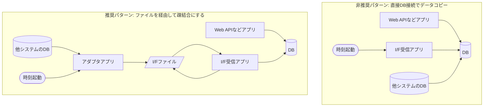

# PostgreSQL の dblink/fdw とリードレプリカ

dblink/fdw での DB 直結は避け、I/F ファイル経由で疎結合にする。
リードレプリカの使い方と、レプリケーション遅延で古いデータを返さない対策を定める。
出典は [PostgreSQL設計ガイドライン](about.md) (CC BY 4.0) で、OKF の形式に合わせて分割、変更している。

## dblink/fdw

PostgreSQLで他DBに接続する（接続される）手法として、以下の2手法が存在する。本章における連携先DBは他システムを想定している。DWHへの接続は [OLAP連携](postgresql-data-integration.md#olap連携) 章を参照すること。

| 手法                                                                    | 説明                                                                                                                    | 主な制約                                                                                                 |
| :---------------------------------------------------------------------- | :---------------------------------------------------------------------------------------------------------------------- | :------------------------------------------------------------------------------------------------------- |
| （1）dblink                                                             | PostgreSQLがクライアントとなり別のDBに接続する                                                                          | ・プッシュダウンができないため、データ転送量が増える                                                     |
| （2）FDW(Foreign Data Wrapper) postgres_fdw、mysql_fdw、oracle_fdw など | dblinkと機能重複があるが、より透過的で標準に準拠した構文を利用可能かつ、性能が良いとされる。postgres_fdwは9.3以降から。 | ・リモートサーバーでのクエリ実行計画が予測困難であり、期待どおりのパフォーマンスが得られないことがある。 |

推奨は以下の通り。

- 原則利用しない（接続する / 接続されるを問わず）
- もし、DB間のデータ連携が必要な場合は、システム間I/F（ファイル）連携を作成する
  - 理由: dblinkやfdwは[Enterprise Integration Patterの共有DB](https://www.enterpriseintegrationpatterns.com/patterns/messaging/SharedDataBaseIntegration.html) に相当するデメリットが生じるため。例えば、スキーマレベルで密結合になるためメンテナンスウィンドウの確保が難しくなり、スキーマ変更時の影響度調査の難易度も上がる。また、依存先のDB障害で連鎖的に自システム側も障害となりえるため可用性が下がる。さらに、依存先のDBのバージョンアップやシステム刷新で課題が生じるなど、運用観点の懸念もある
- データ鮮度が重要であれば、Web APIを作成する
- 自システム側DBのテーブルをdblink/fdwで接続させることはさらに強く禁止とする
- 何かしらの理由で連携先システムがI/F連携を作成できないなどで、避けようがない場合は、参照のみに限るなど利用パターンを極力絞る構成を取る。更新は強く禁止する。参照のみの場合は、リードレプリカに接続してもらう
- 同様に、自システム側のテーブルが更新されるような接続も、強く避けるようにする
- 上記の場合も、dblink/fdwを利用せず、自システム側のアプリケーションからI/Fファイルを作成し、システム移行時の接点を極小化する方針とする（下図を参考）
- 上記全てを理解した上で、DB経由での接続する場合（例えば、1ショットの初期データ移行など）はdblinkではなくfdwを利用する
- もしfdwを利用する場合は、 `FDW_XXX` といったプレフィックスをテーブル名に付与したビューを作成（利用する項目やレコードは必要最小限に絞る）、該当テーブルのみにアクセス権限を絞ったロールを作成し、なるべく結合度を下げる工夫をすること

図: dblink/fdw をなるべく行わない連携方式。



> [!NOTE]
> **参考**
>
> - [dblink](https://www.postgresql.jp/docs/17/contrib-dblink-function.html)
> - [F.35. postgres_fdw](https://www.postgresql.jp/docs/17/postgres-fdw.html)
> - [Oracleデータベースリンクを postgres_fdw に移行してみよう！ケース別の比較もしてみた](https://www.ntt-tx.co.jp/column/postgresql_blog/221121/)
> - [外部データとの連携 ～FDWで様々なデータソースとつなぐ～ | Let's POSTGRES](https://lets.postgresql.jp/documents/technical/fdw)

## リードレプリカ

Amazon RDSやGoogle Cloud SQLには、マスタからレプリケーションされた読み込み専用DBを提供するリードレプリカ機能がある。

※2024.10.17にAmazon Aurora PostgreSQLでリードレプリカの「ローカル書き込み転送機能」がサポートされた。そのため、正確にはリードレプリカに対して読み込み / 書き込みの両方のリクエストを透過的に行える（※2024.10.17時点では、Aurora PostgreSQL バージョン 14.13、15.8、16.4 以降でのサポートであるため、LTS運用を採用している場合は利用できない点に注意）。

- [Amazon Aurora PostgreSQL がローカル書き込み転送のサポートを開始 - AWS](https://aws.amazon.com/jp/about-aws/whats-new/2024/10/amazon-aurora-postgresql-local-write-forwarding/)

マスタ / リードレプリカの構成を採用した際に、アプリケーション側から利用する方針は以下が考えられる。

| 方針案                                                             | 説明                                                                                                                                                     | マスタDBの負荷軽減 | ローカル書き込み転送機能利用 | 設計判断の容易さ |
| :----------------------------------------------------------------- | :------------------------------------------------------------------------------------------------------------------------------------------------------- | :----------------- | :--------------------------- | :--------------- |
| （1）アプリケーションからはリードレプリカを使用しない              | リードレプリカは可用性観点（フェイルオーバー）での利用を想定し、アプリケーションから接続しない。ただし、運用時のデータ調査などはリードレプリカに接続する | ⚠️                 | ー                           | ✅️               |
| （2）参照のみリードレプリカを使用する                              | Web APIなどでGETメソッドの場合はリードレプリカを利用する。                                                                                               | ✅️                 | ー                           | ✅️               |
| （3）参照が大多数の処理であれば、リードレプリカ / マスタを併用する | 2のケースに加え、例えばI/F送信や帳票作成など、大部分のクエリはリードレプリカを用い、最後に管理テーブルにINSERTする場合にマスタを利用する                 | ✅️                 | ✅️                           | ⚠️               |

推奨は以下の通り。

- 大きな理由がなければ、2を採用する

また、以下に注意する。

- アクセスする場合は、DNS経由でアクセスし、フェイルオーバーへ対応できるようにする
- もし、ワークロードの特性などから3を採用したい場合、現在運用しているバージョンがローカル書き込み転送機能に対応しているか確認する

以下に、Goでマスタとリードレプリカごとにコネクションプールを保持する例を示す。Web APIサーバーで、GETメソッドのようにDB参照しか行わない場合は `readReplicaDB` を、POST/PUT/DELETEなどDB書き込みを伴う場合は `masterDB` を利用するイメージである。

```go
var (
    masterDB      *sql.DB
    readReplicaDB *sql.DB
)

func initDB() {
    var err error
    masterDB, err = sql.Open("postgres", "user=youruser password=yourpassword host=master-db-host dbname=yourdb sslmode=disable")
    if err != nil {
        log.Fatalf("connect to master DB: %v", err)
    }

    readReplicaDB, err = sql.Open("postgres", "user=youruser password=yourpassword host=read-replica-db-host dbname=yourdb sslmode=disable")
    if err != nil {
        log.Fatalf("connect to read replica DB: %v", err)
    }
}

func getDBConnection(method string) *sql.DB {
    if method == http.MethodGet {
        return readReplicaDB
    }
    return masterDB
}

func handle(w http.ResponseWriter, r *http.Request) {
    db := getDBConnection(r.Method)
    // … 省略 …
}
```

### 一覧検索が直後で行われた時に、古いデータを返さないか

プライマリーからリードレプリカへの反映には遅延が存在する。RDSとAuroraでは仕組みが異なるため、遅延の大きさには差がある。

| 対象   | リードレプリカへの連携の仕組み                                                   |
| :----- | :------------------------------------------------------------------------------- |
| RDS    | 非同期レプリケーション。ワークロード次第だが、数百ミリ秒～数秒程度の遅延がある   |
| Aurora | ボリュームの共有。レプリカ側のキャッシュを削除するため、数十ミリ秒程度ラグがある |

Auroraについては、ラグが非常に小さく、データ更新→再検索で課題が出るケースはワークロードにもよるがほとんど聞かない。ごく稀に古いデータが参照されても、画面をリロードしてもらう方針で調整することも多い。

RDSは、本節のような懸念が考えられる。

- プライマリーでデータ更新→すぐにレプリカでデータ検索して画面表示（例えば、一覧検索）すると、ラグ（遅延）により古いデータが表示されてしまう

対策として以下の案が考えられる。

| 対応案                                                      | プライマリーDB負荷軽減 | フロントエンド開発工数                                                 | 応答速度                                                      |
| :---------------------------------------------------------- | :--------------------- | :--------------------------------------------------------------------- | :------------------------------------------------------------ |
| （1）GETも常にプライマリーDBを利用                          | ❌️                     | ⚠️更新が一覧検索画面で行われた場合、面倒                               | ✅️DB負荷で遅延の可能性                                        |
| （2）更新操作のレスポンスに表示対象のレコードを返す         | ✅️                     | ⚠️独自の作り込みが必要。他のユーザーによる更新があった場合、整合性に難 | ✅️                                                            |
| （3）GET時にプライマリーDBから参照するオプションを追加      | ✅️                     | ✅️オプション追加するだけ                                               | ✅️                                                            |
| （4）再検索時にSleepを入れる                                | ✅️                     | ✅️容易                                                                 | ❌️Sleep時間の見積もりが難しく、安全に期すと待ち時間が長くなる |
| （5）更新時刻が想定より古い場合は、クライアント側でリトライ | ✅️                     | ⚠️リトライ条件や処理の追加が必要。かつテストがしにくい                 | ⚠️リトライ回数によっては長くなる。                            |

推奨は以下の通り。

- Auroraは原則対策しない。どうしても業務上、データの整合性が求められる場合や、不都合がある場合のみ、RDSと同様の対策を採る
- RDSについては「3.GET時にプライマリーDBから参照するオプションを追加」を採用するなど対策を検討する

> [!NOTE]
> **参考**
>
> - [よくある質問 - Amazon Aurora | AWS](https://aws.amazon.com/jp/rds/aurora/faqs/)
> - [【Aurora】Auroraのレプリカ遅延とは何か - 地方エンジニアの学習日記](https://ryuichi1208.hateblo.jp/entry/2024/05/21/084901)
