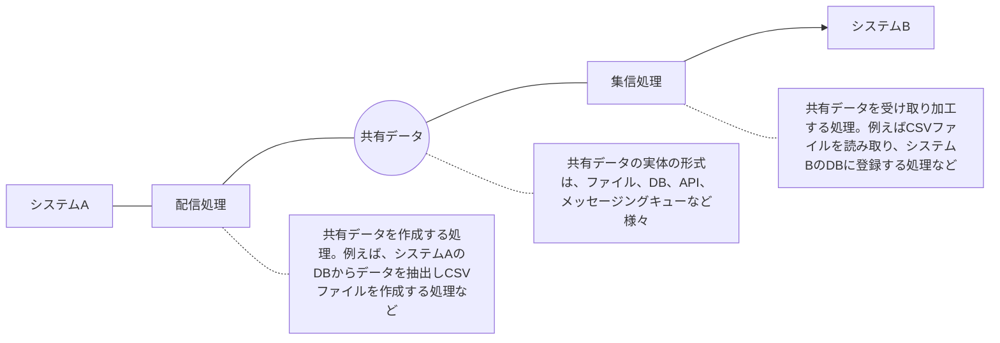

# I/F設計ガイドラインの出典と適用範囲

`docs/interface/` の文書は、フューチャー株式会社の [I/F設計ガイドライン](https://future-architect.github.io/arch-guidelines/documents/forIF/) を元にしている。
I/Fとはインタフェースの略で、システム間のデータ連携におけるシステムインタフェースを指す。クラウドでの開発と、システムごとに独立したクラウドアカウント間でのやり取りを前提にする。

## 出典とライセンス

- 原文: [I/F設計ガイドライン](https://future-architect.github.io/arch-guidelines/documents/forIF/if_guidelines.html) (フューチャー株式会社、[future-architect/arch-guidelines](https://github.com/future-architect/arch-guidelines))
- ライセンス: [CC BY 4.0](https://creativecommons.org/licenses/by/4.0/deed.ja)
- 作成者: 真野隼記、宮崎将太、武田大輝、村田靖拓、山口真明、澁川喜規、山田勇一
- レビュアー: 井上拓、椎名祐介

### 原文からの変更点

- 1つの文書を、責務ごとに複数の文書に分けた。
- 各文書に OKF の frontmatter と、冒頭の要約を足した。
- VitePress の記法 (`<page-title/>`、`::: tip` などのコンテナ、見出しの `{#id}`) を、GitHub の Markdown の記法 (`> [!TIP]` など) に置き換えた。
- 原文の章へのリンクを、分割後の文書へのリンクにした。このリポジトリに取り込んだ他のガイドラインへのリンクは、その docs/ の文書へのリンクにした。取り込んでいないガイドライン (AWS、Terraform、データマネジメント、Git ブランチフロー) へのリンクは、原文のサイトの URL にした。
- 原文トップページ (`index.md`) の構成図 `images/abstract.drawio.png` を、本文書の冒頭に mermaid の図として書き直した。本文中の `images/connect.drawio.png` (配信ファイルの連携数) も mermaid の図に書き直した。比較表のセル内にあった構成図 (mermaid.ink の画像) は、mermaid のコードブロックに戻して各表の直後に配置した。

## 位置づけ

原文トップページの「はじめに」と「用語定義」を、規約の前提として原文のまま残す。

本ガイドラインは、こうしたシステム間のデータ連携するためのI/F設計を説明する。システムI/Fにより、システムを外側から見た振る舞いを定義でき、またシステムあいだの依存関係（結合度）も変わってくる。適切なシステムI/Fを設計することで、システムの外部環境への変化に柔軟に対応し、システムの保守運用を最適化できる。

| 用語         | 説明                                                                                                                                    |
| :----------- | :-------------------------------------------------------------------------------------------------------------------------------------- |
| I/F          | インタフェースの略。本ガイドラインでは特に明記しない限り、対向システム向けのインタフェースのことを指す                                  |
| 対向システム | 自システムから見て、データ連携先（元）のシステムのこと                                                                                  |
| データ連携   | 他システムに自システムのデータを共有すること。ファイル・Web APIなどフォーマット、プロトコルにも依存しない、抽象化された概念であるとする |
| ファイル連携 | データ連携のうち、オブジェクトストレージ上などのファイルを共有することで行うこと                                                        |
| 配信         | データ連携のうち、データを提供する側。送信とも言う                                                                                      |
| 集信         | データ連携のうち、データを利用する側。受信とも言う                                                                                      |
| データ鮮度   | 連携先のデータをどれだけ速く、新しい状態で利用できるかのリアルタイム性のこと                                                            |

## 適用範囲と前提条件

本ガイドラインはシステム間のI/F全般を対象とし、以下の領域を含む。

- システム同士のデータ連携全般。**特に基幹システム同士を指す**
- 自社内のシステム連携や、パートナー企業に対するシステム連携の両方
- ファイル連携、Web API連携、メッセージング、DBリンクなど
- 情報系（OLAP）やデータ基盤へのデータ連携 の一部の手法

逆に、以下の領域は含まない。

- 業務画面、管理画面などUIによる入出力
- 帳票出力
- 印刷
- メール、SMSなどのユーザー向けのメッセージ送信
- データパッチなど、保守運用者によるシステムへの直接操作
- パートナー企業向けのWeb API提供

採用技術やシステム構成は以下を想定している。

- AWS、Google Cloud、Azureなどのクラウドサービスを用いての開発であること
  - オンプレミスでの構築にも応用できる内容も多いと考えているが、ガイドライン作成時は強く念頭に置いていない
- 各システムは独立したクラウドアカウントで構築されており、システム間のデータ連携は一種のクロスアカウント（クロスクラウド）でのやり取りとなること

## 免責事項

原文の免責事項を引用する。

> [!WARNING]
>
> - 有志で作成したドキュメントである。フューチャーには多様なプロジェクトが存在し、それぞれの状況に合わせて工夫された開発プロセスや高度な開発支援環境が存在する。本ガイドラインはフューチャーの全ての部署 / プロジェクトで適用されているわけではなく、有志が観点を持ち寄って新たに整理したものである
> - 相容れない部分があればその領域を書き換えて利用することを想定している。プロジェクト固有の背景や要件への配慮は、ガイドライン利用者が最終的に判断すること。本ガイドラインに必ず従うことは求めておらず、設計案の提示と、それらの評価観点を利用者に提供することを主目的としている
> - 掲載内容および利用に際して発生した問題、それに伴う損害については、フューチャー株式会社は一切の責務を負わないものとする。掲載している情報は予告なく変更する場合がある
