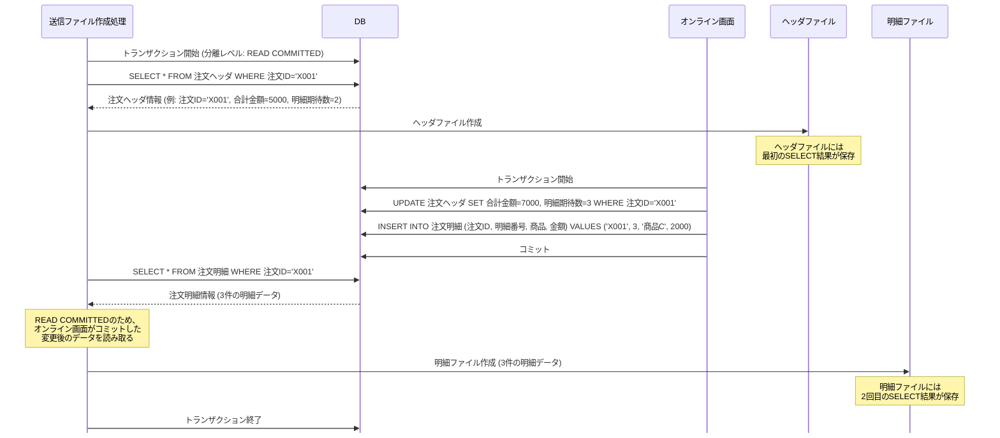

# ファイル連携のデータ整合性

配信ファイル間の整合性は配信側でケアし、静止点調整→抽出条件→行ロック→スナップショット→1ファイル化の順で検討する。
集信の待ち合わせはワークフローエンジンで制御し、集信は冪等にする。取り込みは原則、全件取り込みとする。
出典は [I/F設計ガイドライン](about.md) (CC BY 4.0) で、OKF の形式に合わせて分割、変更している。

## データ整合性

### 配信ファイル間のデータ整合性

複数のテーブルそれぞれで配信ファイルを作成する際、条件によっては配信ファイル間の整合性が崩れうる。例えば、注文ヘッダー・明細のように親子関係のあるテーブルが該当する。ヘッダーファイル作成と明細ファイル作成の間に別のプロセスによる更新処理が入ると、DBのトランザクション分離レベル（READ COMMITTEDなど）によっては、ヘッダーファイルと明細ファイルで件数や合計金額の不一致が生じうる。

【不整合の例】

集信側にデータ不整合を無視してもらう（例えば、常に明細を正とする）仕様が楽ではある。しかしそれが可能であれば、そもそもヘッダーファイルを配信する仕様にはしないはずなので、非現実的である。また、無理に対応してもらえたとしても、システム間のデータ連携の仕様が複雑化し、全体の品質低下にも繋がりうる。一般的には配信側でケアすべきである（そのデータに一番詳しいのは配信側であり、機能配置上もあるべきだと考えられる）。

主要な対応案を以下に示す。なお、DBのトランザクション分離レベルを `SERIALIZABLE` にすることやテーブルロックの取得は、性能上非現実的であるため考慮しない。

1. 静止点が取れないか調整する
   1. オンライン画面や他のバッチ処理と競合しないタイミングを取れないか検討する
2. 作成日時（ `created_at` など）で抽出対象を適切に絞り込める設計ができないか検討する
   1. 追記のみのテーブルであれば可能で、既存レコードへの更新がある場合は採用できない
3. 行ロック（ `SELECT FOR UPDATE`）を最初に取得する
   1. 配信ファイル作成前に、複数のテーブルを結合した `SELECT` 文で `FOR UPDATE` を指定する
4. 処理前にスナップショットを作成する
   1. 一時テーブル（またはワークテーブルやMVIEW）に、ヘッダー・明細のデータをINSERT SELECTでコピーし、そのテーブルから2つのファイルを作成する。コピーのクエリは1本であるため整合性が保たれる（複数のクエリに分けると意味がないため注意する）
5. ファイルレイアウトを、ヘッダー・明細を結合した1ファイルにできないか調整する
   1. [マルチレイアウト](file-layout.md#マルチレイアウト) 節にある通り、本ガイドラインでは非推奨である

推奨は以下の通り。

- 1→2→3→4→5の順番で検討する
- 4を採用する場合、データ調査をSQLで完結できるよう、実表のワークテーブル化を推奨する。ただし、規模が小さなシステムであれば一時表を利用しても良い

### 集信ファイル間のデータ整合性（待ち合わせ）

集信側は以下のケースで、複数のファイルを待ち合わせる必要がある。

- ヘッダー・明細のような親子関係にあるファイル
  - 両方揃って初めて取り込みが開始できる
- 複数のデータソースから関連データを集約したい場合
  - 例えば、キャンペーンサイトから出力される応募者のリストと、CRMシステムから応募者の資格（会員ランクや過去の購入履歴）をそれぞれ集信し、キャンペーン適用の是非や特典付与ロジックに利用する場合
- マスタ・トランの同期
  - POSに含まれる商品コードが最新の商品マスタの値を含むことから、集信側で商品マスタを更新してから、各店舗からのPOS売上実績を取り込む

いずれの場合も、集信ファイルと対になる集信ワークが存在するなら、集信ワークまでは保存して良い。それ以降は関連するファイルの集信が完了するまで待ち合わせる必要があり、これはワークフローエンジンで制御する。

推奨は以下の通り。

- 集信ファイルと対になる集信ワークテーブルまでは、ファイルが到着した順に書き込む
- 全ての集信ワークへの書き込みが完了したタイミング（待ち合わせ）は、ワークフローエンジンで制御する

### 冪等性

一般的に、ジョブは冪等（何度繰り返しても同じ結果になること）な設計にすると運用上優れているとされる。誤って多重実行されても同じ結果になるため、障害復旧時のリランの操作難易度と心理的なハードルを下げられる。

一方で、ファイル作成処理はファイル名にタイムスタンプやUUIDなどをつけることが多く、あえて重複を避ける設計であるため、ファイル出力部分に冪等性をもたせることが難しい。集信はマスタの洗替え等であれば冪等と言えるが、差分データで重複したデータが来た場合、あえてMERGE文を用いた反映にしていない限りは一意制約で落ちてしまう。

推奨は以下の通り。

- 配信側
  - 配信ワークテーブルを作成している場合は、配信ワークにステータス列を追加し、処理済みだった場合は抽出対象外にすることを検討する。ファイルは複数作成されても、レコードの重複は除外できる
  - 配信ワークが作成されない場合は、こういった制御が難しいため、特に考慮できることはない
- 集信側
  - 随時連携などで利用するキューイングサービスは、QoSがAt Least Onceのことが多いため、重複したファイルの作成もありえる。そのため、RDBMSへのMERGE文での反映やアプリケーション側での重複排除など、すでに処理済みなレコードでも冪等な処理ができるようにしておく
  - 定時起動の場合は、INSERTで良い
    - ただし、どの行で落ちたかの原因調査は面倒であることが多いため、一律MERGEで集信させた方が運用性は高い

### 部分取り込み

I/Fファイル取り込みエラーが発生した際、受領したファイルに含まれるレコードの取り扱い方に2つのパターンがある。

| \#                 | （1）全件取り込み                                                                                                                                                                              | （2）部分取り込み                                                                                                                                                                                     |
| :----------------- | :--------------------------------------------------------------------------------------------------------------------------------------------------------------------------------------------- | :---------------------------------------------------------------------------------------------------------------------------------------------------------------------------------------------------- |
| 特徴               | ・受領したファイルに含まれる全てのレコードを取り込む ・1レコードでもエラーになった場合はすべて取り込まない                                                                                     | ・受領したファイルの中で一部レコードのみを取り込む ・エラーレコードがあった場合、そのレコードを除いて取り込む                                                                                         |
| データ整合性       | ✅️取り込み完了時点にてデータ不整合が発生しにくい                                                                                                                                               | ❌️エラーレコードが除外された状態でデータが取り込まれるため、一時的にデータ不整合が発生する可能性がある ❌️除外されたエラーレコードを適切に管理・追跡しないと、恒久的なデータ不整合に繋がるおそれがある |
| データ鮮度         | ❌️エラー頻発時には最新データがいつまでも取り込まれない                                                                                                                                         | ✅️エラー以外の正常レコードは速やかに取り込まれ、利用可能になる                                                                                                                                        |
| 運用・リカバリ     | ✅️リカバリは対象ファイルを一括で処理すれば良いため手順が比較的シンプルになる ✅️レコードの取り込みステータス把握が容易 ❌️再処理は全件を対象とするため、リソース負荷や処理時間がかかる場合がある | ✅️エラーになったレコードのみを修正・再処理すればよいため、影響範囲を限定できる ❌️エラーレコードの特定や修正の運用が煩雑になりがち                                                                     |
| ビジネスへの影響   | ✅️データの完全性が最優先される業務において、不完全なデータセットの混入を防げる ❌️一部の軽微なエラーによって大半の正常データ取り込みがブロックされ、機会損失に繋がるおそれがある                | ✅️正常なデータは遅延なくシステムに反映されるため、データの鮮度を可能な限り高く維持できる ⚠️部分的にデータが欠落した状態で業務が進行することを許容する判断が必要                                       |
| 開発・実装の複雑性 | ✅️取り込み処理やエラー時のロールバック処理など比較的シンプルに実装できる                                                                                                                       | ❌️エラーレコードの特定やハンドリングなど個々のロジックが複雑化しがちである                                                                                                                            |

推奨は以下の通り。

- 原則は（1）を採用する
- ただし、データ整合性よりもデータ鮮度を優先すべき業務仕様の場合には（2）も検討する
