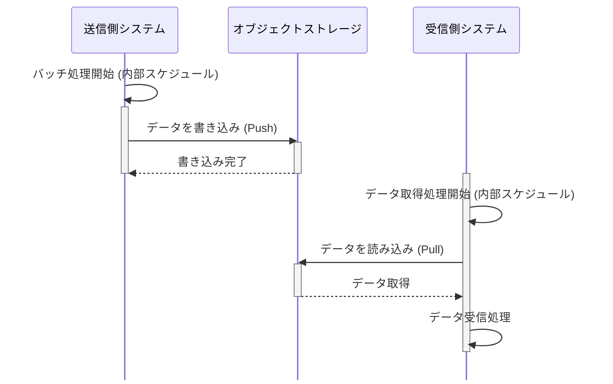

# ファイル連携のデータ鮮度と起動方式

連携頻度はバッチ→サイクルバッチ→マイクロバッチの順に検討し、厳密なイベント駆動は採用しない。
定時連携の集信は未着チェックのため定時起動、随時連携は遅延許容ならポーリングを選ぶ。
出典は [I/F設計ガイドライン](about.md) (CC BY 4.0) で、OKF の形式に合わせて分割、変更している。

## データ鮮度

### 配信ファイル連携頻度

ファイルの連携頻度は、データ鮮度・システム負荷・運用性・コストといった複数の要素を考慮して設計する必要がある。連携頻度は「定時連携」と「随時連携」に大別され、さらに以下の4パターンに分類できる。

- 定時（1日N回、決められた時間帯に連携する）
  - バッチ連携
  - サイクルバッチ連携
- 随時（何かしらの業務イベントが発生の都度ファイルを連携する）
  - マイクロバッチ連携（準リアルタイム。発生から数十秒～数分程度の遅延）
  - イベント駆動連携（リアルタイム。発生から数秒～数十秒程度の遅延）

| \#           | 定時                                                                                                                         |                                                                                         | 随時                                                                                                     |                                                                                            |
| :----------- | :--------------------------------------------------------------------------------------------------------------------------- | :-------------------------------------------------------------------------------------- | :------------------------------------------------------------------------------------------------------- | :----------------------------------------------------------------------------------------- |
| \#           | （1）バッチ連携                                                                                                              | （2）サイクルバッチ連携                                                                 | （3）マイクロバッチ連携                                                                                  | （4）イベント駆動連携                                                                      |
| 説明         | 大量のデータをまとめて処理する。リアルタイム性は低いが、システム効率を上げやすい。処理の確実性や一貫性が求められる場合に有効 | 1h毎など比較的短い間隔で定期的に実行されるデータ連携。頻度によっては（3）の方式に近づく | イベントをある程度まとめて処理することで、リアルタイム性に配慮しつつ、イベント駆動の複雑さを低減する方式 | 業務イベント発生のたびにデータを連携する方式                                               |
| データ粒度   | 大きい                                                                                                                       | 大きい                                                                                  | 業務イベントの何件か集約                                                                                 | 最小粒度（業務イベント単位）                                                               |
| データ鮮度   | ⚠️低い                                                                                                                       | ⚠️低い                                                                                  | ✅️良い                                                                                                   | ✅️最も良い                                                                                 |
| 運用性       | ✅️スケジュールが固定されているため運用管理が容易                                                                             | ⚠️サイクルバッチ間隔が短い（数分単位など）になると、運用が難しくなる傾向                | ⚠️トリガー管理がやや煩雑。ファイル数が増大する傾向                                                       | ❌️トリガー管理がやや煩雑かつ、エラー検知やリカバリ難易度が高い傾向。ファイル数が最大である |
| インフラ費用 | ✅️スケールアウト/ダウンなどの仕組みで下げやすい。またバルクロードなど効率的な方式を採用しやすい                              | ⚠️連携頻度によっては増大する可能性                                                      | ⚠️イベントを小分けに集約することで、利用するサービスの費用を下げやすい                                   | ❌️一般的にコストが高い手法である                                                           |
| ピーク特性   | ❌️あり。オフピークに連携できるのであれば平準化になるが、バッチピークと重なると負荷高騰の懸念あり                             | ❌️あり。バッチピークの重なりは要考慮、要回避                                            | ✅️特性上、負荷は集中しにくい                                                                             | ✅️特性上、負荷は集中しにくい                                                               |

スケジュール起動が最も安価で単純な仕組みであるが、データ鮮度の問題がある。逆に言うと、データ鮮度の問題が無ければ連携頻度を落としたほうがシステム運用のコストは低い。

推奨は以下の通り。

- 業務・システムの両面から、データ連携で本当に求められる要件を確認する（本当に遅延が許されないのか、遅延を減らす業務的な効果がどれくらいあるのか）
- 連携方式を選択する際は、（1）→（2）→（3）→（4）の順序で検討すること
  - データ鮮度の要件は低いほど、システムはシンプルかつ低コストで安定稼働させやすいため
- （1）
  - 1日1回ではなく、朝・夕など1日N回のスケジュール起動（つまり（2）の方式）で調整できる可能性もある
  - DWHへのデータ連携や、比較的更新頻度が低いマスタデータ同期などはこれで事足りる場合が多い
- （2）
  - 日次バッチで鮮度が不足する場合に、（時次・分次）の採用を検討
- （3）
  - データ鮮度の要件が「数分以内」など、厳密なリアルタイム性を求められる場合に採用
  - 例: 店舗売上のリアルタイムダッシュボードのデータ更新や、IoTデバイスのセンサーデータ収集など
- （4）は、原則採用しない
  - マイクロバッチの間隔を短くすれば実質（4）と等価となるため
  - 厳密な1イベント単位の連携は、後述の通りシステム構成の複雑性を著しく増大させ、費用対効果に見合わないため

> [!TIP]
> **リアルタイム性の捉え方に注意**
>
> 業界や技術分野ごとに「リアルタイム処理」という意味合いは大きく異なるため注意が必要である。
>
> 例えば、自動車のエンジン制御や産業ロボットなどは、処理の遅延が重大な事故に直結するため、マイクロ秒～ミリ秒単位の厳密な同期や応答性が求められる。これはハードリアルタイムと呼ばれる。もう少し緩和した世界として、一部の家電製品などは多少の遅延が許容され、ミリ秒～数百ミリ秒の制御で良い場合がある。これはソフトリアルタイムと呼ばれる。また、金融の高頻度取引（HFT）の世界では、低遅延性が企業競争力に直結するためマイクロ秒（ナノ秒！）のしのぎ合いを繰り広げている。
>
> 業務システムの世界においては、一般的にリアルタイムは数秒程度、準リアルタイムはマイクロバッチ的な数十秒～数分程度（≒つまりバッチ処理とは異なる）の遅延を指すことが多い。出身業界によっては違和感を持つアーキテクトも多いと推測されるが、本ガイドラインもこれらの時間感覚を前提として記述されている。

<!-- 前の注記と分ける -->

> [!WARNING]
> **ファイル数の増加に注意**
>
> S3ではオブジェクト数の上限は存在しない。ただし、 `ListObjects` のページング無しで取得できる最大数が1000であるため、それを超えるとちょっとした調査が面倒である。また、Athenaなどとの統合時に、小さなファイルが大量に存在すると不効率である。そのため、Athenaなどで後から検索する運用・調査の作業が考えられる場合は、小さすぎるファイルを一定の粒度に集約するLambdaを追加するなどの考慮が必要となる。

#### バッチ/サイクルバッチ連携構成

定時連携（バッチ/サイクルバッチ）は、JP1やAirflowなどのワークフローエンジンが持つスケジューラ機能を用いることが多い。連携スケジュールは集配信の双方で日時を合意して決める必要がある。

推奨は以下の通り。

- オブジェクト（ファイル）のキー設計は [オブジェクトキー命名規則](object-key-naming.md#オブジェクトキー命名規則) に準じること
- 未着チェックを行うための連携ファイル配信の最大遅延時刻を定義する
- 連携対象のレコードが存在しなかった場合に、0件ファイル（空ファイル）を配信する仕様にする
- 大容量になりえる場合は、ストリーミング的に書き込む実装にする（メモリに全量を抱えない）
  - 普段はデータ量が少なくても、ストリーミング的な実装にすると初期データ移行などに流用できる

※なお、配信/集信側に特化した設計考慮点は後述するため、推奨事項から除いている。

#### マイクロバッチ連携構成

マイクロバッチ連携のシステム構成は、データソースがAuroraのようなRDBか、DynamoDBのようなNoSQLかに大きく依存する。基本的には差分連携になると想定される。全件連携との使い分けは [差分連携](differential-sync.md#差分連携) 章を参考にする。

##### Aurora PostgreSQL

主要な方式は下表が考えられる。

| \#         | （1）最終更新日時から抽出                                              | （2）Debezium利用                                                                        | （3）DMS利用                                                                                 |
| :--------- | :--------------------------------------------------------------------- | :--------------------------------------------------------------------------------------- | :------------------------------------------------------------------------------------------- |
| 説明       | システム共通項目であるupdated_atのような日時カラムを元に差分抽出       | PostgreSQLの変更データキャプチャ（CDC）を利用し、Debezium、Kinesis、Lambda経由で差分送信 | マネージドサービスのDatabase Migration Service（DMS）を用いて、Kinesis、Lambda経由で差分送信 |
| 設計負荷   | ⚠️特にDELETE（物理削除）の場合、差分検知が面倒                         | ⚠️Debeziumのサイジング、監視設定など                                                     | ⚠️DMSのサイジング、監視設定など                                                              |
| 運用負荷   | ✅️シンプル                                                             | ⚠️Debeziumを実行するECS運用コスト                                                        | ✅️マネージドサービスであるため                                                               |
| DB負荷     | ❌️updated_atにインデックス追加してもテーブルサイズ、頻度によっては高い | ✅️テーブル読み取りが不要                                                                 | ✅️テーブル読み取りが不要                                                                     |
| データ鮮度 | ⚠️ポーリング間隔に限界がきやすい                                       | ✅️即時連携が可能                                                                         | ✅️即時連携が可能                                                                             |
| 可搬性     | ✅️高い                                                                 | ✅️高い                                                                                   | ⚠️AWS特有のサービスのため                                                                    |
| 費用       | ⚠️Aurora I/O費用、差分抽出アプリの費用                                 | ⚠️Debezium、Kinesis、S3書き込みアプリ費用                                                | ⚠️DMSのインスタンスサイズに応じた課金                                                        |

CDCを用いた（2）（3）はイベント駆動連携に近しいが、Kinesis Data Streamsに取り込んだ後のバッファリングと起動タイミングの制御により、限りなくマイクロバッチ的であると判断しこの分類にしている。

推奨は以下の通り。

- マイクロバッチの実行間隔が数分以内であれば、（1）は採用しない
  - バッチ連携の差分抽出では利用しても良い
  - 厳密にはテーブル量次第だが、例えば2時間間隔のように連携頻度を落とせた場合は（1）を選択すべきである
- 原則、（3）の利用を検討する
  - Debeziumの運用コスト、学習コストは軽くないという前提
  - DMSも費用は安くないが、Debezium のECSインスタンス費用と比較するとそれほど変わらない（詳細はワークロードやSaving Plansに依存）
- ファイル名、パス形式は、[バッチ連携構成](#バッチサイクルバッチ連携構成)と同じ推奨である
- マイクロバッチ方式でも、連携対象のレコードが存在しない場合は0件ファイル（空ファイル）を配信する仕様にする
  - 遅延監視はしなくても良いが、ジョブの稼働を可視化することで運用性が高まるため
- ファイルの追い抜きがないように注意する
  - 前ジョブの実行中に、次のジョブが起動しないようにする

##### DynamoDB

DynamoDBでは、DynamoDB Streamsを用いて差分データをマネージドに取り扱える。一方で、ハッシュキー＋ソートキーという構成では、同一ハッシュキーでもソートキーが異なるとファイル出力の順序制御が狂いうる（参考にあるリンクを参照）。そのため、マスタデータではDynamoDB Streamsを用いた連携が可能であるが、時系列の並び順が重要であるトランザクションデータ（センシングデータなど）では利用できない可能性がある。

推奨は以下の通り。

- DynamoDB Streamsを用いたマイクロバッチ連携は、条件によっては利用できない可能性があるため注意する
- 順序制御が必要であれば、最終更新日時をGSI項目として、スケジューラで差分抽出する

> [!NOTE]
> **参考**
>
> - [DynamoDB Streams の変更データキャプチャ \- Amazon DynamoDB](https://docs.aws.amazon.com/ja_jp/amazondynamodb/latest/developerguide/Streams.html)
> - [DynamoDB Streamsは同一ハッシュキーでもソートキーが異なれば順序保証されない | フューチャー技術ブログ](https://future-architect.github.io/articles/20221020a/) にハッシュキー単位での順序制御について触れている
> - [オレのDynamoDB Streamsが再着火しないわけがない | フューチャー技術ブログ](https://future-architect.github.io/articles/20210122/) に、再送について触れている

#### イベント駆動連携構成

本ガイドラインでは、イベント駆動は1件単位のデータ連携を指すとする。これはレイテンシが最速であるが、最小粒度のファイルが大量に作成される懸念がある。また、厳密にイベント連携を追求すると、RDBへの書き込み時のトリガーを用いることや、アプリケーション上で同期的に連携データを配信することも考えられる。しかし、これらはアプリケーションとデータ連携処理を密結合にし、保守性を低下させる。CDCを利用した上で、レイテンシを追求しSQSやKinesisなどキューイングサービス無しで構築した場合は、データ欠損や追い抜きの懸念がある。そのため、キューイングサービスを経由する構成が必要となるが、これは事実上バッファサイズを最小化したマイクロバッチであり、マイクロバッチ方式と大差が無くなる。

推奨は以下の通り。

- 厳密なイベント駆動連携構成は採用せず、マイクロバッチ方式を採用する

### ファイル集信の起動方式

配信側がオブジェクトストレージにファイルを書き込んだ後、集信側はスケジュール（ポーリング）やイベント駆動によって集信処理を起動する必要がある。その方式によりデータ鮮度に差が生じる。

考慮ポイントは配信ファイルの連携頻度（定時連携・随時連携）によって変化するため、それぞれで説明する。

#### 定時連携時の集信起動

定時連携では、決められた時刻にI/Fファイルが連携される。随時連携と異なり、本来連携されるはずであったI/Fファイルが定刻になっても未連携の場合は対向システムへの問い合わせが必要になるため、未着チェックが必要である。そのため、下表に示す通り（1）の手段は採用しにくく、（2）と組み合わせる必要がある。なお、（1）のメリットは低遅延だが、そもそも定時連携の時点でそれが優先されることは少なく、（2）を採用することが多い。

| \#           | （1）ファイル作成イベント駆動                                                                                                                                                                                  | （2）定時起動                                                                               |
| :----------- | :------------------------------------------------------------------------------------------------------------------------------------------------------------------------------------------------------------- | :------------------------------------------------------------------------------------------ |
| 説明         | オブジェクトストレージの書き込みイベントを元に、集信タスクを起動する                                                                                                                                           | I/Fファイル連携の門限後の、定められた時間にスケジュール起動する方式                         |
| 機能要件     | ❌️未着チェックの実装が行いにくく、定時起動との組み合わせが必要                                                                                                                                                 | ✅️決められた時刻にファイルの存在を確認するため、未着チェックを行いやすい                    |
| 鮮度         | ❓️遅延は少ないが、そもそも定時連携の時点で遅延が発生しうるため、イベント起動するメリットは少ないはずである                                                                                                     | ⚠️I/Fファイル到着後、定時起動までの間隔の遅延が発生。一定間隔ポーリングさせるなどで緩和可能 |
| インフラ要素 | ⚠️書き込みイベントを取得用のキュー、ワークフロー呼び出しの仕組みが必要                                                                                                                                         | ✅️ワークフローエンジンからシンプルな呼び出しが可能                                          |
| 開発難易度   | ❌️イベントの順序制御などの考慮が必要。異常発生時に以降のファイル取り込みを停止させるといった制御が必要な場合は特に面倒 ❌️At Least Onceで複数回発火する可能性があるため重複イベントの排除など冪等性の担保が必要 | ✅️決められた時刻に存在するファイルを一括で処理するため、順序性担保がしやすく、難易度が低い  |
| 運用性       | ❌️意図しない時間帯に誤連携されたファイルも即座に取り込んでしまう ❌️サービス停止が行いにくい                                                                                                                    | ✅️決められた時間に存在するファイルのみに対象を絞ることができる ✅️サービス停止が行いやすい   |

推奨は以下の通り。

- 原則、（2）を利用する
  - 未着チェックとの相性の良さや、想定外の時間帯に誤送信された場合の取り込みを防ぐことができるため

#### 随時連携の集信起動

随時連携の場合は、起動方式は2方式がある。

| \#           | （1）ファイル作成イベント駆動                                                                                                                                                                                  | （2）ポーリング                                                           |
| :----------- | :------------------------------------------------------------------------------------------------------------------------------------------------------------------------------------------------------------- | :------------------------------------------------------------------------ |
| 説明         | オブジェクトストレージの書き込みイベントを元に、集信タスクを起動する                                                                                                                                           | N分間隔でオブジェクトストレージに未処理ファイルが存在しないか監視する方式 |
| 機能要件     | ✅️随時連携の場合、未着チェックの実装は不要であるため、差は無い                                                                                                                                                 | ✅️差はでない                                                              |
| 鮮度         | ✅️イベント駆動で処理できるため低遅延（通常、数秒以内にイベントが配信される）にできる                                                                                                                           | ❌️最大でポーリング間隔分、遅延が発生                                      |
| インフラ要素 | ⚠️書き込みイベントを取得用のキュー、ワークフロー呼び出しの仕組みが必要                                                                                                                                         | ✅️ワークフローエンジンからポーリングが可能                                |
| 開発難易度   | ❌️イベントの順序制御などの考慮が必要。異常発生時に以降のファイル取り込みを停止させるといった制御が必要な場合は特に面倒 ❌️At Least Onceで複数回発火する可能性があるため重複イベントの排除など冪等性の担保が必要 | ✅️順序性は担保しやすい。キューイングの連携が無いため難易度が低い          |
| 運用性       | ⚠️サービス停止が行いにくい                                                                                                                                                                                     | ✅️サービス停止が行いやすい                                                |

推奨は以下の通り。

- 数分程度の遅延が許容できる場合 → （2）を選択
  - イベント通知に関わるインフラが不要で、構成もシンプルになり開発難易度を下げられるため
  - 開発・運用コストを低く抑えることができるため
- なるべく遅延を減らしたい要件で、数秒単位の低遅延が求められる場合のみ → （1）を選択
  - ファイル到着後、即座に処理を開始できるため、データ鮮度を最大化でき、厳しい要件に対応しやすいため

> [!TIP]
> **AWS S3のputイベントの信頼性**
>
> かつて、S3のイベント通知は欠損する可能性があるとされ、ポーリング処理との合せ技を必要とする時代があった（どうせポーリングが必要であるため、リアルタイム性が求められなければポーリングに寄せることもあった）。
>
> 現在はドキュメント上もAt Least Once（少なくとも1回は送信される）であると強調されているため、イベント通知に依存した作りで問題ないと考えられる。ただし、At Least Onceは、イベントが失われることはないが、稀に同じイベントが複数回配信されうることを意味する。そのため、集信側が同じファイルを誤って二重に取り込まないよう、冪等性を担保した実装（重複実行防止の仕組み）が必要である。
>
> なお、Google Cloud Storageも同様にAt Least Onceがうたわれている。
>
> 【参考】
>
> - [Amazon S3のイベント通知は「稀に失われる」から「少なくとも1回配信」になっていました | DevelopersIO](https://dev.classmethod.jp/articles/amazon-s3-event-notifications-at-least-once/)
> - [Amazon S3 Event Notifications \- Amazon Simple Storage Service](https://docs.aws.amazon.com/AmazonS3/latest/userguide/EventNotifications.html)
> - [Google Cloud StorageのPub/Sub通知](https://cloud.google.com/storage/docs/pubsub-notifications?hl=ja#delivery_guarantees)
