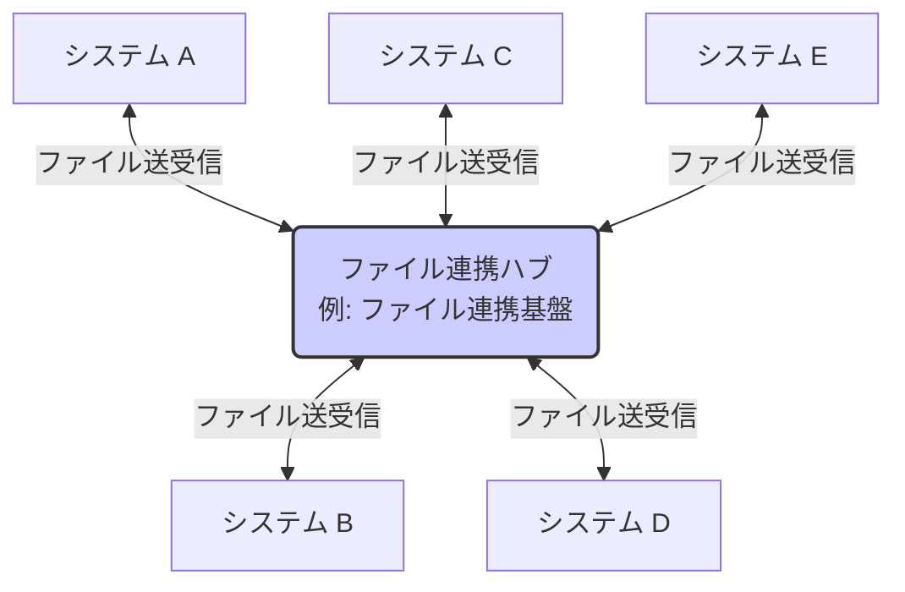
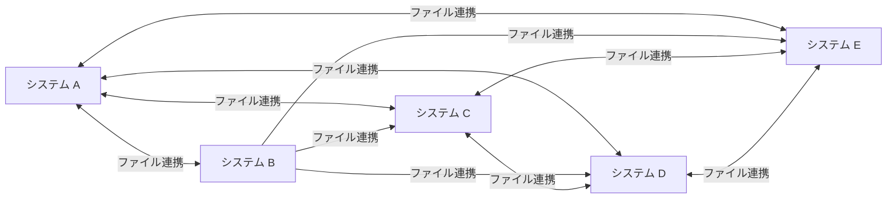

# ファイル連携のシステム構成

原則、ハブシステム (Hub & Spoke 型) の導入を検討し、ハブには汎用的な変換処理に限定した責務のみ持たせる。
他社連携では P2P 型になる。ハブ連携では標準フォーマットに寄せ、スポーク側からプッシュ/プルさせる。
出典は [I/F設計ガイドライン](about.md) (CC BY 4.0) で、OKF の形式に合わせて分割、変更している。

## ファイル共有（File Transfer）

### システム連携パターン

ファイル共有によるシステム間データ連携を設計する際、そのシステム構成（トポロジー）には大きく2つの方針が存在する。代表的な構成パターンである「Hub & Spoke型」と「Peer to Peer (P2P) 型」を下表で比較する。

| \#                 | （1）Hub & Spoke 型                                                                                                                                       | （2）Peer to Peer (P2P) 型                                                                                         |
| :----------------- | :-------------------------------------------------------------------------------------------------------------------------------------------------------- | :----------------------------------------------------------------------------------------------------------------- |
| 図                 | 下図1                                                                                                                                                     | 下図2                                                                                                              |
| 説明               | 中央のハブがシステム間の連携を仲介する方式。スポーク間は互いに非依存。ハブがSPOF（Single Point of Failure: 単一障害点）になるため、高い可用性が求められる | システム同士がハブを介さずに直接1対1で連携する方式。接続により、対向システムに直接依存しやすい。メッシュ型とも言う |
| 開発コスト（初期） | ⚠️高め。ハブ構築コストがかかる場合がある                                                                                                                  | ✅️低め。単純な1対1連携から始められる                                                                               |
| 開発コスト（追加） | ✅️ハブと接続のみ                                                                                                                                          | ⚠️連携先ごとにI/F開発・テストが必要                                                                                |
| 再利用性           | ✅️ハブでの変換ロジック等を再利用しやすい。一度連携済みのデータを別システムに連携可能                                                                      | ❌️連携ロジックが個別ロジック化、再利用が難しくなる傾向                                                             |
| 保守運用性         | ✅️連携ロジックや管理がハブに集約。データ流通を把握しやすい                                                                                                | ❌️システム数増加で接続数が指数関数的に複雑化（スパゲッティ化）、全体像の把握が困難                                 |
| セキュリティ       | ✅️中央で統制を取りやすい                                                                                                                                  | ⚠️各連携経路で個別に設定・管理が必要                                                                               |

下図1 Hub & Spoke 型のイメージ。



下図2 Peer to Peer (P2P) 型のイメージ。



推奨は以下の通り。

- 他社連携の場合は、（2）の構成になる
  - 事実上、（1）は採用できない（ハブの所有は結局、どちらかの会社の持ち物になるため）
- 原則、（1）のようなハブシステムの導入を検討する（すでにあれば利用する）
  - 再利用性を重視し、個別システム向けに特化したデータを連携しない（データマネジメントにおける、データプロダクトを目指す）
- ハブには特定の業務知識に依存しない、汎用的な変換処理に限定した責務のみを持たせ、アプリケーション固有のビジネスロジックは各スポークに持たせる
  - 機能配置の設計判断を簡易にし、実装場所を揺れさせないため
  - 例
    - フォーマット変換（例: CSV → Parquet）
    - 文字コード変換（例: Shift-JIS → UTF-8）
    - 圧縮・解凍（例: gzip）
    - 個人情報などの機微なデータのマスキングなど
- ハブ連携時には、できる限り標準フォーマットにする
  - 日付形式を統一し、全社的なデータモデルの物理名やデータ型に寄せる
  - ファイル形式はできる限りCSV、Parquetなど決められたフォーマットに統一する
- ハブ側から配信側のスポークにファイルをプルせず、スポーク側からプッシュしてもらう
  - ハブ側は門限管理だけ行い、責任分界点をシンプルにするため
  - スポーク側のInboundを極力無くすことで、セキュリティ上のリスクポイントを減らすため
- ハブ側から集信側のスポークにファイルをプッシュせず、スポーク側からプルしてもらう
  - スポーク側の責務とすることで取り込みタイミングの柔軟性を持たせ、責任分界点をシンプルにするため
  - スポーク側のInboundを極力無くすことで、セキュリティ上のリスクポイントを減らすため

> [!TIP]
> **ハブを導入しない場合の構成**
>
> データ連携用のハブシステムの導入が難しい状況も多い。その場合は、（2）型でシステム間のデータ連携を取らざるを得ない。このときは、将来的なハブシステム導入を見越して、以下の方針を取るとよい。
>
> - ファイル形式の再利用性が高まるように、標準的なフォーマット（CSVファイルかつ、物理名や項目値も標準的な形式）を作成し、できる限り準拠する
> - [オブジェクトストレージの所有](object-storage-ownership.md#オブジェクトストレージの所有) 、[バケットの分離方式](bucket-separation.md#バケットの分離方式)、[ファイル集信の完了を示す操作](file-receipt-completion.md#ファイル集信の完了を示す操作) などの推奨ルールを守り、一貫性のある連携方式とする

<!-- 前の注記と分ける -->

> [!TIP]
> **本当にハブを利用すると再利用性が高まるか？**
>
> 対向システムのニーズがある、標準レイアウト・連携頻度を満たしたファイル連携定義にしなければ、ハブを経由したメッシュ連携になってしまう。例えば、システム間でそれぞれ1データ種別を交換する必要があるとする。この場合、システムAはデータ種別1をシステムB\~Fに連携し、他のシステムからデータ種別2 ～ 5を集信する必要がある。理想的には1ファイルの配信（と、5ファイルの集信）で良いはずである。しかし、データ鮮度や必要な項目が微妙に異なり、B・C・D・E・Fが標準レイアウトを受け入れてくれない場合、亜種を5パターン配信する必要がある。ハブを用いたとしても、下図のバッドケースに陥った場合は、各システム向けに配信ファイルを作成する必要があるため、データ配信は `n * (n-1)` となり、ハブを利用しない場合と変化はない。むしろハブを経由する分だけ余計なインフラ費用が発生し、構成の複雑度も高まりマイナスである。
>
> 【配信ファイルの連携数】
>
> ```mermaid
> flowchart TB
>   subgraph ideal["理想: 連携数6"]
>     direction TB
>     A1["システムA"] --> H1(("データハブ"))
>     B1["システムB"] --> H1
>     C1["システムC"] --> H1
>     D1["システムD"] --> H1
>     E1["システムE"] --> H1
>     F1["システムF"] --> H1
>   end
>   subgraph bad["バッドケース: 連携数30"]
>     direction TB
>     A2["システムA"] --- B2["システムB"]
>     A2 --- C2["システムC"]
>     A2 --- D2["システムD"]
>     A2 --- E2["システムE"]
>     A2 --- F2["システムF"]
>     B2 --- C2
>     B2 --- D2
>     B2 --- E2
>     B2 --- F2
>     C2 --- D2
>     C2 --- E2
>     C2 --- F2
>     D2 --- E2
>     D2 --- F2
>     E2 --- F2
>   end
> ```
>
> そのため、それぞれのシステムの要求するデータ鮮度を満たしつつ、標準的なレイアウト（各システムごとに作り込まない形式）を1つに決め、対向システムの全てがそれを集信する取り決めをする必要がある。それを実現できて初めて連携数を抑えられる。
>
> なお、このレイアウト標準化の価値は、主に「配信側」の効率化に現れ、集信側にとってはメリットが少ないという点が重要である。例えばシステムAが集信する立場で、連携元のシステムB・C・D・E・Fからデータを受け取る場合、集信するファイルの数は5つとなる。このファイルのレイアウトが標準化されているかどうかにかかわらず、集信側の開発・テストの手間はさほど変わらない。
>
> つまり、ハブを介したレイアウト標準化の真の価値は、「一度作れば、どこへでも渡せる」という配信側の開発・運用コストの削減にある（集信側にも標準レイアウトを受け入れるのであれば早期にデータ連携を開始できるというメリットはある）。実現には、各システムが個別の要求を取り下げて「標準レイアウト」を受け入れる、組織的な合意形成（ガバナンス）が不可欠となる。

<!-- 前の注記と分ける -->

> [!NOTE]
> **参考**
>
> [DXを成功に導くデータマネジメント データ資産価値向上と問題解決のための実務プロセス75 | 翔泳社](https://www.shoeisha.co.jp/book/detail/9784798171371)
