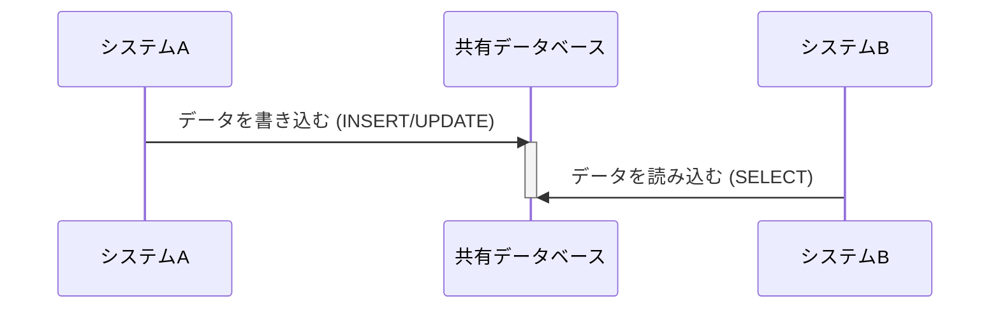
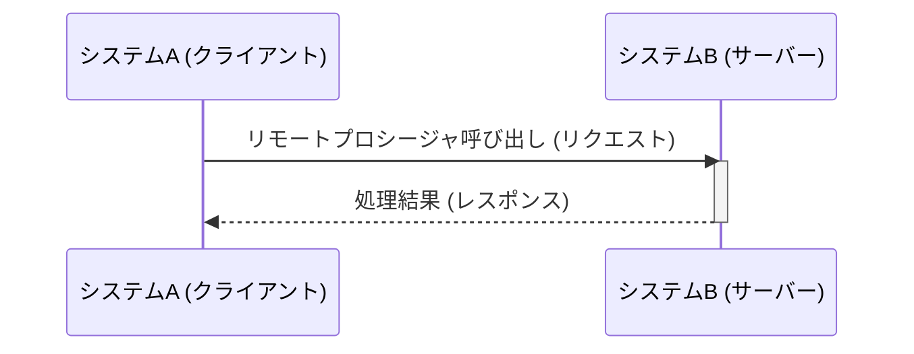
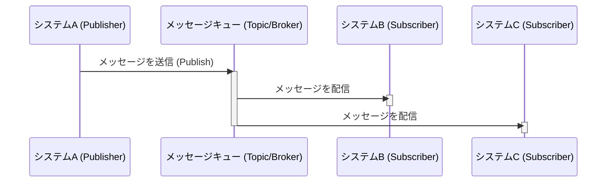
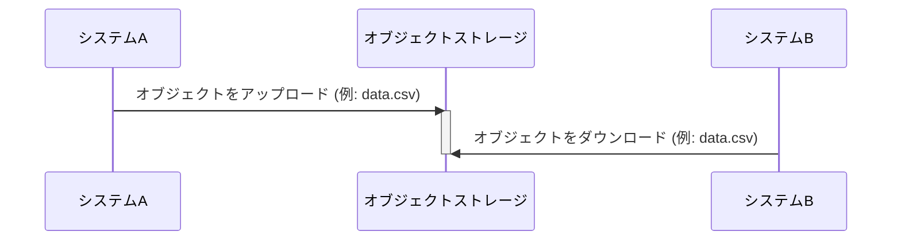

# I/F の統合パターン

連携方式は DB共有・RPC呼び出し・メッセージング連携・ファイル共有の4つに分類し、データ鮮度・結合度・実装運用コストでバランスさせる。
大量データのシステム間連携では原則ファイル共有を利用し、DB共有は採用しない。
出典は [I/F設計ガイドライン](about.md) (CC BY 4.0) で、OKF の形式に合わせて分割、変更している。

## 統合パターン

基幹系システム間のデータ連携方式を検討する上で、エンタープライズ統合パターン（EIP）には以下の4パターンの分類があるとされる。

| \#               | （1）Shared Database                                                              | （2）Remote Procedure Invocation      | （3）Messaging                                                     | （4）File Transfer                                             |
| :--------------- | :-------------------------------------------------------------------------------- | :------------------------------------ | :----------------------------------------------------------------- | :------------------------------------------------------------- |
| 図               | 下図1                                                                             | 下図2                                 | 下図3                                                              | 下図4                                                          |
| 手法             | DB共有                                                                            | RPC呼び出し                           | メッセージング連携                                                 | ファイル共有                                                   |
| 説明             | 複数のシステムが同じDBに直接アクセスする方式。DBリンク（fdw）を用いての連携も含む | Web APIを呼び出してデータ連携する方式 | メッセージキューやメッセージブローカーを経由してデータ連携する方式 | システム間でファイルを交換することによってデータを連携する方式 |
| 同期/非同期      | 非同期                                                                            | 同期                                  | 非同期                                                             | 非同期                                                         |
| データ鮮度       | ✅️高くできる可能性                                                                | ✅️高い                                | ✅️高い                                                             | ⚠️低くなる傾向                                                 |
| 結合度           | ❌️とても高い                                                                      | ⚠️密結合と言える                      | ✅️疎結合                                                           | ✅️疎結合                                                       |
| スケーラビリティ | ⚠️大量データの場合はロック競合のリスク                                            | ⚠️サーバー負荷が高く付く場合がある    | ⚠️サーバー負荷が高く付く場合がある                                 | ✅️バルクロードが得意                                           |

下図1 DB共有の連携イメージ。

下図2 RPC呼び出しの連携イメージ。

下図3 メッセージング連携のイメージ。

下図4 ファイル共有の連携イメージ。

連携方式の選択は、上表のとおり以下の観点をいかにバランスさせるかにある。

1. **データ鮮度:** 連携先のデータをどれだけ速く、新しい状態で利用できるか（リアルタイム性）
2. **システム間の結合度:** 一方のシステムの変更や障害が、他方のシステムに与える影響の度合い。疎結合であるほど影響は少ない
3. **実装・運用の複雑性とコスト:** 連携方式を実現する技術的な難易度と、運用開始後の監視や障害対応のコスト

推奨は以下の通り。

- 大量データの一括処理や、バッチを主体とするシステム間連携では原則、（4）を利用する
  - 特に、組織間で大量データを連携するのであれば性能上、一択である
  - 連携データがファイルという実体を持つため、集配信の記録や管理、障害時の原因調査や再送も容易
  - 各システムは、対向システムの稼働状況に直接依存せず、定められた形式のファイルを定められた場所へ配置・取得する責務に集中できるため、結合度が低い
- （1）は複数システムでDBを共有するデメリットが大きいため採用しない
  - メンテナンスウィンドウの確保が難しい
  - スキーマ変更時の影響度が見えにくい（単一システム内で完結しない）
  - 予期せぬDB負荷の高騰や、意図しないロック競合による障害発生がありえる
- （2）は、モダンな印象と裏腹にシステム間が密結合となる
  - [RPC呼び出し](rpc-web-api.md#rpc呼び出し) 章を参照
  - ただし、SaaSの機能を呼び出すなど、データ交換目的ではない場合は、この限りではない
- （3）はシステム間を疎結合に保ちつつ高いデータ鮮度を実現できるが、メッセージングサービス部分が運用難易度を高めるため、慎重になるべき
  - 再送の対応が難しい（複数システムがコンシューマーにいた場合、他システムへも配信されてしまう）
  - AsyncAPI specificationなどのスキーマ管理が発達しているが、不正データが混入した場合のエラーハンドリングが難しい
  - 静止点が取りにくいため、データ不整合が発生した場合の調査が困難

> [!NOTE]
> **参考**
>
> - [Enterprise Integration Patterns](https://www.enterpriseintegrationpatterns.com/)
> - [Enterprise Integration Patterns: Designing, Building, and Deploying Messaging Solutions (Addison-Wesley Signature Series (Fowler))](https://www.amazon.co.jp/-/en/Gregor-Woolf-Bobby-Hohpe/dp/0321200683)
