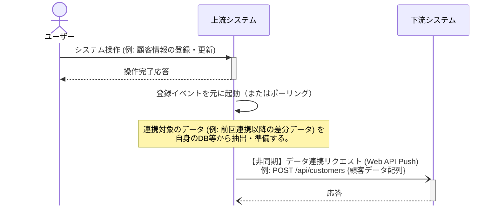
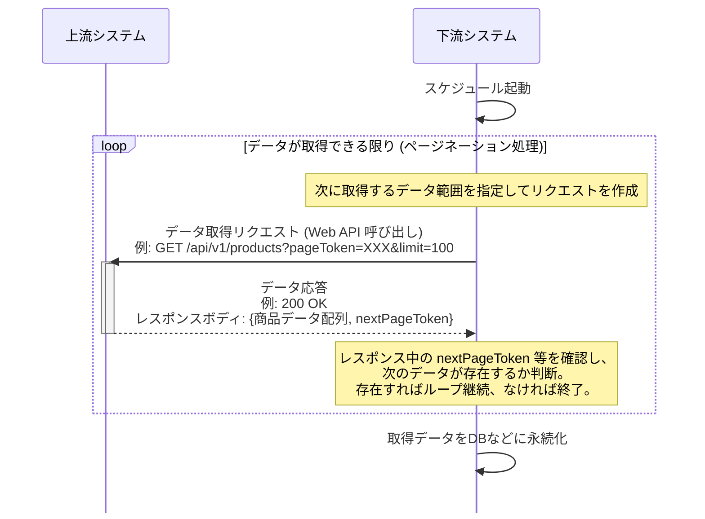

# I/F の RPC (Web API) 連携

プッシュ型の Web API 連携は密結合となるため採用しない。ファイル共有に切り替える。
プル型も大量・全件取得はファイル I/F 化する。新規 I/F はファイル I/F 化を第一に検討する。
出典は [I/F設計ガイドライン](about.md) (CC BY 4.0) で、OKF の形式に合わせて分割、変更している。

## RPC呼び出し

RPCによるデータ連携は、現代的な解釈ではWeb APIを用いた連携に該当すると考えられる。システム間のデータ交換の文脈では、WebSocketやServer Sent Eventによるイベント駆動ではなく、同期的なリクエスト・レスポンスの利用が一般的である。RPC呼び出しの設計ポイントは、リアルタイムに連携できる即時性のメリットと、同期処理に起因してシステム間の結合度が高まるデメリットを、業務要件やシステム特性に照らしてどう評価するかにある。

連携パターンは、データが流れる向きによって以下に大別する。

1. 上流システムが起点となり、下流システム側のWeb APIに対してデータをプッシュ（配信）する
2. 下流システムが起点となり、上流システム側のWeb APIを呼び出してデータをプル（受信）する

### プッシュ型のWeb API連携

プッシュ型は、業務イベントをトリガーにイベント駆動で別システムへデータを連携したいケースが多い。上流システムから下流システムに向けて、Webフック的にプッシュ送信がなされる。仕組み上、全件データ連携には不向きであるため、差分データ連携となる。

この構成には以下のメリットがある。

- リアルタイムに下流システムへデータ連携が可能
- Web APIベースのやり取りであるため、システム間の連携があることを明示できる
- 連携仕様をOpenAPI Specificationなどでドキュメント化すれば、標準的な仕様で管理でき、ブラックボックス化を防ぎやすい
- 下流側としてレコード単位のバリデーションを行いやすい

一方で、以下のようなデメリットも存在する。

- 上流システム側から、下流システムのWeb APIをネットワーク・権限的に呼び出せるようにしておく必要がある
- 下流側のシステムで障害が発生した場合、上流側のデータ連携処理を止める・再開する必要がある
- 下流システム側のメンテナンスウィンドウに、上流システム側が影響を受ける（メンテナンスウィンドウを知っておく必要がある）
- リプレイス時の柔軟性の欠如:
  - 上流システムをリプレイスする際、新システムから下流APIを呼び出すには、下流側での接続元IPアドレス制限の変更など、調整や改修が必要。切り替え過渡期のデータ移行やテストの計画も複雑化する
  - 下流システムをリプレイスする際は、上流システム側に、現・新両方のAPIへリクエストを送信（両投げ）してもらうか、切り替えタイミングを完全に同期させるといった改修依頼を含む調整が必須となる
- ほぼ同時タイミングでイベントが発生した際の順序保証が必要となる場合があり、同時実行数などの考慮が必要になる
- 下流システム側の都合で、連携タイミングを制御することが困難となる。例えば、バッチ起動などシステム負荷が高いタイミングは一時停止するといった対応を取りにくい
- 業務フロー上は上流に当たるシステムが、データ連携のために下流システムのWeb APIや稼働状況に依存し、システムモデルが複雑化する傾向（システムの構成理解が難しくなり、変更時の影響範囲の見通しが下がる）

推奨は以下の通り。

- プッシュ型のWeb API連携は、密結合となるため採用しない
- 代案として、Web APIではなく、オブジェクトストレージを経由したファイル共有に切り替える
  - ファイルの出力頻度をN分間隔にするなど、データ鮮度の要件に合わせて調整する
  - 最低でも、キューイングシステムを経由した手法に取り替える
  - これにより、集信側の都合で制御が可能となり、システム的な結合度を下げられる

### プル型のWeb API連携

プル型は、データ発生源であるシステム側がデータ取得方法としてWeb APIを公開し、利用システム側の裁量に任せたいケースで採用されることがある。下流システム側の任意のタイミングで呼び出せ、データ取得範囲も部分的に指定できることから自由度が高い。

マスタ配信など比較的静的なデータから、トランザクションデータまで特にデータ種別を限定せず利用される。なお、フロントエンドでのマッシュアップや、バックエンドAPIからデータをエンリッチメント（項目を付加）するパターンは本節の対象外で、あくまでシステム間データ連携に閉じた議題とする。

この構成には以下のメリットがある。

- **データ鮮度を向上させやすい**: 下流側が任意のタイミングで最新データを取得できる
- **必要なデータのみに絞り込める**: クエリパラメータなどで条件を指定することで、効率的な取り込みが可能
- **セキュリティの適用しやすさ**: APIキー認証、OAuth認証など、標準的な認証・認可の仕組みを適用しやすい

一方で、以下のようなデメリットも存在する。

- 大量・全件のデータを取得する場合は、複数回のAPI呼び出しが必要となり、処理時間が長くなる
- API呼び出しにリソース（LB、コンピューティング、DB、ロギング、監視）が必要なため、コストが高い
- 開発/検証環境などでテストが行いにくい（検証用サーバーを用意する必要がある）
- 下流システムが複数存在し、全く同じAPI呼び出しが複数のクライアントから行われる場合、無駄に思える

推奨は以下の通り。

- 大量データ・全件データを毎回一括取得するデータ連携の場合は、ファイルI/F化する
  - 処理速度・クラウド費用の面で有利であるため
- 対向システムがWeb API経由のデータ連携しか許容しない場合や、下流システム側が取り込み対象を条件に指定して大きく絞り込める場合にのみ、プル型での取り込みを許容する
- 新規構築のI/Fの場合、ファイルI/F化を第一に検討する
  - ファイルという明確な中間情報が存在することで、障害発生時の再処理の容易さ、リプレイス時の移行データ検証の確実性、責任分界点の明確化といった点で、API連携に比べて運用上の安定性に寄与するため

> [!TIP]
> **リアルタイム性と効率性を両立させるためのハイブリッド方式**
>
> ポーリング間隔を短くしすぎると、データに変更がない場合でも余計な問い合わせが発生し、上流・下流双方の負荷となる。そのため、上流側でなにかしらデータ変更があった場合にメッセージング経由で通知し、下流はその通知を起点に上流のAPIをプルする。この方式にすると、無駄なポーリングを排除しつつリアルタイムなデータ取得を実現でき、双方の利点を組み合わせた良いところ取りができる。
