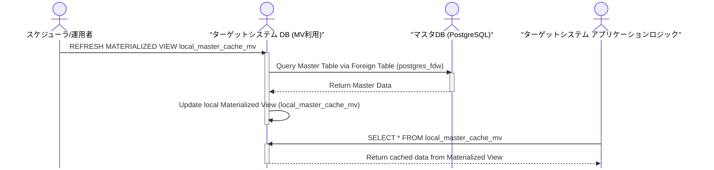
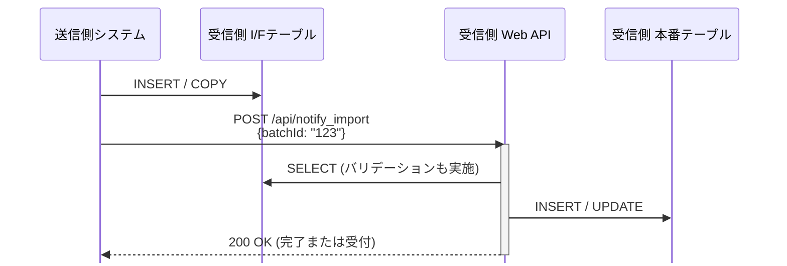

# I/F の DB 共有連携

DB共有は非推奨である。DBリンク (postgres_fdw + MVIEW) も受信ワークテーブル共有も、原則採用しない。
密結合や影響範囲の広がり、セキュリティ事故時の影響の限定しにくさが理由である。
出典は [I/F設計ガイドライン](about.md) (CC BY 4.0) で、OKF の形式に合わせて分割、変更している。

## DB共有（Shared Database）

[連携パターン方針](integration-patterns.md#統合パターン) 章で説明した通り、DB共有によるデータ連携は非推奨である。

> [!TIP]
> **クラウド環境であればデータ交換用のDBインスタンスを起動する手も考えられる？**
>
> DB共有の結合度を下げるために、データ交換用のDBインスタンスを別途起動して経由する手法も考えられる。しかし、共有用DBへのデータロードやデータ取得の方式を検討する手間がかかり、何よりデータ連携のためだけにインスタンスを起動することで費用増になる。停止タイミングのプロトコルを決める必要もあり、現実的では無い。

### DBリンク

DB共有は[統合パターン](integration-patterns.md#統合パターン) 章で述べた通り非推奨である。しかし、同一組織内のシステム間連携（マイクロサービス同士の連携も含む）では、マスタデータなどをDBリンクを元に配信したいという要求は強くある。この方式は、ファイル出力/取り込みやAPI開発などのコストをかけずにデータ連携を実現できるため、一見すると魅力的に映る。



PostgreSQLのDBリンク機能（`postgres_fdw`など）を用いて外部DBのテーブルを参照し、その結果をマテリアライズド・ビュー（MVIEW）として自システム内に保持する方式である。定期的に以下のコマンドを実行してMVIEWを更新することで、データを準リアルタイムに同期する。 `CONCURRENTLY` オプションを付与すれば、リフレッシュ中もMVIEWへのSELECTをブロックしない（更新速度は下がる）。

```sql
REFRESH MATERIALIZED VIEW CONCURRENTLY schema_name.view_name;
```

この構成には以下のメリットがある。

- I/F連携仕様などの設計コスト、機能開発コストを無くせる
- マスタDBに負荷がかかるのはMVIEWリフレッシュ時のみで、それ以外への影響を無くせる
- マスタDB側のERD変更があっても、MVIEW更新時のクエリで吸収できる

制約としては以下がある。

- MVIEWリフレッシュ中にマスタDBを再起動すると更新が失敗するため、再起動タイミングなどを各システムと調整する必要がある

推奨は以下の通り。

- 開発工数を浮かせることができ、非常に有用な手法ではあるが、原則利用しない
  - ファイル連携、DB連携などシステム間の連携パターンが複数あると、統制が取りにくく、影響範囲の調査や変更作業が困難になるなど、アーキテクチャ全体の複雑性を上げてしまうため
  - 参照するテーブルが相互に増え、密結合になる懸念があるため。当初はマスタ参照のみの想定でも、運用を経て参照テーブルや結合条件が増え、MVIEWのSQLが複雑化すると考えられる。このSQL自体が実質的なI/Fとなり、容易に修正できないブラックボックスとなる懸念がある
  - セキュリティ事故時の影響範囲を限定しにくい（セキュリティホールにならないように、統制すべき対象が増える）ため。また、権限設定のミスや脆弱性を突かれた際の影響範囲が、単一システム内に留まらなくなる
  - 接続システム側が予期しないクエリを実行し、接続先DBに高負荷を与える可能性が原理上あるため

### 受信ワークテーブル共有

DB共有の一種で、直接本番テーブルを参照・更新させるのではなく、データ連携専用の「受信ワークテーブル」を介在させ、処理のトリガーにWeb APIなどを用いる「プッシュ型」の連携パターンが考えられる。

ファイル連携における「送信ファイル」の代わりに、送信側が受信側の「受信テーブル」へ直接データを書き込む点が特徴である。



主な評価観点を次にまとめる。

| 観点         | 評価         | 説明                                                                                                                                                                 |
| :----------- | :----------- | :------------------------------------------------------------------------------------------------------------------------------------------------------------------- |
| 性能         | ✅️メリット   | I/Fファイルの生成・転送・パース処理が不要なため、オーバーヘッドが少なく高速に動作する                                                                                |
| 保守性       | ❌️制約       | 受信テーブルのスキーマは送信側の都合で決定されることが多く、受信側は常に最新のスキーマに追従する必要がある（変更頻度が高いI/Fには不向き）                            |
| セキュリティ | ❌️デメリット | 送信側システムに受信側DBへの「書き込み権限」を付与する必要がある。インバウンド通信の許可も必要で、ネットワーク設計やセキュリティグループの設定が複雑になりがちである |
| 安定性       | ❌️デメリット | 送信側が直接DBリソース（コネクション、I/O等）を消費するため、受信側のDB性能に影響を与えるリスクがある                                                                |

推奨は以下の通り。

- 原則採用しない。ファイル連携の方が、責任分界点やセキュリティの観点で優れているため
- ただし、以下の条件をすべて満たす場合に限り、採用を検討する
  - ファイル連携基盤が存在し、ハブが「受信テーブルへの書き込みと通知」をマネージドに代行する機能を持つ場合
  - ファイル生成・パースのオーバーヘッドさえも削減したいほど、大量データかつ厳しいレイテンシ要件（秒レベル）がある
  - I/Fのスキーマ変更がほとんど発生しない、枯れたデータ連携である
