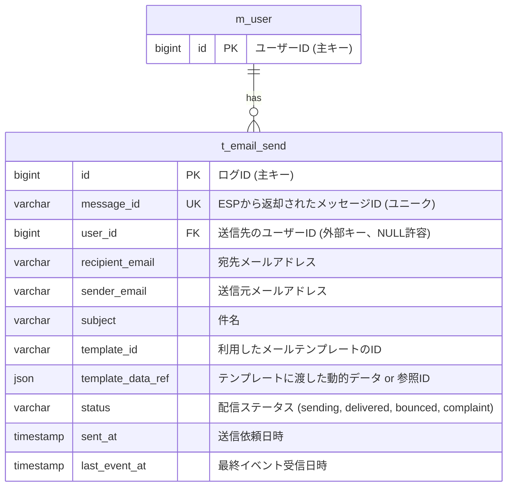

# メールの監査

「いつ、だれに、どのような内容のメールを送信し、どうなったか」を後から調査できるよう、監査項目を DB に保存する。
ESP の Webhook で配信結果のステータスを更新する。
出典は [メール設計ガイドライン](about.md) (CC BY 4.0) で、OKF の形式に合わせて分割、変更している。

システムメールの監査は「いつ、だれに、どのような内容のメールを送信し、どうなったか」を後から調査可能にすることが求められる。これを怠ると、問題発生時に必要な情報が無く、法的・コンプライアンス・セキュリティ・顧客サポートで課題が生じうる。具体的には以下の場合に、監査情報を利用する。

- ユーザーとの間で「利用規約の変更を通知したか」　「重要な支払い督促を送ったか」といった紛争が発生した場合
  - 送信の事実を証明できない場合、法的に不利な立場となる
- 個人情報保護委員会などの監督官庁から、個人情報の取り扱いや本人への通知に関する報告を求められた場合
  - 適切な記録が提示できない場合、安全管理措置義務違反を問われるリスク
- 万が一、ユーザーアカウントが乗っ取られた場合の被害調査
  - 「いつ、犯人がパスワードやメールアドレスを変更したのか」　「その際、本来のユーザーに通知メールは送られたのか」といった事実調査ができず、ユーザーへの適切な対応が遅延する懸念
- 「注文確認メールが届いていない」　「支払いリマインダーを受け取っていない」といった顧客からの問い合わせ対応
  - 原因がユーザー側の受信設定なのか、自社のシステムの問題なのかが分からず、適切なサポートができなくなる

推奨は以下の通り。

- 以下の監査項目を、DBに保存する
  - 【Who】宛先メールアドレス
  - 【When】送信日時
  - 【What】利用したメールテンプレートのID
  - 【What】テンプレートに渡した動的データ（例: 注文ID、ユーザーIDなど）
  - 【What】件名
  - 【Who From】送信元メールアドレス
  - 【Proof】ESPから返却されたメッセージID
  - 【Proof】メール送信結果
    - ESPが提供する「Webhook」機能を利用して、ステータスを更新する
    - ステータスは、Delivered（配信成功）、Bounce（配信失敗）、Hard Bounce（恒久的なエラー）、Soft Bounce（メールボックスが一杯など一時的なエラー）、Complaint（迷惑メール報告）など
- invoice.pdf などの添付ファイルのクラウドストレージの保存期間は、上記監査レコードの保存期間と整合性を保つ

> [!WARNING]
> **Webhookを用いたステータス反映処理**
>
> Webhookを用いてESPからリアルタイム連携する場合、適切なキューイングサービスを経由する構成を取ることが望ましい。特に直接OLTPやDWHにデータ登録すると、思わぬ取りこぼしの発生リスクがある。
