# メールの DMARC

DMARC は SPF/DKIM とヘッダー FROM のアライメントをもとに、認証失敗メールの扱い (受信・隔離・拒否) を指定する。
まず `p=none` でレポートを確認し、`quarantine`/`reject` に段階的に引き上げ、`pct` を徐々に上げる。
出典は [メール設計ガイドライン](about.md) (CC BY 4.0) で、OKF の形式に合わせて分割、変更している。

## DMARC（Domain-based Message Authentication, Reporting, and Conformance）

DMARC(ディーマーク)は、[RFC 7489](https://tex2e.github.io/rfc-translater/html/rfc7489.html)により定められた仕様で、ドメイン認証（Domain-based Message Authentication）の結果を用いて、送信者への認証結果の報告（Reporting）と受信者へのメールの取り扱いへの準拠（Conformance）を要求する。DMARCはSPFおよびDKIMを前提とした仕組みであり、「SPFおよびSPFアライメント」あるいは「DKIMおよびDKIMアライメント」のいずれかを通過しなかったメールの取り扱い（受信拒否・隔離・受信）をメール送信者が指定できる。

SPF/DKIMアライメントとは、各認証に用いたドメインが、ヘッダーFROM（主に受信者に表示されるメールアドレス）のドメインと一致しているかの検証を指す。SPFやDKIMは各ドメインが送信者によって管理されていることを保証する仕組みである。しかしヘッダーFROMとは異なるドメインで認証している場合、SPF/DKIMに通過していたとしても、メール送信者の正当性（ヘッダーFROMのドメイン管理者であるか）は全く担保されない。そのような状況を検知するのがSPF/DKIMアライメントであり、両者を総称してDMARCアライメントと呼ぶ。

```mermaid
graph TB
    classDef ok fill:#D5F5E3,stroke:#28B463,color:#186A3B;
    classDef ng fill:#F5DDDD,stroke:#D9534F,color:#922B21;

    senderServer -->|1.メール送信| receiverServer
    senderDNS -->|2.DMARCレコード参照| receiverServer

    subgraph "受信者"
        receiverServer[メールサーバ]:::server
        receiverServer --> spfResult{SPF検証}
        spfResult -->|PASS| spfPass>SPF: PASS]:::ok
        spfPass --> spfAlignment{エンベロープFROMと<br>ヘッダFROMを比較}
        spfAlignment -->|一致| spfAlignmentPass>SPFアライメント: PASS]:::ok
        spfAlignment -->|不一致| spfAlignmentFail>SPFアライメント: FAIL]:::ng
        spfAlignmentFail --> dmarcFail
        spfResult -->|FAIL| spfFail>SPF: FAIL]:::ng
        spfFail --> dmarcFail
        receiverServer --> dkimResult{DKIM検証}
        dkimResult -->|FAIL| dkimFail>DKIM: FAIL]:::ng
        dkimFail --> dmarcFail
        dkimResult -->|PASS| dkimPass>DKIM: PASS]:::ok
        dkimPass --> dkimAlignment{エンベロープFROMと<br>ヘッダFROMを比較}
        dkimAlignment -->|不一致| dkimAlignmentFail>DKIMアライメント: FAIL]:::ng
        dkimAlignmentFail --> dmarcFail
        dmarcFail --> dmarcPolicy
        dmarcPolicy -->|隔離する| spam
        dmarcPolicy -->|配信する| receiver
        dmarcPolicy -->|拒否する| reject
        dmarcPolicy{DMARCレコードに基づき<br>メールの処理方法を判断}
        spam>スパムフォルダ]:::ng
        reject>バウンス or 削除]:::ng
        dkimAlignment -->|一致| dkimAlignmentPass>DKIMアライメント: PASS]:::ok
        spfAlignmentPass --> dmarcPassSpf
        dkimAlignmentPass --> dmarcPassDkim
        dmarcPassSpf --> receiver
        dmarcPassDkim --> receiver
        dmarcFail>DMARC: FAIL]:::ng
        dmarcPassSpf>DMARC: PASS]:::ok
        dmarcPassDkim>DMARC: PASS]:::ok
        receiver>正常に受信]:::ok
    end
    subgraph "送信元システム"
        admin(👨🏻‍💻管理者):::actor
        senderServer[メールサーバ]:::server
        senderDNS[DNS]:::server
        admin -->|DMARCレコード登録| senderDNS
    end
```



SPF/DKIM同様、設定はDNSに以下のようなレコードを登録することで行う。

```txt
_dmarc.example.com IN TXT “v=DMARC1; p=reject; rua=dmarc-report@example.com”
```

| タグ  | 意味                                                                                                                                                                                                                                                                                                                                                                                        | 必須/任意                    |
| :---- | :------------------------------------------------------------------------------------------------------------------------------------------------------------------------------------------------------------------------------------------------------------------------------------------------------------------------------------------------------------------------------------------ | :--------------------------- |
| adkim | DKIMアライメントの判定モード `r`: ヘッダーFROMドメインがDKIM認証ドメインのサブドメインであっても許容する（relaxed mode） `s`: ヘッダーFROMドメインとDKIM認証ドメインが完全一致していない場合許容しない（strict mode）                                                                                                                                                                       | 任意 省略時は`r`となる。     |
| aspf  | SPFアライメントの判定モード `r`: ヘッダーFROMドメインがSPF認証ドメインのサブドメインであっても許容する（relaxed mode） `s`: ヘッダーFROMドメインとSPF認証ドメインが完全一致していない場合許容しない（strict mode）                                                                                                                                                                          | 任意 省略時は`r`となる。     |
| fo    | フォレンジックレポート（失敗レポート）作成基準オプション `0`: すべての認証が失敗した場合にレポートを作成する。 `1`: いずれかの認証が失敗した場合にレポートを作成する。 `d`: DKIM認証が失敗した場合にレポートを作成する（アライメントは考慮しない） `s`: SPF認証が失敗した場合にレポートを作成する（アライメントは考慮しない）                                                               | 任意 省略時は`0`となる。     |
| p     | 認証が失敗した場合に要求するメールの取り扱いポリシー `none`: 何も要求しない。 `quarantine`: 不審なメールとして取り扱うよう要求する。具体的な処理は受信者に依存する。 `reject`: メールの受信を拒否する。                                                                                                                                                                                     | 必須                         |
| pct   | DMARCポリシーが適用される割合（`0-100`）                                                                                                                                                                                                                                                                                                                                                    | 任意 省略時は`100`となる。   |
| rf    | フォレンジックレポートのフォーマット （2025年7月現在`afrf`のみ有効）                                                                                                                                                                                                                                                                                                                        | 任意 省略時は`afrf`となる。  |
| ri    | アグリゲートレポート（集約レポート）作成間隔の要求値。 日次以上の頻度がベストエフォートされる                                                                                                                                                                                                                                                                                               | 任意 省略時は`86400`となる。 |
| rua   | アグリゲートレポートの送信先。 [`mailto:dmarc-report@example.com`](mailto:dmarc-report@example.com)のように指定する。 DMARCレコードを登録したドメイン（`example.com`）と異なるドメインのメールアドレス宛に送信する場合は、 送信先ドメイン（`example.org`）のDNSに以下の様なレコードを登録する必要がある。 [`example.com`](http://example.com)`._report.dmarc.example.org IN TXT “v=DMARC1”` | 任意 省略時は未指定となる。  |
| ruf   | フォレンジックレポートの送信先 記法は`rua`タグと共通。                                                                                                                                                                                                                                                                                                                                      | 任意 省略時は未指定となる。  |
| sp    | サブドメインから送信された認証失敗メールの取り扱いポリシー 記法は`p`タグと共通。 未指定の場合、`p`タグの設定値が適用される。                                                                                                                                                                                                                                                                | 任意 省略時は未指定となる。  |
| v     | DMARCバージョン （2025年7月現在`DMARC1`のみ有効）                                                                                                                                                                                                                                                                                                                                           | 必須                         |

SPFおよびDKIMを前提とした認証の仕組みである以上、必ずSPF/DKIMの設定が完了してからDMARCを設定する。設定伝播には時間がかかることがあるため、SPF/DKIM設定後、48時間以上経過してからDMARCを設定することが[Googleにより推奨されている](https://support.google.com/a/answer/10032473?hl=ja)。

推奨は以下の通り。

- まず、`p=none`とした上で、ruaに適切なレポート送信先を設定、日次でレポートを確認、SPF/DKIMの設定が正常に行えていることを確認する
  - `ruf`は設定しても良いが、[Gmail](https://support.google.com/a/answer/2466580?hl=ja)や[Microsoft 365](https://learn.microsoft.com/ja-jp/defender-office-365/email-authentication-dmarc-configure#dmarc-for-inbound-mail-into-microsoft-365)などの主要サービスがフォレンジックレポートの送信に対応していないため、あまり参考になる情報は得られない可能性が高い
- 次に、`p=quarantine`、あるいは`p=reject`に設定したうえで、`pct`に`10`などの小さな値を設定し、引き続きレポートを確認する。加えて受信者（システムのユーザーなど）から、「メールが届かなくなった」といった問い合わせが発生するようになっていないか注視する
  - `p=quarantine`は、認証失敗メールを迷惑メールフォルダなどに隔離するよう受信者に要求する。正当なメールが誤って認証に失敗した場合でも、受信者を救出できる可能性がある
  - `p=reject`とすると、認証に失敗したメールが配信されなくなるため、既にドメインのなりすましが行われているなど、認証失敗メールの配信を確実に防ぎたいなどの場合は`reject`を設定する
- 徐々に`pct`の値を大きくしていき、最終的に`100`（あるいは指定なし）まで引き上げる
  - `pct`の初期値・増加量は、設定の影響範囲と設定値変更の作業コストを鑑みて決定する

> [!TIP]
> **アグリゲートレポートの形式について**
>
> アグリゲートレポートは以下のような形式で配信される（[Googleの例示](https://support.google.com/a/answer/10032472)を引用・一部改変）。
>
> ```xml
> <?xml version="1.0" encoding="UTF-8"?>
> <feedback>
>   <report_metadata>
>     <org_name>example.com</org_name>
>     <email>noreply-dmarc-support@example.com</email>
>     <extra_contact_info>http://example.com/dmarc/support</extra_contact_info>
>     <report_id>xxxxxxxxxxxxxxxx</report_id>
>     <date_range>
>       <begin>UNIX_TIME</begin>
>       <end>UNIX_TIME</end>
>     </date_range>
>   </report_metadata>
>   <policy_published>
>     <domain>example.org</domain>
>     <adkim>r</adkim>
>     <aspf>r</aspf>
>     <p>none</p>
>     <sp>none</sp>
>     <pct>100</pct>
>   </policy_published>
>   <record>
>     <row>
>       <source_ip>198.51.100.36</source_ip>
>       <count>2</count>
>       <policy_evaluated>
>         <disposition>none</disposition>
>         <dkim>fail</dkim>
>         <spf>pass</spf>
>       </policy_evaluated>
>     </row>
>     <identifiers>
>       <header_from>example.org</header_from>
>       <envelope_from>example.org</envelope_from>
>     </identifiers>
>     <auth_results>
>       <dkim>
>         <domain>example.jp</domain>
>         <result>pass</result>
>         <human_result></human_result>
>       </dkim>
>       <spf>
>         <domain>example.org</domain>
>         <result>pass</result>
>       </spf>
>     </auth_results>
>   </record>
> </feedback>
> ```
>
> 主要なタグの意味は以下の通り。
>
> | 要素                                  | 説明                                                                                                                                                             |
> | :------------------------------------ | :--------------------------------------------------------------------------------------------------------------------------------------------------------------- |
> | `<report_metadata>`                   | レポート作成者、すなわち受信サーバーが作成した、レポート自体に関する情報                                                                                         |
> | `<policy_published>`                  | 受信サーバーが確認したDMARCポリシー。DMARCレコードの設定値に誤りがある場合、この項目が想定外の値となっている可能性があるため、正常に配信が行われない場合は要確認 |
> | `<record>`                            | 各ドメイン認証の結果。送信元サーバーのIPアドレスの数だけ含まれる                                                                                                 |
> | ┗ `<source_ip>`                       | 送信元サーバーのIPアドレス                                                                                                                                       |
> | ┗ `<policy_evaluated>`                | DMARCポリシーの評価結果                                                                                                                                          |
> | &nbsp;&nbsp;&nbsp;┗ `<disposition>`   | 評価の結果、メールをどのように処理したか                                                                                                                         |
> | &nbsp;&nbsp;&nbsp;┗ `<dkim>`, `<spf>` | DKIM, SPFのアライメントチェックの結果（各ドメイン認証そのものの結果ではない）                                                                                    |
> | ┗ `<identifiers>`                     | メールの送信者・宛先に関する情報                                                                                                                                 |
> | &nbsp;&nbsp;&nbsp;┗ `<header_from>`   | ヘッダーFROMドメイン                                                                                                                                             |
> | &nbsp;&nbsp;&nbsp;┗ `<envelope_from>` | エンベロープFROMドメイン                                                                                                                                         |
> | ┗ `<auth_results>`                    | 各ドメイン認証の結果                                                                                                                                             |
> | &nbsp;&nbsp;&nbsp;┗ `<dkim>`, `<spf>` | DKIM, SPFのドメイン認証の結果                                                                                                                                    |
>
> アグリゲートレポートの厳密な仕様はRFC 7489のAppendix Cに定義されているが、必ずしも全ての受信サーバーが準拠しているとは限らないため、適宜読み替えを行うこと（上記Googleの例においても、`minOccurs="1"`と定義されている項目が出現していない等、準拠していない項目が存在する）。

<!-- 前の注記と分ける -->

> [!TIP]
> **ドッペルゲンガードメイン**
>
> [`example.com`](http://example.com) に対する `exampl.com`や`example.co`など、正規のドメインに酷似していたり、タイプミス等で誤入力しやすいドメインをドッペルゲンガードメインと呼ぶ。攻撃者が企業のドメインのドッペルゲンガードメインを意図的に取得し、フィッシングメール等に用いることがある。
>
> 攻撃者は実際にドッペルゲンガードメインの管理者であるため、ここまで記載したドメイン認証は全て通過するフィッシングメールを送信できてしまう。受信者はドメインをよく確認する以外に、ドッペルゲンガードメインそのものに対する防御策を取り得ないため、詐欺の被害に遭う可能性がある。
>
> 新規でドメインを取得し、サービスに利用する場合は、悪用される恐れがあるドッペルゲンガードメインの所有者確認と、可能であれば攻撃者より先に取得することを推奨する。

<!-- 前の注記と分ける -->

> [!TIP]
> **発展的な取り組み: BIMIについて**
>
> DMARC導入後の更なるステップとして、BIMI（Brand Indicators for Message Identification）が存在する。これは、DMARC認証を通過したメールに対し、受信トレイの送信者アイコンとして企業のブランドロゴを表示させる仕組みである。
>
> 受信者がひと目で「正規の送信者である」と認識できるほか、Gmail等では送信者名の横に「認証済みチェックマーク」が表示されるため、開封率の向上やブランド認知に寄与する。しかし、2025年12月現在、導入には高いハードルがある。
>
> 1. **厳格なDMARCポリシー**: DMARCポリシーが `reject` または `quarantine` (pct=100) でなければならない
> 2. **商標登録とVMC**: ロゴを表示させるためには、そのロゴが商標登録されていることの証明に加え、認証局が発行するVMC（検証済みマーク証明書）の購入が必要となる（年間数十万円〜のコストが発生する）
>
> コストや手続きの煩雑さから、導入はセキュリティやブランディングを強く重視する一部の企業に限られている。本ガイドラインでは必須としないが、将来的な選択肢として紹介する。
>
> - BIMIの技術仕様草案（標準化プロセス中）: [IETF Internet-Draft](https://datatracker.ietf.org/doc/draft-brand-indicators-for-message-identification/)
