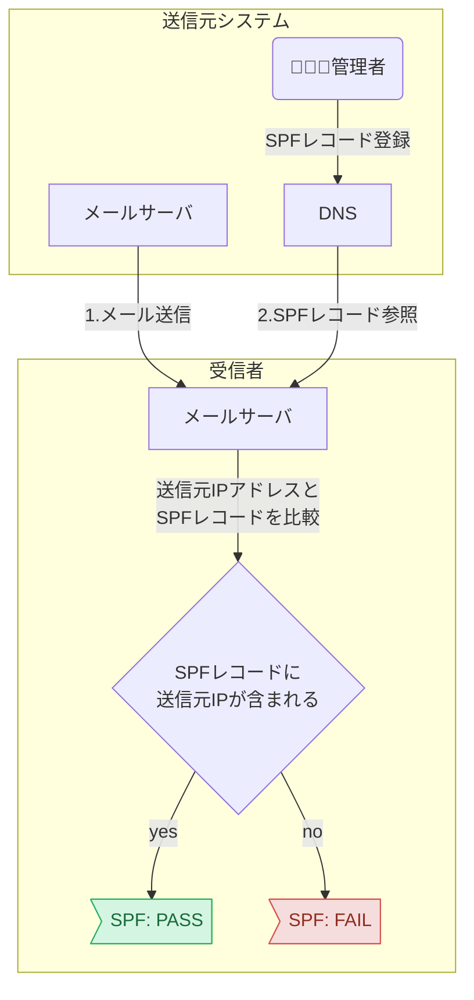
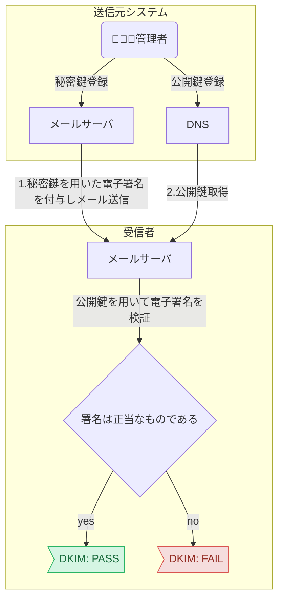

# メールのドメイン認証 (SPF と DKIM)

メールは送信者がドメインを任意に設定できるため、なりすまし対策としてドメイン認証 (SPF・DKIM・DMARC) が求められる。
SPF は送信元 IP を、DKIM は送信元と内容を、DNS レコードで検証する。両方を設定する。ESP が提示した設定値があれば必ず設定する。
出典は [メール設計ガイドライン](about.md) (CC BY 4.0) で、OKF の形式に合わせて分割、変更している。

メールアドレスは、@の前後でローカルパートとドメインに分けられる。[`local-part@example.com`](mailto:local-part@example.com) であれば、`local-part`がローカルパート、[`example.com`](http://example.com)がドメインである。システムから配信されるメールの場合、多くの受信者はローカルパートではなくドメイン部分を確認し、メールの送信元とその妥当性を判断する。

しかし、メールの仕様上、送信者はドメイン部分を含め、受信者に通知するメールアドレスを任意に設定できる。そのため、管理していないドメインからのメールであるかのように振る舞うこと、すなわちドメインのなりすましが可能である。ドメインのなりすましは多くの場合悪意をもって行われる（フィッシング詐欺等）ため、メールの信頼性を高めるドメイン認証（SPF、DKIM、DMARC）が求められる。

## SPF（Sender Policy Framework）

SPF（エスピーエフ）は、[RFC 7208](https://tex2e.github.io/rfc-translater/html/rfc7208.html)で標準化されている仕様で、ドメイン所有者がそのドメインを用いてメールを送信できる送信者(Sender)を限定する(Policy)ための仕組み(Framework)である。

具体的には、DNSに送信者として許可するホストのIPアドレスをSPFレコードとして記録しておく。受信者はメールに記載されているドメインを用いてDNSにSPFレコードを問い合わせ、送信元IPアドレスと照合することで、メールがSPFに準拠しているかを判定できる。



SPFの導入は、以下のようなレコードをDNSに設定するだけでよく、メールサーバー側の設定は不要である。

```txt
example.com. IN TXT "v=spf1 ip4:192.0.2.0 ip4:198.51.100.36 ip4:203.0.113.104 -all"
```

SPFレコードは複数の要素（ディレクティブと修飾子）から構成され、ディレクティブはさらに限定子と機構から構成される。それぞれ、メールサーバーの構成に応じて適切な値を設定する。

| 種別   | 名前          | 意味                                                                                                                                                                                   |
| :----- | :------------ | :------------------------------------------------------------------------------------------------------------------------------------------------------------------------------------- |
| 限定子 | \+ (pass)     | 機構と一致する送信元は認証に成功する。限定子を明記しない場合、デフォルト値として設定される。                                                                                           |
|        | \- (fail)     | 機構と一致する送信元は認証に失敗する。                                                                                                                                                 |
|        | \~ (softfail) | 機構と一致する送信元は認証に失敗するが、受信拒否を強く要求はしない。                                                                                                                   |
|        | ? (neutral)   | 機構と一致する送信元の認証結果を明示しない。                                                                                                                                           |
| 機構   | all           | 常に一致する。                                                                                                                                                                         |
|        | include       | 後続するドメインのSPFレコードを用いて認証する。                                                                                                                                        |
|        | a             | 送信元IPアドレスが、後続するドメインのAレコード、あるいはAAAAレコードに含まれる場合、一致する。                                                                                        |
|        | mx            | 送信元IPアドレスが、後続するドメインのMXレコードが指すホストのAレコード、あるいはAAAAレコードに含まれる場合、一致する。                                                                |
|        | ptr           | （利用非推奨） 送信元IPアドレスから逆引きしたホストの、Aレコード、あるいはAAAAレコードが送信元IPアドレスを含む場合、一致する。                                                         |
|        | ip4/ip6       | 送信元IPアドレスが、指定されたIPアドレス（CIDR表記による範囲指定可能）に含まれる場合、一致する。                                                                                       |
|        | exists        | 後続するドメインに対する正引きが成功した場合、一致する。                                                                                                                               |
| 修飾子 | redirect      | 後続するドメインのSPFレコードを用いて認証する。指定されたドメインでの認証結果が失敗であった場合、include機構は後続する機構の評価を継続するが、redirect修飾子は以降の記述を評価しない。 |
|        | exp           | 認証が失敗した場合に、後続するドメインのTXTレコードを認証失敗の理由として扱う。                                                                                                        |

設定値の推奨は以下の通り。

- ESPから設定値が提供された場合、その値を設定する
  - サービス提供者がそのサービスでメール送信に利用するIPアドレスを正確に把握・管理しており、その情報を集約したSPFレコードを提供しているため

## DKIM（DomainKeys Identified Mail）

DKIM(ディーキム)は、[RFC 6376](https://tex2e.github.io/rfc-translater/html/rfc6376.html)により定められた仕様で、ドメインに紐づけられた鍵(DomainKeys)を用いて、メール(Mail)の内容と送信者が正当であると証明する(Identified)。公開鍵暗号を用いた認証仕様で、まずDNSに公開鍵を登録しておく。送信者はメール送信時に内容から電子署名を作成し、メールヘッダーに含める。受信者はDNSから公開鍵を取得し、電子署名を検証することで、内容と送信者の正当性を確認できる(検証に失敗した場合、なりすましや受信経路での内容の改ざんが考えられる)。



DKIMを導入する場合、まずキーペアを作成し、以下のようなレコードとしてDNSに登録する。その上で、メール送信時に電子署名を作成しヘッダーに含めるよう、メールサーバー上で設定する。

```txt
selector._domainkey.example.com. IN TXT “v=DKIM1; k=rsa; h=sha256; p=xxxxxxx…;”
```

サブドメインの`selector`は、複数のキーペアを署名に用いる場合の識別子、セレクタとして記載する。値自体は任意であるが、1組のキーペアしか用いない場合も省略できないため、必ず指定する。

DKIMレコードは複数のタグと値の組み合わせで構成される。

| タグ | 意味                                                                                                                                                                                                                                                                                                                                                    | 必須/任意                                                                                                             |
| :--- | :------------------------------------------------------------------------------------------------------------------------------------------------------------------------------------------------------------------------------------------------------------------------------------------------------------------------------------------------------ | :-------------------------------------------------------------------------------------------------------------------- |
| v    | DKIMバージョン（2025年7月現在”DKIM1”のみ有効）                                                                                                                                                                                                                                                                                                          | 任意（推奨） 省略時は`DKIM1`となる。                                                                                  |
| h    | 利用できるハッシュ方式（2025年7月現在`sha1`と`sha256`のみ有効）                                                                                                                                                                                                                                                                                         | 任意（推奨） 省略時はすべてのハッシュ方式を許容するが、`sha1`が非推奨であるため、`sha256`の明示的な指定が推奨される。 |
| k    | 署名に用いられる鍵の型式（`rsa`と`ed25519`が定義されている。`ed25519`は[RFC 8463](https://www.rfc-editor.org/rfc/rfc8463.html)で追加された）                                                                                                                                                                                                            | 任意（推奨）省略時は`rsa`となる。                                                                                     |
| n    | 管理者用のメモ領域                                                                                                                                                                                                                                                                                                                                      | 任意                                                                                                                  |
| p    | 公開鍵（Base64でのエンコードが必要）                                                                                                                                                                                                                                                                                                                    | 必須                                                                                                                  |
| s    | DKIMレコードに登録されている公開鍵を利用できるサービス（2025年7月現在`email`と`*`のみ有効）                                                                                                                                                                                                                                                             | 任意 省略時は`*`となる。                                                                                              |
| t    | DKIM認証時の挙動を指定するフラグ（2025年7月現在`y`と`s`のみ有効） `y`: テストモードであり、署名の検証に失敗した場合も、未署名のメールと同等の扱いを要求する。 `s`: 送信元メールアドレスのドメインと、署名を行ったドメインが一致しない（サブドメインが用いられている）場合に認証を失敗させる。 なお、`y`と`s`はコロン”:”で区切ることで両方の指定が可能。 | 任意 省略時はフラグ未指定となる。                                                                                     |

※RFC 4871時点では`g`タグも定義されていたが、現在は非推奨となっている。

設定値の推奨は以下の通り。

- ESPを利用している場合、サービスからセレクタや公開鍵などの設定値が提示された場合は、その設定を必ず行う

> [!TIP]
> **SPF vs DKIM**
>
> ここまでを整理すると、SPFは送信元の正当性を、DKIMは送信元と内容の正当性を担保している。そうすると、DKIMにさえ準拠していれば、SPFは不要なように思えるが、一般にSPFとDKIMは両方を設定するほうが良いとされる。それは、SPFとDKIMでは検証対象とするドメインの参照元が異なるためである。SPFは**エンベロープFROM**のドメインを検証する。エンベロープFROMとは、メールサーバー間のSMTP通信で`MAIL FROM`コマンドとして指定される送信元アドレスであり、通常は受信者に表示されず、エラーメールの返送先などに利用される。一方、DKIMは**DKIM-Signatureヘッダー**の`d=`タグに記載されたドメインを検証する。このドメインは、通常、受信者がメールクライアントで「差出人」として目にする**ヘッダーFROM**と一致することが期待される。このように、それぞれがメールの異なる側面を保護するため、両方を設定することが推奨される。また、後述するDMARCはSPFおよびDKIMを前提とした仕組みであるため、DMARCを最大限活用するためにはSPF/DKIMの両方に準拠する必要がある。
