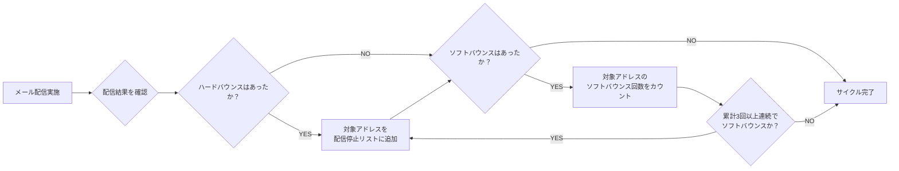

# 配信リストの維持と ISP 対策

無効なアドレスへの配信を続けるとレピュテーションが下がるため、配信リストをクレンジングする。
ハードバウンスは即時に配信停止リストへ、ソフトバウンスは累計3回で配信停止リストへ登録する。
出典は [メール設計ガイドライン](about.md) (CC BY 4.0) で、OKF の形式に合わせて分割、変更している。

## 健全な配信リストを維持するためのリストクレンジング

メールの到達力を高め、送信者としての信頼性を維持するには、配信リスト全体の品質を向上させるリストクレンジングが重要となる。

### リストクレンジングの目的と重要性

古く整理されていないリストにメールを送り続けると、以下のようなリスクが発生する。

- **レピュテーションの悪化:** 無効なアドレスへの配信を続けると、ISPから迷惑メール送信者と見なされ、評価が低下する。その結果、本来届くはずのメールまでブロックされたり、迷惑メール判定を受けたりするようになる
- **コスト浪費:** 無駄な配信数分のコストが発生する
- **正確な効果測定の阻害:** 反応しないユーザーが含まれることで、指標が不正確になる可能性がある
- **スパムトラップ化:** 無効なアドレスがスパムトラップ(送信するとほぼ一発アウト/数分後にSMTP接続がブロックされるアドレス)と化して、そのドメイン全体への配信が大規模に遅延する可能性がある

### クレンジングの対象となるリスト

リストクレンジングでは、以下の宛先を整理することを推奨する。

| 対象                     | 特徴                                                         | 対策例                                       |
| :----------------------- | :----------------------------------------------------------- | :------------------------------------------- |
| ハードバウンス           | 宛先が存在しない、恒久的なエラー                             | ✅️配信停止リストへ即時登録                   |
| ソフトバウンス           | 一般的なエラー（受信ボックス満杯など）                       | ⚠️監視し、継続する場合は配信停止リストへ登録 |
| 長期間反応のないユーザー | 半年以上、メール内のリンクを一度もクリックしていないユーザー | ⚠️対策はせず、購読者の意思に委ねる           |

### ハード・ソフトバウンスの対応について

以下のフローや対応はあくまでサンプルのため、業務に合わせて対応すること。

メール配信後、以下のように対応する。

- ハードバウンスの対応
  - 条件: 配信結果でハードバウンスとなったアドレス
  - 対応: 即時、全件を「配信停止リスト」に登録する
- ソフトバウンスの対応
  - 条件: ソフトバウンスの発生が累計3回以上となったアドレス
  - 対応: 累計”3回”に達した時点で、対象アドレスを「配信停止リスト」に登録

> [!TIP]
> **ソフトバウンス回数の記録**
>
> ソフトバウンス回数の記録と、条件に応じた配信停止ステータスへの変更を自動で行うツールもある。この機能がないツールを利用する場合は、スプレッドシートなどで管理するのが良い。

## 大手ISPごとの特徴

以下に各ISPの大まかな特徴を紹介する。ISPのアルゴリズムや判定基準は頻繁に変更されるため、こういった傾向があるという参考情報として利用する。

| ISP               | 特徴                                                                                                                     | 対策例                                                                                                                                 |
| :---------------- | :----------------------------------------------------------------------------------------------------------------------- | :------------------------------------------------------------------------------------------------------------------------------------- |
| Gmail             | ・機械学習ベースのフィルタリング ・ユーザー行動（開封、削除、スパム報告など）を重視 ・送信者レピュテーションを厳格に評価 | ・Google Postmaster Toolsでレピュテーションを監視 ・高いエンゲージメント率を維持 ・送信量の急激な変化を避ける                          |
| Microsoft Outlook | ・IPレピュテーションを重視 ・SNDSでフィードバックを提供 ・送信者認証を厳格にチェック                                     | ・SNDSに登録しフィードバックを取得 ・送信ドメイン認証を確実に設定 ・段階的に送信量を増加させる                                         |
| Yahoo\! Mail      | ・送信者認証とコンテンツフィルタリングを両立 ・ユーザーの苦情に敏感 ・独自のフィードバックループを提供                   | ・Yahoo\!のフィードバックループに参加 ・送信頻度を適切に管理 ・コンテンツの品質を高く維持                                              |
| キャリアメール    | ・厳格なフィルタリング ・送信者認証（SPF/DKIM/DMARC）を重視 ・大量送信に特に敏感 ・件名や本文の文字数制限が厳しい傾向    | ・送信ドメイン認証を確実に設定 ・件名は短く、本文は簡潔に（テキストメール推奨） ・送信量を段階的に増加させる ・携帯向けESPの利用を検討 |

> [!WARNING]
> **ISP対策について**
>
> 各ISPの判定アルゴリズムは非公開で、頻繁に変更される。上記の特徴と対策は過去の経験や一般的な傾向に基づくものであり、必ずしも現在の状況に適用できるとは限らない。実際の対策は、各ISPのフィードバックツールやサポートからの情報を基に判断することが重要である。
