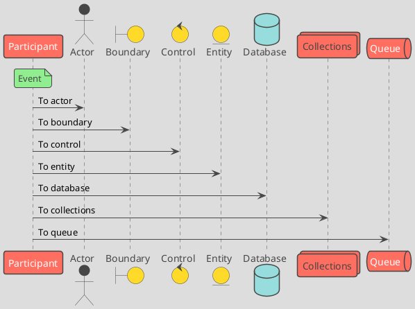

# 設計ドキュメントの図とシステム構成図

図は Git と差分の相性が良い PlantUML (テーマは `toy`) または Mermaid.js で作る。
システム構成図などは PlantUML で対応しにくいため diagrams.net (draw.io) で作り、拡張子は `.drawio.png`、`.drawio.jpg`、`.drawio.svg` のいずれかにする。
出典は [Markdown設計ドキュメント規約](about.md) (CC BY 4.0) で、OKF の形式に合わせて分割、変更している。

## システム構成図

図は基本的に変更差分がGitと相性が良い、PlantUML（またはMermaid.js）で作成すること。PlantUMLの場合、テーマは `toy` を指定すること。

システム構成図などは上記では対応しにくいことが多いため、diagrams.net（draw.io）で作成する。

diagrams.netの場合は、拡張子は以下のいずれかで作成する。

- `.drawio.png`
- `.drawio.jpg`
- `.drawio.svg`
